# My Dotfiles
[](https://builtwithnix.org)

## Systems

| System | Architecture | Roles |
|--------|--------------|-------|
| Ivys-MacBook-Pro | aarch64-darwin | study, gui, dev, gaming |
| auspc | x86_64-linux | gui, gaming, dev |
| birdsarentreal | x86_64-linux | gui |
| celler2 | x86_64-linux |  |
| iphone | aarch64-ios |  |
| lora-pi | aarch64-linux |  |
| macmini | aarch64-darwin | gui |
| pentestvm | x86_64-linux |  |
| secondpc | x86_64-linux |  |
| surfacelaptop | x86_64-linux | gui, dev |
| wsl-nixos | x86_64-linux |  |

## Ivys-MacBook-Pro

**Architecture:** `aarch64-darwin`
**Roles:** study, gui, dev, gaming

### Aspects
- Ivys-MacBook-Pro/to-users
- agenix-rekey
- batteries/define-user
- batteries/hostname
- batteries/inputs&#39;
- batteries/primary-user(ivypierlot@Ivys-MacBook-Pro)
- batteries/self&#39;
- batteries/sources
- browsers
- browsers/zen
- builders
- ccache
- ccache/Ivys-MacBook-Pro
- celler-host
- celler-quirk-args
- celler-user
- claude
- codesign-identity
- coolabah
- cotabby
- darwin-base
- darwin-finder
- darwin-gaming
- darwin-general
- darwin-hmApps
- define-user/ivypierlot@Ivys-MacBook-Pro
- dev
- dev-cli
- dev-nix
- difftastic
- esp-dev
- file-local
- fish
- ghostty
- gpg
- gui
- home-base
- homebrew
- hostname/os
- idris
- inputs&#39;/os
- insecure-predicate
- insecure-predicate/os
- insecure-predicate/user
- ivy-fetch
- ivypierlot
- ivypierlot/Ivys-MacBook-Pro
- ivypierlot/Ivys-MacBook-Pro/to-users
- js
- js/to-users
- jujutsu
- kanata
- karabiner-driver
- laptop-dock
- lib
- linux-builder
- lspmux
- main-ssh-key
- mcp-servers
- neovim
- nix
- nix-conf-parts
- nix-index
- nixpkgs-config
- nixvim
- nushell
- obsidian
- onepassword
- opencode
- overlays
- pam-rssh
- pam-touchid
- paneru
- provides/unfree(cmp-nvim-lsp-document-symbol,copilot-language-server)
- provides/unfree(copilot-language-server,copilot-language-server-lspmux)
- provides/unfree(copilot.vim,idris2-vim,presence.nvim,cmp-copilot,intel-ocl,code,1password,1password-cli,1password-gui,1password-gui-beta,claude-code,discord,google-chrome,helium,helium-bin,libkey-nomad,memorymate,minecraft-launcher,minecraft-server,nvidia-settings,nvidia-x11,obsidian,opencode,slack,spotify,steam,steam-original,steam-run,steam-runtime,steam-unwrapped,tidal-hifi,vscode,zoom,cmp-nvim-lsp-document-symbol)
- provides/unfree(libkey-nomad,onepassword-password-manager)
- provides/unfree(onepassword-password-manager)
- roaming-resolver
- runtime-links
- self&#39;/os
- shell
- shell/to-users
- sources/os
- specialisations
- starship
- stylix
- sudoagents
- t3code
- tailscale
- time-machine
- unfree-predicate
- unfree-predicate/os
- unfree-predicate/user
- user-shell/ivypierlot@Ivys-MacBook-Pro
- user/&lt;policy:ivypierlot-role-study&gt;[7]
- vpn
- vpn-secrets
- wakatime
- wrapperd
- zig
- zotero

### Aspect Graph

```mermaid
%%{init: {"theme":"base","themeVariables":{"activationBkgColor":"#d0d7de","activationBorderColor":"#8c959f","actorBkg":"#d0d7de","actorBorder":"#6e7781","actorLineColor":"#6e7781","actorTextColor":"#424a53","background":"#eaeef2","classText":"#424a53","clusterBkg":"#d0d7de","clusterBorder":"#8c959f","edgeLabelBackground":"#eaeef2","labelBoxBkgColor":"#d0d7de","labelBoxBorderColor":"#6e7781","labelTextColor":"#424a53","lineColor":"#6e7781","loopTextColor":"#424a53","mainBkg":"#d0d7de","nodeBkg":"#d0d7de","nodeBorder":"#6e7781","nodeTextColor":"#424a53","noteBkgColor":"#d0d7de","noteBorderColor":"#8c959f","noteTextColor":"#424a53","pie1":"#fa4549","pie2":"#e16f24","pie3":"#bf8700","pie4":"#2da44e","pie5":"#339D9B","pie6":"#218bff","pie7":"#a475f9","pie8":"#e85aad","pieLegendTextColor":"#424a53","pieOuterStrokeColor":"#8c959f","pieSectionTextColor":"#424a53","pieStrokeColor":"#8c959f","pieTitleTextColor":"#424a53","primaryBorderColor":"#6e7781","primaryColor":"#d0d7de","primaryTextColor":"#424a53","secondBkg":"#d0d7de","secondaryBorderColor":"#8c959f","secondaryColor":"#d0d7de","secondaryTextColor":"#424a53","sequenceNumberColor":"#eaeef2","signalColor":"#6e7781","signalTextColor":"#424a53","tertiaryBorderColor":"#8c959f","tertiaryColor":"#d0d7de","tertiaryTextColor":"#424a53","textColor":"#424a53","titleColor":"#424a53"}}}%%
graph LR
  Ivys_MacBook_Pro([Ivys-MacBook-Pro]):::root

  subgraph ctx_host_Ivys_MacBook_Pro["host: Ivys-MacBook-Pro"]
  ccache__Ivys_MacBook_Pro[/"ccache/Ivys-MacBook-Pro"\]:::ccache__Ivys_MacBook_Pro_c
  agenix_rekey_host_Ivys_MacBook_Pro["agenix-rekey"]:::agenix_rekey_host_Ivys_MacBook_Pro_c
  builders["builders"]:::builders_c
  ccache["ccache"]:::ccache_c
  celler_host["celler-host"]:::celler_host_c
  celler_quirk_args_host_Ivys_MacBook_Pro["celler-quirk-args"]:::celler_quirk_args_host_Ivys_MacBook_Pro_c
  codesign_identity["codesign-identity"]:::codesign_identity_c
  darwin_base["darwin-base"]:::darwin_base_c
  darwin_finder["darwin-finder"]:::darwin_finder_c
  darwin_general["darwin-general"]:::darwin_general_c
  darwin_hmApps["darwin-hmApps"]:::darwin_hmApps_c
  den__batteries__define_user[/"batteries/define-user"\]:::den__batteries__define_user_c
  define_user__ivypierlot_Ivys_MacBook_Pro{{"define-user/ivypierlot@Ivys-MacBook-Pro"}}:::define_user__ivypierlot_Ivys_MacBook_Pro_c
  difftastic{{"difftastic"}}:::difftastic_c
  home_base["home-base"]:::home_base_c
  homebrew_host_Ivys_MacBook_Pro["homebrew"]:::homebrew_host_Ivys_MacBook_Pro_c
  den__batteries__hostname[/"batteries/hostname"\]:::den__batteries__hostname_c
  hostname__os{{"hostname/os"}}:::hostname__os_c
  den__batteries__inputs_[/"batteries/inputs'"\]:::den__batteries__inputs__c
  inputs___os{{"inputs'/os"}}:::inputs___os_c
  insecure_predicate["insecure-predicate"]:::insecure_predicate_c
  js["js"]:::js_c
  jujutsu["jujutsu"]:::jujutsu_c
  karabiner_driver["karabiner-driver"]:::karabiner_driver_c
  laptop_dock["laptop-dock"]:::laptop_dock_c
  lib["lib"]:::lib_c
  linux_builder["linux-builder"]:::linux_builder_c
  nix["nix"]:::nix_c
  nix_conf_parts["nix-conf-parts"]:::nix_conf_parts_c
  nix_index["nix-index"]:::nix_index_c
  nixpkgs_config_host_Ivys_MacBook_Pro["nixpkgs-config"]:::nixpkgs_config_host_Ivys_MacBook_Pro_c
  unfree_predicate__os{{"unfree-predicate/os"}}:::unfree_predicate__os_c
  insecure_predicate__os{{"insecure-predicate/os"}}:::insecure_predicate__os_c
  overlays["overlays"]:::overlays_c
  pam_rssh_host_Ivys_MacBook_Pro["pam-rssh"]:::pam_rssh_host_Ivys_MacBook_Pro_c
  pam_touchid["pam-touchid"]:::pam_touchid_c
  roaming_resolver["roaming-resolver"]:::roaming_resolver_c
  runtime_links["runtime-links"]:::runtime_links_c
  den__batteries__self_[/"batteries/self'"\]:::den__batteries__self__c
  self___os{{"self'/os"}}:::self___os_c
  shell_host_Ivys_MacBook_Pro["shell"]:::shell_host_Ivys_MacBook_Pro_c
  den__batteries__sources[/"batteries/sources"\]:::den__batteries__sources_c
  sources__os{{"sources/os"}}:::sources__os_c
  specialisations{{"specialisations"}}:::specialisations_c
  starship["starship"]:::starship_c
  sudoagents_host_Ivys_MacBook_Pro["sudoagents"]:::sudoagents_host_Ivys_MacBook_Pro_c
  tailscale["tailscale"]:::tailscale_c
  time_machine["time-machine"]:::time_machine_c
  Ivys_MacBook_Pro__to_users[/"Ivys-MacBook-Pro/to-users"\]:::Ivys_MacBook_Pro__to_users_c
  ivypierlot__Ivys_MacBook_Pro__to_users[/"ivypierlot/Ivys-MacBook-Pro/to-users"\]:::ivypierlot__Ivys_MacBook_Pro__to_users_c
  js__to_users[/"js/to-users"\]:::js__to_users_c
  den__provides__unfree_copilot_vim_idris2_vim_presence_nvim_cmp_copilot_intel_ocl_code_1password_1password_cli_1password_gui_1password_gui_beta_claude_code_discord_google_chrome_helium_helium_bin_libkey_nomad_memorymate_minecraft_launcher_minecraft_server_nvidia_settings_nvidia_x11_obsidian_opencode_slack_spotify_steam_steam_original_steam_run_steam_runtime_steam_unwrapped_tidal_hifi_vscode_zoom_cmp_nvim_lsp_document_symbol_{{"provides/unfree(copilot.vim,idris2-vim,presence.nvim,cmp-copilot,intel-ocl,code,1password,1password-cli,1password-gui,1password-gui-beta,claude-code,discord,google-chrome,helium,helium-bin,libkey-nomad,memorymate,minecraft-launcher,minecraft-server,nvidia-settings,nvidia-x11,obsidian,opencode,slack,spotify,steam,steam-original,steam-run,steam-runtime,steam-unwrapped,tidal-hifi,vscode,zoom,cmp-nvim-lsp-document-symbol)"}}:::den__provides__unfree_copilot_vim_idris2_vim_presence_nvim_cmp_copilot_intel_ocl_code_1password_1password_cli_1password_gui_1password_gui_beta_claude_code_discord_google_chrome_helium_helium_bin_libkey_nomad_memorymate_minecraft_launcher_minecraft_server_nvidia_settings_nvidia_x11_obsidian_opencode_slack_spotify_steam_steam_original_steam_run_steam_runtime_steam_unwrapped_tidal_hifi_vscode_zoom_cmp_nvim_lsp_document_symbol__c
  unfree_predicate["unfree-predicate"]:::unfree_predicate_c
  unfree_predicate__user{{"unfree-predicate/user"}}:::unfree_predicate__user_c
  insecure_predicate__user{{"insecure-predicate/user"}}:::insecure_predicate__user_c
  vpn{{"vpn"}}:::vpn_c
  vpn_secrets["vpn-secrets"]:::vpn_secrets_c
  wrapperd["wrapperd"]:::wrapperd_c
  cap_builders_builder{{"builder"}}:::cap_builders_builder_c
  cap_celler_default_celler{{"celler"}}:::cap_celler_default_celler_c
  cap_celler_default_celler_t["celler-default"]:::cap_celler_default_celler_t_c
  cap_ivypierlot_celler{{"celler name=celler2"}}:::cap_ivypierlot_celler_c
  cap_ivypierlot_celler_wn0["2 other instances wrong instance: want celler2"]:::cap_ivypierlot_celler_wn0_c
  cap_nix_builder_ssh{{"ssh"}}:::cap_nix_builder_ssh_c
  cap_nix_builder_ssh_g_openssh[/"openssh on Ivys-MacBook-Pro"\]:::cap_nix_builder_ssh_g_openssh_c
  cap_nix_builder_ssh_t["nix-builder"]:::cap_nix_builder_ssh_t_c
  cap_paperwork_share{{"share displayName=Paperwork, permissions=(read,write,share,delete)"}}:::cap_paperwork_share_c
  cap_paperwork_share_t["paperwork"]:::cap_paperwork_share_t_c
  cap_photos_share{{"share displayName=Photos, quota=200G"}}:::cap_photos_share_c
  cap_photos_share_t["photos"]:::cap_photos_share_t_c
  cap_samba_user_samba_user{{"samba-user"}}:::cap_samba_user_samba_user_c
  cap_samba_user_samba_user_t["samba-user"]:::cap_samba_user_samba_user_t_c
  cap_zotero_library_share{{"share displayName=zotero"}}:::cap_zotero_library_share_c
  cap_zotero_library_share_t["zotero-library"]:::cap_zotero_library_share_t_c
  cap_zotero_webdav_provisioned{{"webdav-provisioned account=zotero, shares=(zotero-library)"}}:::cap_zotero_webdav_provisioned_c
  Ivys_MacBook_Pro --> ccache
  Ivys_MacBook_Pro --> codesign_identity
  Ivys_MacBook_Pro --> homebrew_host_Ivys_MacBook_Pro
  Ivys_MacBook_Pro --> js
  Ivys_MacBook_Pro --> karabiner_driver
  Ivys_MacBook_Pro --> laptop_dock
  Ivys_MacBook_Pro --> roaming_resolver
  Ivys_MacBook_Pro --> sudoagents_host_Ivys_MacBook_Pro
  Ivys_MacBook_Pro --> tailscale
  Ivys_MacBook_Pro --> time_machine
  Ivys_MacBook_Pro --> vpn
  Ivys_MacBook_Pro --> wrapperd
  celler_host --> celler_quirk_args_host_Ivys_MacBook_Pro
  darwin_base --> darwin_finder
  darwin_base --> darwin_general
  darwin_base --> darwin_hmApps
  darwin_base --> pam_touchid
  den__batteries__define_user --> define_user__ivypierlot_Ivys_MacBook_Pro
  den__batteries__hostname --> hostname__os
  den__batteries__inputs_ --> inputs___os
  den__batteries__self_ --> self___os
  den__batteries__sources --> sources__os
  home_base --> shell_host_Ivys_MacBook_Pro
  insecure_predicate --> insecure_predicate__os
  insecure_predicate --> insecure_predicate__user
  jujutsu --> difftastic
  nix --> linux_builder
  nixpkgs_config_host_Ivys_MacBook_Pro --> den__provides__unfree_copilot_vim_idris2_vim_presence_nvim_cmp_copilot_intel_ocl_code_1password_1password_cli_1password_gui_1password_gui_beta_claude_code_discord_google_chrome_helium_helium_bin_libkey_nomad_memorymate_minecraft_launcher_minecraft_server_nvidia_settings_nvidia_x11_obsidian_opencode_slack_spotify_steam_steam_original_steam_run_steam_runtime_steam_unwrapped_tidal_hifi_vscode_zoom_cmp_nvim_lsp_document_symbol_
  shell_host_Ivys_MacBook_Pro --> jujutsu
  shell_host_Ivys_MacBook_Pro --> nix_index
  shell_host_Ivys_MacBook_Pro --> starship
  unfree_predicate --> unfree_predicate__os
  unfree_predicate --> unfree_predicate__user
  vpn --> vpn_secrets
  vpn_secrets --> agenix_rekey_host_Ivys_MacBook_Pro
  Ivys_MacBook_Pro -.->|provides| Ivys_MacBook_Pro__to_users
  ccache -.->|provides| ccache__Ivys_MacBook_Pro
  js -.->|provides| js__to_users
  builders -.-x cap_builders_builder
  cap_celler_default_celler_t -.->|takes| cap_celler_default_celler
  cap_ivypierlot_celler -.-x cap_ivypierlot_celler_wn0
  cap_nix_builder_ssh_t -.->|takes| cap_nix_builder_ssh
  cap_nix_builder_ssh -.->|loopback 0 (same host)| cap_nix_builder_ssh_g_openssh
  cap_paperwork_share_t -.-x cap_paperwork_share
  cap_photos_share_t -.-x cap_photos_share
  cap_samba_user_samba_user_t -.-x cap_samba_user_samba_user
  cap_zotero_library_share_t -.-x cap_zotero_library_share
  end
  subgraph ctx_user_ivypierlot["user: ivypierlot"]
  user___policy_ivypierlot_role_study__7_[/"user/<policy:ivypierlot-role-study>[7]"\]:::user___policy_ivypierlot_role_study__7__c
  agenix_rekey_user_ivypierlot["agenix-rekey"]:::agenix_rekey_user_ivypierlot_c
  celler_quirk_args_user_ivypierlot["celler-quirk-args"]:::celler_quirk_args_user_ivypierlot_c
  celler_user["celler-user"]:::celler_user_c
  claude["claude"]:::claude_c
  coolabah["coolabah"]:::coolabah_c
  cotabby["cotabby"]:::cotabby_c
  darwin_gaming["darwin-gaming"]:::darwin_gaming_c
  dev["dev"]:::dev_c
  dev_cli["dev-cli"]:::dev_cli_c
  dev_nix["dev-nix"]:::dev_nix_c
  esp_dev["esp-dev"]:::esp_dev_c
  file_local["file-local"]:::file_local_c
  fish["fish"]:::fish_c
  ghostty["ghostty"]:::ghostty_c
  gpg["gpg"]:::gpg_c
  gui["gui"]:::gui_c
  homebrew_user_ivypierlot["homebrew"]:::homebrew_user_ivypierlot_c
  idris["idris"]:::idris_c
  ivy_fetch["ivy-fetch"]:::ivy_fetch_c
  ivypierlot{{"ivypierlot"}}:::ivypierlot_c
  ivypierlot__Ivys_MacBook_Pro["ivypierlot/Ivys-MacBook-Pro"]:::ivypierlot__Ivys_MacBook_Pro_c
  kanata{{"kanata"}}:::kanata_c
  lspmux["lspmux"]:::lspmux_c
  main_ssh_key["main-ssh-key"]:::main_ssh_key_c
  mcp_servers["mcp-servers"]:::mcp_servers_c
  neovim["neovim"]:::neovim_c
  nixvim["nixvim"]:::nixvim_c
  nushell["nushell"]:::nushell_c
  obsidian["obsidian"]:::obsidian_c
  onepassword["onepassword"]:::onepassword_c
  opencode["opencode"]:::opencode_c
  pam_rssh_user_ivypierlot["pam-rssh"]:::pam_rssh_user_ivypierlot_c
  paneru["paneru"]:::paneru_c
  den__batteries__primary_user_ivypierlot_Ivys_MacBook_Pro_{{"batteries/primary-user(ivypierlot@Ivys-MacBook-Pro)"}}:::den__batteries__primary_user_ivypierlot_Ivys_MacBook_Pro__c
  shell__to_users["shell/to-users"]:::shell__to_users_c
  stylix["stylix"]:::stylix_c
  sudoagents_user_ivypierlot["sudoagents"]:::sudoagents_user_ivypierlot_c
  t3code["t3code"]:::t3code_c
  den__provides__unfree_cmp_nvim_lsp_document_symbol_copilot_language_server_{{"provides/unfree(cmp-nvim-lsp-document-symbol,copilot-language-server)"}}:::den__provides__unfree_cmp_nvim_lsp_document_symbol_copilot_language_server__c
  den__provides__unfree_copilot_language_server_copilot_language_server_lspmux_{{"provides/unfree(copilot-language-server,copilot-language-server-lspmux)"}}:::den__provides__unfree_copilot_language_server_copilot_language_server_lspmux__c
  den__provides__unfree_libkey_nomad_onepassword_password_manager_{{"provides/unfree(libkey-nomad,onepassword-password-manager)"}}:::den__provides__unfree_libkey_nomad_onepassword_password_manager__c
  den__provides__unfree_onepassword_password_manager_{{"provides/unfree(onepassword-password-manager)"}}:::den__provides__unfree_onepassword_password_manager__c
  user_shell__ivypierlot_Ivys_MacBook_Pro{{"user-shell/ivypierlot@Ivys-MacBook-Pro"}}:::user_shell__ivypierlot_Ivys_MacBook_Pro_c
  wakatime["wakatime"]:::wakatime_c
  browsers__zen[/"browsers/zen"\]:::browsers__zen_c
  zig["zig"]:::zig_c
  zotero["zotero"]:::zotero_c
  browsers__zen --> den__provides__unfree_libkey_nomad_onepassword_password_manager_
  celler_user --> celler_quirk_args_user_ivypierlot
  dev --> dev_cli
  dev --> dev_nix
  fish --> user_shell__ivypierlot_Ivys_MacBook_Pro
  ivypierlot --> agenix_rekey_user_ivypierlot
  ivypierlot --> coolabah
  ivypierlot --> cotabby
  ivypierlot --> dev
  ivypierlot --> file_local
  ivypierlot --> fish
  ivypierlot --> ghostty
  ivypierlot --> gpg
  ivypierlot --> gui
  ivypierlot --> homebrew_user_ivypierlot
  ivypierlot --> idris
  ivypierlot --> kanata
  ivypierlot --> neovim
  ivypierlot --> nixvim
  ivypierlot --> nushell
  ivypierlot --> onepassword
  ivypierlot --> opencode
  ivypierlot --> paneru
  ivypierlot --> den__batteries__primary_user_ivypierlot_Ivys_MacBook_Pro_
  ivypierlot --> t3code
  ivypierlot --> browsers__zen
  ivypierlot --> zig
  ivypierlot__Ivys_MacBook_Pro --> darwin_gaming
  ivypierlot__Ivys_MacBook_Pro --> esp_dev
  lspmux --> den__provides__unfree_copilot_language_server_copilot_language_server_lspmux_
  main_ssh_key --> pam_rssh_user_ivypierlot
  neovim --> stylix
  nixvim --> den__provides__unfree_cmp_nvim_lsp_document_symbol_copilot_language_server_
  nixvim --> wakatime
  onepassword --> den__provides__unfree_onepassword_password_manager_
  opencode --> claude
  opencode --> mcp_servers
  user___policy_ivypierlot_role_study__7_ --> obsidian
  user___policy_ivypierlot_role_study__7_ --> zotero
  zig --> lspmux
  end
  subgraph ctx_host_auspc["host: auspc"]
  cap_builders_builder_ox0["nix-builder on auspc out of reach: reach = fleet"]:::cap_builders_builder_ox0_c

  end
  subgraph ctx_host_secondpc["host: secondpc"]
  cap_builders_builder_ox1["nix-builder on secondpc out of reach: reach = fleet"]:::cap_builders_builder_ox1_c
  cap_celler_default_celler_g_celler[/"celler on secondpc"\]:::cap_celler_default_celler_g_celler_c
  cap_paperwork_share_ox0["shares on secondpc out of reach: reach = host"]:::cap_paperwork_share_ox0_c
  cap_photos_share_ox0["shares on secondpc out of reach: reach = host"]:::cap_photos_share_ox0_c
  cap_zotero_library_share_ox0["shares on secondpc out of reach: reach = host"]:::cap_zotero_library_share_ox0_c
  cap_zotero_webdav_provisioned_g_nextcloud[/"nextcloud on secondpc"\]:::cap_zotero_webdav_provisioned_g_nextcloud_c

  end

  ivypierlot -.->|provides| ivypierlot__Ivys_MacBook_Pro__to_users
  cap_builders_builder -.-x cap_builders_builder_ox0
  cap_builders_builder -.-x cap_builders_builder_ox1
  cap_celler_default_celler -.->|not routed| cap_celler_default_celler_g_celler
  ivypierlot -.-x cap_ivypierlot_celler
  cap_paperwork_share -.-x cap_paperwork_share_ox0
  cap_photos_share -.-x cap_photos_share_ox0
  zotero -.->|takes| cap_zotero_webdav_provisioned
  cap_zotero_webdav_provisioned -.->|not routed| cap_zotero_webdav_provisioned_g_nextcloud
  cap_zotero_library_share -.-x cap_zotero_library_share_ox0

  classDef root fill:#218bff,stroke:#218bff,color:#1f2328,font-weight:bold
  classDef user___policy_ivypierlot_role_study__7__c fill:#e16f24,stroke:#e16f24,color:#1f2328,stroke-dasharray: 3 3,stroke-width:1px
  classDef Ivys_MacBook_Pro_c fill:#218bff,stroke:#218bff,color:#1f2328,stroke-width:3px
  classDef ccache__Ivys_MacBook_Pro_c fill:#bf8700,stroke:#bf8700,color:#1f2328,stroke-width:3px
  classDef agenix_rekey_host_Ivys_MacBook_Pro_c fill:#e85aad,stroke:#e85aad,color:#1f2328,stroke-width:3px
  classDef agenix_rekey_user_ivypierlot_c fill:#e16f24,stroke:#e16f24,color:#1f2328,stroke-width:3px
  classDef browsers_c fill:#e16f24,stroke:#e16f24,color:#1f2328,stroke-dasharray: 3 3,stroke-width:1px
  classDef builders_c fill:#e85aad,stroke:#e85aad,color:#1f2328,stroke-width:3px
  classDef ccache_c fill:#e85aad,stroke:#e85aad,color:#1f2328,stroke-width:3px
  classDef celler_host_c fill:#218bff,stroke:#218bff,color:#1f2328,stroke-width:3px
  classDef celler_quirk_args_host_Ivys_MacBook_Pro_c fill:#a475f9,stroke:#a475f9,color:#1f2328,stroke-width:3px
  classDef celler_quirk_args_user_ivypierlot_c fill:#fa4549,stroke:#fa4549,color:#1f2328,stroke-width:3px
  classDef celler_user_c fill:#e16f24,stroke:#e16f24,color:#1f2328,stroke-width:3px
  classDef claude_c fill:#fa4549,stroke:#fa4549,color:#1f2328,stroke-width:3px
  classDef codesign_identity_c fill:#a475f9,stroke:#a475f9,color:#1f2328,stroke-width:3px
  classDef coolabah_c fill:#e16f24,stroke:#e16f24,color:#1f2328,stroke-width:3px
  classDef cotabby_c fill:#e85aad,stroke:#e85aad,color:#1f2328,stroke-width:3px
  classDef darwin_base_c fill:#a475f9,stroke:#a475f9,color:#1f2328,stroke-width:3px
  classDef darwin_finder_c fill:#e85aad,stroke:#e85aad,color:#1f2328,stroke-width:3px
  classDef darwin_gaming_c fill:#e16f24,stroke:#e16f24,color:#1f2328,stroke-width:3px
  classDef darwin_general_c fill:#218bff,stroke:#218bff,color:#1f2328,stroke-width:3px
  classDef darwin_hmApps_c fill:#a475f9,stroke:#a475f9,color:#1f2328,stroke-width:3px
  classDef den__batteries__define_user_c fill:#218bff,stroke:#218bff,color:#1f2328,stroke-width:3px
  classDef define_user__ivypierlot_Ivys_MacBook_Pro_c fill:#a475f9,stroke:#a475f9,color:#1f2328,stroke-width:2px
  classDef dev_c fill:#fa4549,stroke:#fa4549,color:#1f2328,stroke-width:3px
  classDef dev_cli_c fill:#fa4549,stroke:#fa4549,color:#1f2328,stroke-width:3px
  classDef dev_nix_c fill:#fa4549,stroke:#fa4549,color:#1f2328,stroke-width:3px
  classDef difftastic_c fill:#e85aad,stroke:#e85aad,color:#1f2328,stroke-width:3px
  classDef esp_dev_c fill:#e16f24,stroke:#e16f24,color:#1f2328,stroke-width:3px
  classDef file_local_c fill:#fa4549,stroke:#fa4549,color:#1f2328,stroke-width:3px
  classDef fish_c fill:#e16f24,stroke:#e16f24,color:#1f2328,stroke-width:3px
  classDef ghostty_c fill:#fa4549,stroke:#fa4549,color:#1f2328,stroke-width:3px
  classDef gpg_c fill:#fa4549,stroke:#fa4549,color:#1f2328,stroke-width:3px
  classDef gui_c fill:#fa4549,stroke:#fa4549,color:#1f2328,stroke-width:3px
  classDef home_base_c fill:#e85aad,stroke:#e85aad,color:#1f2328,stroke-width:3px
  classDef homebrew_host_Ivys_MacBook_Pro_c fill:#a475f9,stroke:#a475f9,color:#1f2328,stroke-width:3px
  classDef homebrew_user_ivypierlot_c fill:#fa4549,stroke:#fa4549,color:#1f2328,stroke-width:3px
  classDef den__batteries__hostname_c fill:#218bff,stroke:#218bff,color:#1f2328,stroke-width:3px
  classDef hostname__os_c fill:#e85aad,stroke:#e85aad,color:#1f2328,stroke-width:2px
  classDef idris_c fill:#fa4549,stroke:#fa4549,color:#1f2328,stroke-width:3px
  classDef den__batteries__inputs__c fill:#218bff,stroke:#218bff,color:#1f2328,stroke-width:3px
  classDef inputs___os_c fill:#a475f9,stroke:#a475f9,color:#1f2328,stroke-width:2px
  classDef insecure_predicate_c fill:#e85aad,stroke:#e85aad,color:#1f2328,stroke-width:3px
  classDef ivy_fetch_c fill:#e85aad,stroke:#e85aad,color:#1f2328,stroke-width:3px
  classDef ivypierlot_c fill:#e85aad,stroke:#e85aad,color:#1f2328,stroke-width:3px
  classDef ivypierlot__Ivys_MacBook_Pro_c fill:#e16f24,stroke:#e16f24,color:#1f2328,stroke-width:2px,stroke-dasharray: 8 4
  classDef js_c fill:#a475f9,stroke:#a475f9,color:#1f2328,stroke-width:3px
  classDef jujutsu_c fill:#e85aad,stroke:#e85aad,color:#1f2328,stroke-width:3px
  classDef kanata_c fill:#fa4549,stroke:#fa4549,color:#1f2328,stroke-width:3px
  classDef karabiner_driver_c fill:#a475f9,stroke:#a475f9,color:#1f2328,stroke-width:3px
  classDef laptop_dock_c fill:#218bff,stroke:#218bff,color:#1f2328,stroke-width:3px
  classDef lib_c fill:#e85aad,stroke:#e85aad,color:#1f2328,stroke-width:3px
  classDef linux_builder_c fill:#a475f9,stroke:#a475f9,color:#1f2328,stroke-width:3px
  classDef lspmux_c fill:#e85aad,stroke:#e85aad,color:#1f2328,stroke-width:3px
  classDef main_ssh_key_c fill:#e16f24,stroke:#e16f24,color:#1f2328,stroke-width:3px
  classDef mcp_servers_c fill:#e85aad,stroke:#e85aad,color:#1f2328,stroke-width:3px
  classDef neovim_c fill:#e85aad,stroke:#e85aad,color:#1f2328,stroke-width:3px
  classDef nix_c fill:#e85aad,stroke:#e85aad,color:#1f2328,stroke-width:3px
  classDef nix_conf_parts_c fill:#218bff,stroke:#218bff,color:#1f2328,stroke-width:3px
  classDef nix_index_c fill:#a475f9,stroke:#a475f9,color:#1f2328,stroke-width:3px
  classDef nixpkgs_config_host_Ivys_MacBook_Pro_c fill:#218bff,stroke:#218bff,color:#1f2328,stroke-width:3px
  classDef nixvim_c fill:#fa4549,stroke:#fa4549,color:#1f2328,stroke-width:3px
  classDef nushell_c fill:#fa4549,stroke:#fa4549,color:#1f2328,stroke-width:3px
  classDef obsidian_c fill:#e16f24,stroke:#e16f24,color:#1f2328,stroke-width:3px
  classDef onepassword_c fill:#e16f24,stroke:#e16f24,color:#1f2328,stroke-width:3px
  classDef opencode_c fill:#e85aad,stroke:#e85aad,color:#1f2328,stroke-width:3px
  classDef unfree_predicate__os_c fill:#a475f9,stroke:#a475f9,color:#1f2328,stroke-width:2px
  classDef insecure_predicate__os_c fill:#218bff,stroke:#218bff,color:#1f2328,stroke-width:2px
  classDef overlays_c fill:#218bff,stroke:#218bff,color:#1f2328,stroke-width:3px
  classDef pam_rssh_host_Ivys_MacBook_Pro_c fill:#218bff,stroke:#218bff,color:#1f2328,stroke-width:3px
  classDef pam_rssh_user_ivypierlot_c fill:#e85aad,stroke:#e85aad,color:#1f2328,stroke-width:3px
  classDef pam_touchid_c fill:#218bff,stroke:#218bff,color:#1f2328,stroke-width:3px
  classDef paneru_c fill:#e16f24,stroke:#e16f24,color:#1f2328,stroke-width:3px
  classDef den__batteries__primary_user_ivypierlot_Ivys_MacBook_Pro__c fill:#fa4549,stroke:#fa4549,color:#1f2328,stroke-width:2px
  classDef roaming_resolver_c fill:#e85aad,stroke:#e85aad,color:#1f2328,stroke-width:3px
  classDef runtime_links_c fill:#e85aad,stroke:#e85aad,color:#1f2328,stroke-width:3px
  classDef den__batteries__self__c fill:#a475f9,stroke:#a475f9,color:#1f2328,stroke-width:3px
  classDef self___os_c fill:#a475f9,stroke:#a475f9,color:#1f2328,stroke-width:2px
  classDef shell_host_Ivys_MacBook_Pro_c fill:#e85aad,stroke:#e85aad,color:#1f2328,stroke-width:3px
  classDef shell__to_users_c fill:#e16f24,stroke:#e16f24,color:#1f2328,stroke-width:2px,stroke-dasharray: 8 4
  classDef den__batteries__sources_c fill:#218bff,stroke:#218bff,color:#1f2328,stroke-width:3px
  classDef sources__os_c fill:#a475f9,stroke:#a475f9,color:#1f2328,stroke-width:2px
  classDef specialisations_c fill:#a475f9,stroke:#a475f9,color:#1f2328,stroke-width:3px
  classDef starship_c fill:#a475f9,stroke:#a475f9,color:#1f2328,stroke-width:3px
  classDef stylix_c fill:#e85aad,stroke:#e85aad,color:#1f2328,stroke-width:3px
  classDef sudoagents_host_Ivys_MacBook_Pro_c fill:#e85aad,stroke:#e85aad,color:#1f2328,stroke-width:3px
  classDef sudoagents_user_ivypierlot_c fill:#e16f24,stroke:#e16f24,color:#1f2328,stroke-width:3px
  classDef t3code_c fill:#e16f24,stroke:#e16f24,color:#1f2328,stroke-width:3px
  classDef tailscale_c fill:#e85aad,stroke:#e85aad,color:#1f2328,stroke-width:3px
  classDef time_machine_c fill:#a475f9,stroke:#a475f9,color:#1f2328,stroke-width:3px
  classDef Ivys_MacBook_Pro__to_users_c fill:#2da44e,stroke:#2da44e,color:#1f2328,stroke-width:3px
  classDef ivypierlot__Ivys_MacBook_Pro__to_users_c fill:#2da44e,stroke:#2da44e,color:#1f2328,stroke-width:3px
  classDef js__to_users_c fill:#bf8700,stroke:#bf8700,color:#1f2328,stroke-width:3px
  classDef den__provides__unfree_cmp_nvim_lsp_document_symbol_copilot_language_server__c fill:#e85aad,stroke:#e85aad,color:#1f2328,stroke-width:2px
  classDef den__provides__unfree_copilot_language_server_copilot_language_server_lspmux__c fill:#e85aad,stroke:#e85aad,color:#1f2328,stroke-width:2px
  classDef den__provides__unfree_copilot_vim_idris2_vim_presence_nvim_cmp_copilot_intel_ocl_code_1password_1password_cli_1password_gui_1password_gui_beta_claude_code_discord_google_chrome_helium_helium_bin_libkey_nomad_memorymate_minecraft_launcher_minecraft_server_nvidia_settings_nvidia_x11_obsidian_opencode_slack_spotify_steam_steam_original_steam_run_steam_runtime_steam_unwrapped_tidal_hifi_vscode_zoom_cmp_nvim_lsp_document_symbol__c fill:#218bff,stroke:#218bff,color:#1f2328,stroke-width:2px
  classDef den__provides__unfree_libkey_nomad_onepassword_password_manager__c fill:#fa4549,stroke:#fa4549,color:#1f2328,stroke-width:2px
  classDef den__provides__unfree_onepassword_password_manager__c fill:#fa4549,stroke:#fa4549,color:#1f2328,stroke-width:2px
  classDef unfree_predicate_c fill:#e85aad,stroke:#e85aad,color:#1f2328,stroke-width:3px
  classDef unfree_predicate__user_c fill:#a475f9,stroke:#a475f9,color:#1f2328,stroke-dasharray: 3 3,stroke-width:1px
  classDef insecure_predicate__user_c fill:#e85aad,stroke:#e85aad,color:#1f2328,stroke-dasharray: 3 3,stroke-width:1px
  classDef user_shell__ivypierlot_Ivys_MacBook_Pro_c fill:#fa4549,stroke:#fa4549,color:#1f2328,stroke-width:2px
  classDef vpn_c fill:#e85aad,stroke:#e85aad,color:#1f2328,stroke-width:3px
  classDef vpn_secrets_c fill:#218bff,stroke:#218bff,color:#1f2328,stroke-width:3px
  classDef wakatime_c fill:#fa4549,stroke:#fa4549,color:#1f2328,stroke-width:3px
  classDef wrapperd_c fill:#218bff,stroke:#218bff,color:#1f2328,stroke-width:3px
  classDef browsers__zen_c fill:#e16f24,stroke:#e16f24,color:#1f2328,stroke-width:3px
  classDef zig_c fill:#e85aad,stroke:#e85aad,color:#1f2328,stroke-width:3px
  classDef zotero_c fill:#e16f24,stroke:#e16f24,color:#1f2328,stroke-width:3px
  classDef cap_builders_builder_c fill:#a475f9,stroke:#fa4549,color:#1f2328,stroke-dasharray: 5 5,stroke-width:2px
  classDef cap_builders_builder_ox0_c fill:#218bff,stroke:#fa4549,color:#1f2328,stroke-dasharray: 5 5,stroke-width:2px
  classDef cap_builders_builder_ox1_c fill:#e85aad,stroke:#fa4549,color:#1f2328,stroke-dasharray: 5 5,stroke-width:2px
  classDef cap_celler_default_celler_c fill:#a475f9,stroke:#a475f9,color:#1f2328,stroke-width:2px
  classDef cap_celler_default_celler_g_celler_c fill:#218bff,stroke:#218bff,color:#1f2328,stroke-width:2px
  classDef cap_celler_default_celler_t_c fill:#a475f9,stroke:#a475f9,color:#1f2328,stroke-width:2px
  classDef cap_ivypierlot_celler_c fill:#a475f9,stroke:#fa4549,color:#1f2328,stroke-dasharray: 5 5,stroke-width:2px
  classDef cap_ivypierlot_celler_wn0_c fill:#a475f9,stroke:#fa4549,color:#1f2328,stroke-dasharray: 5 5,stroke-width:2px
  classDef cap_nix_builder_ssh_c fill:#e85aad,stroke:#e85aad,color:#1f2328,stroke-width:2px
  classDef cap_nix_builder_ssh_g_openssh_c fill:#a475f9,stroke:#a475f9,color:#1f2328,stroke-width:2px
  classDef cap_nix_builder_ssh_t_c fill:#218bff,stroke:#218bff,color:#1f2328,stroke-width:2px
  classDef cap_paperwork_share_c fill:#a475f9,stroke:#fa4549,color:#1f2328,stroke-dasharray: 5 5,stroke-width:2px
  classDef cap_paperwork_share_ox0_c fill:#a475f9,stroke:#fa4549,color:#1f2328,stroke-dasharray: 5 5,stroke-width:2px
  classDef cap_paperwork_share_t_c fill:#a475f9,stroke:#a475f9,color:#1f2328,stroke-width:2px
  classDef cap_photos_share_c fill:#218bff,stroke:#fa4549,color:#1f2328,stroke-dasharray: 5 5,stroke-width:2px
  classDef cap_photos_share_ox0_c fill:#a475f9,stroke:#fa4549,color:#1f2328,stroke-dasharray: 5 5,stroke-width:2px
  classDef cap_photos_share_t_c fill:#218bff,stroke:#218bff,color:#1f2328,stroke-width:2px
  classDef cap_samba_user_samba_user_c fill:#a475f9,stroke:#fa4549,color:#1f2328,stroke-dasharray: 5 5,stroke-width:2px
  classDef cap_samba_user_samba_user_t_c fill:#a475f9,stroke:#a475f9,color:#1f2328,stroke-width:2px
  classDef cap_zotero_library_share_c fill:#218bff,stroke:#fa4549,color:#1f2328,stroke-dasharray: 5 5,stroke-width:2px
  classDef cap_zotero_library_share_ox0_c fill:#a475f9,stroke:#fa4549,color:#1f2328,stroke-dasharray: 5 5,stroke-width:2px
  classDef cap_zotero_library_share_t_c fill:#a475f9,stroke:#a475f9,color:#1f2328,stroke-width:2px
  classDef cap_zotero_webdav_provisioned_c fill:#218bff,stroke:#218bff,color:#1f2328,stroke-width:2px
  classDef cap_zotero_webdav_provisioned_g_nextcloud_c fill:#e85aad,stroke:#e85aad,color:#1f2328,stroke-width:2px
style ctx_host_Ivys_MacBook_Pro fill:#d0d7de,stroke:#8c959f,stroke-width:2px
style ctx_user_ivypierlot fill:#d0d7de,stroke:#8c959f,stroke-width:2px
style ctx_host_auspc fill:#d0d7de,stroke:#8c959f,stroke-width:2px
style ctx_host_secondpc fill:#d0d7de,stroke:#8c959f,stroke-width:2px
style ctx_host_celler2 fill:#d0d7de,stroke:#8c959f,stroke-width:2px
```

## auspc

**Architecture:** `x86_64-linux`
**Roles:** gui, gaming, dev

### Aspects
- agenix-rekey
- attachment-interface-check
- auscyber
- auscyber/auspc
- auscyber/auspc/to-users
- auspc/to-users
- batteries/define-user
- batteries/hostname
- batteries/inputs&#39;
- batteries/primary-user(auscyber@auspc)
- batteries/self&#39;
- batteries/sources
- bootlogo
- browsers
- browsers/helium
- builder-server
- builders
- cachyos-kernel
- ccache
- ccache/auspc
- celler-host
- celler-quirk-args
- celler-user
- claude
- corsair-psu
- define-user/auscyber@auspc
- den/provides/unfree(castlabs-electron)
- derived-firewall
- derived-port-exclusion
- dev
- dev-cli
- dev-nix
- difftastic
- disko
- fish
- ghostty
- gpg
- gpus
- gui
- hda-jack-retask
- home-base
- hostname/os
- house-wifi
- inputs&#39;/os
- insecure-predicate
- insecure-predicate/os
- insecure-predicate/user
- ivy-fetch
- jujutsu
- lib
- lspmux
- main-ssh-key
- neovim
- nix
- nix-conf-parts
- nix-index
- nixos-general
- nixpkgs-config
- nixvim
- node-metrics
- nushell
- onepassword
- openrgb
- openssh
- overlays
- packages
- packages/proton-ge-bin
- pam-rssh
- plasma
- provides/unfree(cmp-nvim-lsp-document-symbol,copilot-language-server)
- provides/unfree(copilot-language-server,copilot-language-server-lspmux)
- provides/unfree(copilot.vim,idris2-vim,presence.nvim,cmp-copilot,intel-ocl,code,1password,1password-cli,1password-gui,1password-gui-beta,claude-code,discord,google-chrome,helium,helium-bin,libkey-nomad,memorymate,minecraft-launcher,minecraft-server,nvidia-settings,nvidia-x11,obsidian,opencode,slack,spotify,steam,steam-original,steam-run,steam-runtime,steam-unwrapped,tidal-hifi,vscode,zoom,cmp-nvim-lsp-document-symbol)
- provides/unfree(onepassword-password-manager)
- qemu
- qemu/to-users
- routing
- runtime-links
- secure-boot
- self&#39;/os
- service-user
- shell
- shell/to-users
- sources/os
- specialisations
- starship
- stylix
- tailscale
- turntable-input
- unfree-predicate
- unfree-predicate/os
- unfree-predicate/user
- user-shell/auscyber@auspc
- user/&lt;policy:default-role-gaming&gt;[2]
- user/&lt;policy:eightbitdo-role-gui&gt;[4]
- user/&lt;policy:main-ssh-key/to-hosts&gt;[8]
- vban
- vban-turntable
- vpn
- vpn-secrets
- wakatime

### Aspect Graph

```mermaid
%%{init: {"theme":"base","themeVariables":{"activationBkgColor":"#d0d7de","activationBorderColor":"#8c959f","actorBkg":"#d0d7de","actorBorder":"#6e7781","actorLineColor":"#6e7781","actorTextColor":"#424a53","background":"#eaeef2","classText":"#424a53","clusterBkg":"#d0d7de","clusterBorder":"#8c959f","edgeLabelBackground":"#eaeef2","labelBoxBkgColor":"#d0d7de","labelBoxBorderColor":"#6e7781","labelTextColor":"#424a53","lineColor":"#6e7781","loopTextColor":"#424a53","mainBkg":"#d0d7de","nodeBkg":"#d0d7de","nodeBorder":"#6e7781","nodeTextColor":"#424a53","noteBkgColor":"#d0d7de","noteBorderColor":"#8c959f","noteTextColor":"#424a53","pie1":"#fa4549","pie2":"#e16f24","pie3":"#bf8700","pie4":"#2da44e","pie5":"#339D9B","pie6":"#218bff","pie7":"#a475f9","pie8":"#e85aad","pieLegendTextColor":"#424a53","pieOuterStrokeColor":"#8c959f","pieSectionTextColor":"#424a53","pieStrokeColor":"#8c959f","pieTitleTextColor":"#424a53","primaryBorderColor":"#6e7781","primaryColor":"#d0d7de","primaryTextColor":"#424a53","secondBkg":"#d0d7de","secondaryBorderColor":"#8c959f","secondaryColor":"#d0d7de","secondaryTextColor":"#424a53","sequenceNumberColor":"#eaeef2","signalColor":"#6e7781","signalTextColor":"#424a53","tertiaryBorderColor":"#8c959f","tertiaryColor":"#d0d7de","tertiaryTextColor":"#424a53","textColor":"#424a53","titleColor":"#424a53"}}}%%
graph LR
  auspc([auspc]):::root

  subgraph ctx_host_auspc["host: auspc"]
  agenix_rekey_host_auspc["agenix-rekey"]:::agenix_rekey_host_auspc_c
  attachment_interface_check["attachment-interface-check"]:::attachment_interface_check_c
  ccache__auspc[/"ccache/auspc"\]:::ccache__auspc_c
  bootlogo["bootlogo"]:::bootlogo_c
  builder_server["builder-server"]:::builder_server_c
  builders["builders"]:::builders_c
  cachyos_kernel["cachyos-kernel"]:::cachyos_kernel_c
  ccache["ccache"]:::ccache_c
  celler_host["celler-host"]:::celler_host_c
  celler_quirk_args_host_auspc["celler-quirk-args"]:::celler_quirk_args_host_auspc_c
  corsair_psu["corsair-psu"]:::corsair_psu_c
  den__batteries__define_user[/"batteries/define-user"\]:::den__batteries__define_user_c
  define_user__auscyber_auspc{{"define-user/auscyber@auspc"}}:::define_user__auscyber_auspc_c
  derived_firewall["derived-firewall"]:::derived_firewall_c
  derived_port_exclusion["derived-port-exclusion"]:::derived_port_exclusion_c
  difftastic{{"difftastic"}}:::difftastic_c
  disko["disko"]:::disko_c
  gpus{{"gpus"}}:::gpus_c
  hda_jack_retask["hda-jack-retask"]:::hda_jack_retask_c
  home_base["home-base"]:::home_base_c
  den__batteries__hostname[/"batteries/hostname"\]:::den__batteries__hostname_c
  hostname__os{{"hostname/os"}}:::hostname__os_c
  house_wifi["house-wifi"]:::house_wifi_c
  den__batteries__inputs_[/"batteries/inputs'"\]:::den__batteries__inputs__c
  inputs___os{{"inputs'/os"}}:::inputs___os_c
  insecure_predicate["insecure-predicate"]:::insecure_predicate_c
  jujutsu["jujutsu"]:::jujutsu_c
  lib["lib"]:::lib_c
  nix["nix"]:::nix_c
  nix_conf_parts["nix-conf-parts"]:::nix_conf_parts_c
  nix_index["nix-index"]:::nix_index_c
  nixos_general["nixos-general"]:::nixos_general_c
  nixpkgs_config_host_auspc["nixpkgs-config"]:::nixpkgs_config_host_auspc_c
  node_metrics["node-metrics"]:::node_metrics_c
  openrgb["openrgb"]:::openrgb_c
  openssh["openssh"]:::openssh_c
  unfree_predicate__os{{"unfree-predicate/os"}}:::unfree_predicate__os_c
  insecure_predicate__os{{"insecure-predicate/os"}}:::insecure_predicate__os_c
  overlays["overlays"]:::overlays_c
  pam_rssh_host_auspc["pam-rssh"]:::pam_rssh_host_auspc_c
  qemu["qemu"]:::qemu_c
  routing["routing"]:::routing_c
  runtime_links["runtime-links"]:::runtime_links_c
  secure_boot["secure-boot"]:::secure_boot_c
  den__batteries__self_[/"batteries/self'"\]:::den__batteries__self__c
  self___os{{"self'/os"}}:::self___os_c
  service_user["service-user"]:::service_user_c
  shell_host_auspc["shell"]:::shell_host_auspc_c
  den__batteries__sources[/"batteries/sources"\]:::den__batteries__sources_c
  sources__os{{"sources/os"}}:::sources__os_c
  specialisations{{"specialisations"}}:::specialisations_c
  starship["starship"]:::starship_c
  tailscale["tailscale"]:::tailscale_c
  auscyber__auspc__to_users[/"auscyber/auspc/to-users"\]:::auscyber__auspc__to_users_c
  auspc__to_users[/"auspc/to-users"\]:::auspc__to_users_c
  qemu__to_users[/"qemu/to-users"\]:::qemu__to_users_c
  turntable_input["turntable-input"]:::turntable_input_c
  den__provides__unfree_castlabs_electron__host_auspc{{"den/provides/unfree(castlabs-electron)"}}:::den__provides__unfree_castlabs_electron__host_auspc_c
  den__provides__unfree_copilot_vim_idris2_vim_presence_nvim_cmp_copilot_intel_ocl_code_1password_1password_cli_1password_gui_1password_gui_beta_claude_code_discord_google_chrome_helium_helium_bin_libkey_nomad_memorymate_minecraft_launcher_minecraft_server_nvidia_settings_nvidia_x11_obsidian_opencode_slack_spotify_steam_steam_original_steam_run_steam_runtime_steam_unwrapped_tidal_hifi_vscode_zoom_cmp_nvim_lsp_document_symbol_{{"provides/unfree(copilot.vim,idris2-vim,presence.nvim,cmp-copilot,intel-ocl,code,1password,1password-cli,1password-gui,1password-gui-beta,claude-code,discord,google-chrome,helium,helium-bin,libkey-nomad,memorymate,minecraft-launcher,minecraft-server,nvidia-settings,nvidia-x11,obsidian,opencode,slack,spotify,steam,steam-original,steam-run,steam-runtime,steam-unwrapped,tidal-hifi,vscode,zoom,cmp-nvim-lsp-document-symbol)"}}:::den__provides__unfree_copilot_vim_idris2_vim_presence_nvim_cmp_copilot_intel_ocl_code_1password_1password_cli_1password_gui_1password_gui_beta_claude_code_discord_google_chrome_helium_helium_bin_libkey_nomad_memorymate_minecraft_launcher_minecraft_server_nvidia_settings_nvidia_x11_obsidian_opencode_slack_spotify_steam_steam_original_steam_run_steam_runtime_steam_unwrapped_tidal_hifi_vscode_zoom_cmp_nvim_lsp_document_symbol__c
  unfree_predicate["unfree-predicate"]:::unfree_predicate_c
  unfree_predicate__user{{"unfree-predicate/user"}}:::unfree_predicate__user_c
  insecure_predicate__user{{"insecure-predicate/user"}}:::insecure_predicate__user_c
  vban["vban"]:::vban_c
  vban_turntable["vban-turntable"]:::vban_turntable_c
  vpn{{"vpn"}}:::vpn_c
  vpn_secrets["vpn-secrets"]:::vpn_secrets_c
  cap_auscyber_celler{{"celler"}}:::cap_auscyber_celler_c
  cap_builders_builder{{"builder"}}:::cap_builders_builder_c
  cap_celler_cache_pull_http{{"http"}}:::cap_celler_cache_pull_http_c
  cap_celler_cache_pull_http_t["celler-cache-pull"]:::cap_celler_cache_pull_http_t_c
  cap_celler_default_celler{{"celler"}}:::cap_celler_default_celler_c
  cap_celler_default_celler_t["celler-default"]:::cap_celler_default_celler_t_c
  cap_corsair_psu_home_assistant{{"home-assistant extraComponents=(mqtt)"}}:::cap_corsair_psu_home_assistant_c
  cap_corsair_psu_mqtt{{"mqtt acl=(write homeassistant/sensor/#,write sensors/#)"}}:::cap_corsair_psu_mqtt_c
  cap_nix_builder_ssh{{"ssh"}}:::cap_nix_builder_ssh_c
  cap_nix_builder_ssh_t["nix-builder"]:::cap_nix_builder_ssh_t_c
  cap_openrgb_home_assistant{{"home-assistant extraComponents=(openrgb), listensOn=(...)"}}:::cap_openrgb_home_assistant_c
  cap_paperwork_share{{"share displayName=Paperwork, permissions=(read,write,share,delete)"}}:::cap_paperwork_share_c
  cap_paperwork_share_t["paperwork"]:::cap_paperwork_share_t_c
  cap_photos_share{{"share displayName=Photos, quota=200G"}}:::cap_photos_share_c
  cap_photos_share_t["photos"]:::cap_photos_share_t_c
  cap_samba_user_samba_user{{"samba-user"}}:::cap_samba_user_samba_user_c
  cap_samba_user_samba_user_t["samba-user"]:::cap_samba_user_samba_user_t_c
  cap_vban_turntable_udp{{"udp mtu=<fn>, name=music-assistant"}}:::cap_vban_turntable_udp_c
  cap_vban_turntable_udp_hx0["tailscale 40 mtu is 1280, which this flow refuses"]:::cap_vban_turntable_udp_hx0_c
  cap_vban_turntable_udp_wn0["5 other instances wrong instance: want music-assistant"]:::cap_vban_turntable_udp_wn0_c
  cap_zotero_library_share{{"share displayName=zotero"}}:::cap_zotero_library_share_c
  cap_zotero_library_share_t["zotero-library"]:::cap_zotero_library_share_t_c
  auspc --> bootlogo
  auspc --> builder_server
  auspc --> cachyos_kernel
  auspc --> corsair_psu
  auspc --> disko
  auspc --> gpus
  auspc --> house_wifi
  auspc --> openrgb
  auspc --> qemu
  auspc --> secure_boot
  auspc --> tailscale
  auspc --> den__provides__unfree_castlabs_electron__host_auspc
  auspc --> vban_turntable
  auspc --> vpn
  cachyos_kernel --> ccache
  celler_host --> celler_quirk_args_host_auspc
  den__batteries__define_user --> define_user__auscyber_auspc
  den__batteries__hostname --> hostname__os
  den__batteries__inputs_ --> inputs___os
  den__batteries__self_ --> self___os
  den__batteries__sources --> sources__os
  home_base --> shell_host_auspc
  insecure_predicate --> insecure_predicate__os
  insecure_predicate --> insecure_predicate__user
  jujutsu --> difftastic
  nixpkgs_config_host_auspc --> den__provides__unfree_copilot_vim_idris2_vim_presence_nvim_cmp_copilot_intel_ocl_code_1password_1password_cli_1password_gui_1password_gui_beta_claude_code_discord_google_chrome_helium_helium_bin_libkey_nomad_memorymate_minecraft_launcher_minecraft_server_nvidia_settings_nvidia_x11_obsidian_opencode_slack_spotify_steam_steam_original_steam_run_steam_runtime_steam_unwrapped_tidal_hifi_vscode_zoom_cmp_nvim_lsp_document_symbol_
  shell_host_auspc --> jujutsu
  shell_host_auspc --> nix_index
  shell_host_auspc --> starship
  turntable_input --> hda_jack_retask
  unfree_predicate --> unfree_predicate__os
  unfree_predicate --> unfree_predicate__user
  vban_turntable --> turntable_input
  vban_turntable --> vban
  vpn --> vpn_secrets
  vpn_secrets --> agenix_rekey_host_auspc
  auspc -.->|provides| auspc__to_users
  ccache -.->|provides| ccache__auspc
  qemu -.->|provides| qemu__to_users
  builders -.->|takes| cap_builders_builder
  cap_celler_cache_pull_http_t -.->|takes| cap_celler_cache_pull_http
  cap_celler_default_celler_t -.->|takes| cap_celler_default_celler
  corsair_psu -.->|takes| cap_corsair_psu_home_assistant
  corsair_psu -.->|takes| cap_corsair_psu_mqtt
  cap_nix_builder_ssh_t -.->|takes| cap_nix_builder_ssh
  openrgb -.->|takes| cap_openrgb_home_assistant
  cap_paperwork_share_t -.-x cap_paperwork_share
  cap_photos_share_t -.-x cap_photos_share
  cap_samba_user_samba_user_t -.-x cap_samba_user_samba_user
  vban_turntable -.->|takes| cap_vban_turntable_udp
  cap_vban_turntable_udp -.-x cap_vban_turntable_udp_wn0
  cap_vban_turntable_udp -.-x cap_vban_turntable_udp_hx0
  cap_zotero_library_share_t -.-x cap_zotero_library_share
  end
  subgraph ctx_user_auscyber["user: auscyber"]
  user___policy_default_role_gaming__2_[/"user/<policy:default-role-gaming>[2]"\]:::user___policy_default_role_gaming__2__c
  user___policy_eightbitdo_role_gui__4_[/"user/<policy:eightbitdo-role-gui>[4]"\]:::user___policy_eightbitdo_role_gui__4__c
  user___policy_main_ssh_key__to_hosts__8_[/"user/<policy:main-ssh-key/to-hosts>[8]"\]:::user___policy_main_ssh_key__to_hosts__8__c
  agenix_rekey_user_auscyber["agenix-rekey"]:::agenix_rekey_user_auscyber_c
  auscyber{{"auscyber"}}:::auscyber_c
  auscyber__auspc["auscyber/auspc"]:::auscyber__auspc_c
  celler_quirk_args_user_auscyber["celler-quirk-args"]:::celler_quirk_args_user_auscyber_c
  celler_user["celler-user"]:::celler_user_c
  claude["claude"]:::claude_c
  dev["dev"]:::dev_c
  dev_cli["dev-cli"]:::dev_cli_c
  dev_nix["dev-nix"]:::dev_nix_c
  fish["fish"]:::fish_c
  ghostty["ghostty"]:::ghostty_c
  gpg["gpg"]:::gpg_c
  gui["gui"]:::gui_c
  browsers__helium[/"browsers/helium"\]:::browsers__helium_c
  ivy_fetch["ivy-fetch"]:::ivy_fetch_c
  lspmux["lspmux"]:::lspmux_c
  main_ssh_key["main-ssh-key"]:::main_ssh_key_c
  neovim["neovim"]:::neovim_c
  nixvim["nixvim"]:::nixvim_c
  nushell["nushell"]:::nushell_c
  onepassword["onepassword"]:::onepassword_c
  pam_rssh_user_auscyber["pam-rssh"]:::pam_rssh_user_auscyber_c
  plasma["plasma"]:::plasma_c
  den__batteries__primary_user_auscyber_auspc_{{"batteries/primary-user(auscyber@auspc)"}}:::den__batteries__primary_user_auscyber_auspc__c
  packages__proton_ge_bin[/"packages/proton-ge-bin"\]:::packages__proton_ge_bin_c
  shell__to_users["shell/to-users"]:::shell__to_users_c
  stylix["stylix"]:::stylix_c
  den__provides__unfree_castlabs_electron__user_auscyber{{"den/provides/unfree(castlabs-electron)"}}:::den__provides__unfree_castlabs_electron__user_auscyber_c
  den__provides__unfree_cmp_nvim_lsp_document_symbol_copilot_language_server_{{"provides/unfree(cmp-nvim-lsp-document-symbol,copilot-language-server)"}}:::den__provides__unfree_cmp_nvim_lsp_document_symbol_copilot_language_server__c
  den__provides__unfree_copilot_language_server_copilot_language_server_lspmux_{{"provides/unfree(copilot-language-server,copilot-language-server-lspmux)"}}:::den__provides__unfree_copilot_language_server_copilot_language_server_lspmux__c
  den__provides__unfree_onepassword_password_manager_{{"provides/unfree(onepassword-password-manager)"}}:::den__provides__unfree_onepassword_password_manager__c
  user_shell__auscyber_auspc{{"user-shell/auscyber@auspc"}}:::user_shell__auscyber_auspc_c
  wakatime["wakatime"]:::wakatime_c
  auscyber --> agenix_rekey_user_auscyber
  auscyber --> claude
  auscyber --> fish
  auscyber --> lspmux
  auscyber --> den__provides__unfree_castlabs_electron__user_auscyber
  auscyber__auspc --> dev
  auscyber__auspc --> gpg
  auscyber__auspc --> gui
  auscyber__auspc --> browsers__helium
  auscyber__auspc --> neovim
  auscyber__auspc --> nushell
  auscyber__auspc --> plasma
  auscyber__auspc --> den__batteries__primary_user_auscyber_auspc_
  browsers__helium --> stylix
  celler_user --> celler_quirk_args_user_auscyber
  dev --> dev_cli
  dev --> dev_nix
  fish --> user_shell__auscyber_auspc
  gui --> ghostty
  gui --> onepassword
  lspmux --> den__provides__unfree_copilot_language_server_copilot_language_server_lspmux_
  main_ssh_key --> pam_rssh_user_auscyber
  neovim --> nixvim
  nixvim --> den__provides__unfree_cmp_nvim_lsp_document_symbol_copilot_language_server_
  nixvim --> wakatime
  onepassword --> den__provides__unfree_onepassword_password_manager_
  user___policy_default_role_gaming__2_ --> packages__proton_ge_bin
  end
  subgraph ctx_host_secondpc["host: secondpc"]
  cap_auscyber_celler_g_celler[/"celler on secondpc"\]:::cap_auscyber_celler_g_celler_c
  cap_celler_cache_pull_http_g_celler[/"celler on secondpc"\]:::cap_celler_cache_pull_http_g_celler_c
  cap_celler_default_celler_g_celler[/"celler on secondpc"\]:::cap_celler_default_celler_g_celler_c
  cap_corsair_psu_home_assistant_g_homeassistant[/"homeassistant on secondpc"\]:::cap_corsair_psu_home_assistant_g_homeassistant_c
  cap_corsair_psu_mqtt_g_mosquitto[/"mosquitto on secondpc"\]:::cap_corsair_psu_mqtt_g_mosquitto_c
  cap_openrgb_home_assistant_g_homeassistant[/"homeassistant on secondpc"\]:::cap_openrgb_home_assistant_g_homeassistant_c
  cap_paperwork_share_ox0["shares on secondpc out of reach: reach = host"]:::cap_paperwork_share_ox0_c
  cap_photos_share_ox0["shares on secondpc out of reach: reach = host"]:::cap_photos_share_ox0_c
  cap_vban_turntable_udp_g_music_assistant[/"music-assistant on secondpc"\]:::cap_vban_turntable_udp_g_music_assistant_c
  cap_zotero_library_share_ox0["shares on secondpc out of reach: reach = host"]:::cap_zotero_library_share_ox0_c

  end
  subgraph ctx_host_Ivys_MacBook_Pro["host: Ivys-MacBook-Pro"]
  cap_builders_builder_g_nix_builder[/"nix-builder on Ivys-MacBook-Pro"\]:::cap_builders_builder_g_nix_builder_c
  cap_nix_builder_ssh_g_openssh[/"openssh on Ivys-MacBook-Pro"\]:::cap_nix_builder_ssh_g_openssh_c

  end

  auscyber -.->|provides| auscyber__auspc__to_users
  auscyber -.->|takes| cap_auscyber_celler
  cap_auscyber_celler -.->|not routed| cap_auscyber_celler_g_celler
  cap_builders_builder -.->|not routed| cap_builders_builder_g_nix_builder
  cap_celler_cache_pull_http -.->|lan-home 20 (auspc to secondpc)| cap_celler_cache_pull_http_g_celler
  cap_celler_default_celler -.->|not routed| cap_celler_default_celler_g_celler
  cap_corsair_psu_home_assistant -.->|not routed| cap_corsair_psu_home_assistant_g_homeassistant
  cap_corsair_psu_mqtt -.->|lan-home 20 (auspc to secondpc)| cap_corsair_psu_mqtt_g_mosquitto
  cap_nix_builder_ssh -.->|tailscale 40 (auspc to Ivys-MacBook-Pro)| cap_nix_builder_ssh_g_openssh
  cap_openrgb_home_assistant -.->|not routed| cap_openrgb_home_assistant_g_homeassistant
  cap_paperwork_share -.-x cap_paperwork_share_ox0
  cap_photos_share -.-x cap_photos_share_ox0
  cap_vban_turntable_udp -.->|lan-home 20 (auspc to secondpc)| cap_vban_turntable_udp_g_music_assistant
  cap_zotero_library_share -.-x cap_zotero_library_share_ox0

  classDef root fill:#218bff,stroke:#218bff,color:#1f2328,font-weight:bold
  classDef user___policy_default_role_gaming__2__c fill:#fa4549,stroke:#fa4549,color:#1f2328,stroke-width:2px
  classDef user___policy_eightbitdo_role_gui__4__c fill:#fa4549,stroke:#fa4549,color:#1f2328,stroke-width:2px
  classDef user___policy_main_ssh_key__to_hosts__8__c fill:#e85aad,stroke:#e85aad,color:#1f2328,stroke-width:2px
  classDef agenix_rekey_host_auspc_c fill:#e85aad,stroke:#e85aad,color:#1f2328,stroke-width:3px
  classDef agenix_rekey_user_auscyber_c fill:#e16f24,stroke:#e16f24,color:#1f2328,stroke-width:3px
  classDef attachment_interface_check_c fill:#218bff,stroke:#218bff,color:#1f2328,stroke-width:3px
  classDef auscyber_c fill:#e16f24,stroke:#e16f24,color:#1f2328,stroke-width:3px
  classDef auscyber__auspc_c fill:#e16f24,stroke:#e16f24,color:#1f2328,stroke-width:2px,stroke-dasharray: 8 4
  classDef auspc_c fill:#218bff,stroke:#218bff,color:#1f2328,stroke-width:3px
  classDef ccache__auspc_c fill:#e16f24,stroke:#e16f24,color:#1f2328,stroke-width:3px
  classDef bootlogo_c fill:#a475f9,stroke:#a475f9,color:#1f2328,stroke-width:3px
  classDef browsers_c fill:#e16f24,stroke:#e16f24,color:#1f2328,stroke-dasharray: 3 3,stroke-width:1px
  classDef builder_server_c fill:#218bff,stroke:#218bff,color:#1f2328,stroke-width:3px
  classDef builders_c fill:#e85aad,stroke:#e85aad,color:#1f2328,stroke-width:3px
  classDef cachyos_kernel_c fill:#a475f9,stroke:#a475f9,color:#1f2328,stroke-width:3px
  classDef ccache_c fill:#e85aad,stroke:#e85aad,color:#1f2328,stroke-width:3px
  classDef celler_host_c fill:#218bff,stroke:#218bff,color:#1f2328,stroke-width:3px
  classDef celler_quirk_args_host_auspc_c fill:#a475f9,stroke:#a475f9,color:#1f2328,stroke-width:3px
  classDef celler_quirk_args_user_auscyber_c fill:#fa4549,stroke:#fa4549,color:#1f2328,stroke-width:3px
  classDef celler_user_c fill:#e16f24,stroke:#e16f24,color:#1f2328,stroke-width:3px
  classDef claude_c fill:#fa4549,stroke:#fa4549,color:#1f2328,stroke-width:3px
  classDef corsair_psu_c fill:#218bff,stroke:#218bff,color:#1f2328,stroke-width:3px
  classDef den__batteries__define_user_c fill:#218bff,stroke:#218bff,color:#1f2328,stroke-width:3px
  classDef define_user__auscyber_auspc_c fill:#a475f9,stroke:#a475f9,color:#1f2328,stroke-width:2px
  classDef derived_firewall_c fill:#e85aad,stroke:#e85aad,color:#1f2328,stroke-width:3px
  classDef derived_port_exclusion_c fill:#a475f9,stroke:#a475f9,color:#1f2328,stroke-width:3px
  classDef dev_c fill:#fa4549,stroke:#fa4549,color:#1f2328,stroke-width:3px
  classDef dev_cli_c fill:#fa4549,stroke:#fa4549,color:#1f2328,stroke-width:3px
  classDef dev_nix_c fill:#fa4549,stroke:#fa4549,color:#1f2328,stroke-width:3px
  classDef difftastic_c fill:#e85aad,stroke:#e85aad,color:#1f2328,stroke-width:3px
  classDef disko_c fill:#e85aad,stroke:#e85aad,color:#1f2328,stroke-width:3px
  classDef fish_c fill:#e16f24,stroke:#e16f24,color:#1f2328,stroke-width:3px
  classDef ghostty_c fill:#fa4549,stroke:#fa4549,color:#1f2328,stroke-width:3px
  classDef gpg_c fill:#fa4549,stroke:#fa4549,color:#1f2328,stroke-width:3px
  classDef gpus_c fill:#218bff,stroke:#218bff,color:#1f2328,stroke-width:3px
  classDef gui_c fill:#fa4549,stroke:#fa4549,color:#1f2328,stroke-width:3px
  classDef hda_jack_retask_c fill:#a475f9,stroke:#a475f9,color:#1f2328,stroke-width:3px
  classDef browsers__helium_c fill:#fa4549,stroke:#fa4549,color:#1f2328,stroke-dasharray: 3 3,stroke-width:1px
  classDef home_base_c fill:#e85aad,stroke:#e85aad,color:#1f2328,stroke-width:3px
  classDef den__batteries__hostname_c fill:#218bff,stroke:#218bff,color:#1f2328,stroke-width:3px
  classDef hostname__os_c fill:#e85aad,stroke:#e85aad,color:#1f2328,stroke-width:2px
  classDef house_wifi_c fill:#a475f9,stroke:#a475f9,color:#1f2328,stroke-width:3px
  classDef den__batteries__inputs__c fill:#218bff,stroke:#218bff,color:#1f2328,stroke-width:3px
  classDef inputs___os_c fill:#a475f9,stroke:#a475f9,color:#1f2328,stroke-width:2px
  classDef insecure_predicate_c fill:#e85aad,stroke:#e85aad,color:#1f2328,stroke-width:3px
  classDef ivy_fetch_c fill:#e85aad,stroke:#e85aad,color:#1f2328,stroke-width:3px
  classDef jujutsu_c fill:#e85aad,stroke:#e85aad,color:#1f2328,stroke-width:3px
  classDef lib_c fill:#e85aad,stroke:#e85aad,color:#1f2328,stroke-width:3px
  classDef lspmux_c fill:#e85aad,stroke:#e85aad,color:#1f2328,stroke-width:3px
  classDef main_ssh_key_c fill:#e16f24,stroke:#e16f24,color:#1f2328,stroke-width:3px
  classDef neovim_c fill:#e85aad,stroke:#e85aad,color:#1f2328,stroke-width:3px
  classDef nix_c fill:#e85aad,stroke:#e85aad,color:#1f2328,stroke-width:3px
  classDef nix_conf_parts_c fill:#218bff,stroke:#218bff,color:#1f2328,stroke-width:3px
  classDef nix_index_c fill:#a475f9,stroke:#a475f9,color:#1f2328,stroke-width:3px
  classDef nixos_general_c fill:#a475f9,stroke:#a475f9,color:#1f2328,stroke-width:3px
  classDef nixpkgs_config_host_auspc_c fill:#218bff,stroke:#218bff,color:#1f2328,stroke-width:3px
  classDef nixvim_c fill:#fa4549,stroke:#fa4549,color:#1f2328,stroke-width:3px
  classDef node_metrics_c fill:#218bff,stroke:#218bff,color:#1f2328,stroke-width:3px
  classDef nushell_c fill:#fa4549,stroke:#fa4549,color:#1f2328,stroke-width:3px
  classDef onepassword_c fill:#e16f24,stroke:#e16f24,color:#1f2328,stroke-width:3px
  classDef openrgb_c fill:#e85aad,stroke:#e85aad,color:#1f2328,stroke-width:3px
  classDef openssh_c fill:#a475f9,stroke:#a475f9,color:#1f2328,stroke-width:3px
  classDef unfree_predicate__os_c fill:#a475f9,stroke:#a475f9,color:#1f2328,stroke-width:2px
  classDef insecure_predicate__os_c fill:#218bff,stroke:#218bff,color:#1f2328,stroke-width:2px
  classDef overlays_c fill:#218bff,stroke:#218bff,color:#1f2328,stroke-width:3px
  classDef packages_c fill:#2da44e,stroke:#2da44e,color:#1f2328,stroke-dasharray: 3 3,stroke-width:1px
  classDef pam_rssh_host_auspc_c fill:#218bff,stroke:#218bff,color:#1f2328,stroke-width:3px
  classDef pam_rssh_user_auscyber_c fill:#e85aad,stroke:#e85aad,color:#1f2328,stroke-width:3px
  classDef plasma_c fill:#e85aad,stroke:#e85aad,color:#1f2328,stroke-width:3px
  classDef den__batteries__primary_user_auscyber_auspc__c fill:#e16f24,stroke:#e16f24,color:#1f2328,stroke-width:2px
  classDef packages__proton_ge_bin_c fill:#e16f24,stroke:#e16f24,color:#1f2328,stroke-width:2px
  classDef qemu_c fill:#e85aad,stroke:#e85aad,color:#1f2328,stroke-width:3px
  classDef routing_c fill:#a475f9,stroke:#a475f9,color:#1f2328,stroke-width:3px
  classDef runtime_links_c fill:#e85aad,stroke:#e85aad,color:#1f2328,stroke-width:3px
  classDef secure_boot_c fill:#218bff,stroke:#218bff,color:#1f2328,stroke-width:3px
  classDef den__batteries__self__c fill:#a475f9,stroke:#a475f9,color:#1f2328,stroke-width:3px
  classDef self___os_c fill:#a475f9,stroke:#a475f9,color:#1f2328,stroke-width:2px
  classDef service_user_c fill:#a475f9,stroke:#a475f9,color:#1f2328,stroke-width:3px
  classDef shell_host_auspc_c fill:#e85aad,stroke:#e85aad,color:#1f2328,stroke-width:3px
  classDef shell__to_users_c fill:#e16f24,stroke:#e16f24,color:#1f2328,stroke-width:2px,stroke-dasharray: 8 4
  classDef den__batteries__sources_c fill:#218bff,stroke:#218bff,color:#1f2328,stroke-width:3px
  classDef sources__os_c fill:#a475f9,stroke:#a475f9,color:#1f2328,stroke-width:2px
  classDef specialisations_c fill:#a475f9,stroke:#a475f9,color:#1f2328,stroke-width:3px
  classDef starship_c fill:#a475f9,stroke:#a475f9,color:#1f2328,stroke-width:3px
  classDef stylix_c fill:#e85aad,stroke:#e85aad,color:#1f2328,stroke-width:3px
  classDef tailscale_c fill:#e85aad,stroke:#e85aad,color:#1f2328,stroke-width:3px
  classDef auscyber__auspc__to_users_c fill:#2da44e,stroke:#2da44e,color:#1f2328,stroke-width:3px
  classDef auspc__to_users_c fill:#e16f24,stroke:#e16f24,color:#1f2328,stroke-width:3px
  classDef qemu__to_users_c fill:#e16f24,stroke:#e16f24,color:#1f2328,stroke-width:3px
  classDef turntable_input_c fill:#e85aad,stroke:#e85aad,color:#1f2328,stroke-width:3px
  classDef den__provides__unfree_castlabs_electron__host_auspc_c fill:#e85aad,stroke:#e85aad,color:#1f2328,stroke-width:2px
  classDef den__provides__unfree_castlabs_electron__user_auscyber_c fill:#e16f24,stroke:#e16f24,color:#1f2328,stroke-width:2px
  classDef den__provides__unfree_cmp_nvim_lsp_document_symbol_copilot_language_server__c fill:#e85aad,stroke:#e85aad,color:#1f2328,stroke-width:2px
  classDef den__provides__unfree_copilot_language_server_copilot_language_server_lspmux__c fill:#e85aad,stroke:#e85aad,color:#1f2328,stroke-width:2px
  classDef den__provides__unfree_copilot_vim_idris2_vim_presence_nvim_cmp_copilot_intel_ocl_code_1password_1password_cli_1password_gui_1password_gui_beta_claude_code_discord_google_chrome_helium_helium_bin_libkey_nomad_memorymate_minecraft_launcher_minecraft_server_nvidia_settings_nvidia_x11_obsidian_opencode_slack_spotify_steam_steam_original_steam_run_steam_runtime_steam_unwrapped_tidal_hifi_vscode_zoom_cmp_nvim_lsp_document_symbol__c fill:#218bff,stroke:#218bff,color:#1f2328,stroke-width:2px
  classDef den__provides__unfree_onepassword_password_manager__c fill:#fa4549,stroke:#fa4549,color:#1f2328,stroke-width:2px
  classDef unfree_predicate_c fill:#e85aad,stroke:#e85aad,color:#1f2328,stroke-width:3px
  classDef unfree_predicate__user_c fill:#a475f9,stroke:#a475f9,color:#1f2328,stroke-dasharray: 3 3,stroke-width:1px
  classDef insecure_predicate__user_c fill:#e85aad,stroke:#e85aad,color:#1f2328,stroke-dasharray: 3 3,stroke-width:1px
  classDef user_shell__auscyber_auspc_c fill:#e16f24,stroke:#e16f24,color:#1f2328,stroke-width:2px
  classDef vban_c fill:#e85aad,stroke:#e85aad,color:#1f2328,stroke-width:3px
  classDef vban_turntable_c fill:#e85aad,stroke:#e85aad,color:#1f2328,stroke-width:3px
  classDef vpn_c fill:#e85aad,stroke:#e85aad,color:#1f2328,stroke-width:3px
  classDef vpn_secrets_c fill:#218bff,stroke:#218bff,color:#1f2328,stroke-width:3px
  classDef wakatime_c fill:#fa4549,stroke:#fa4549,color:#1f2328,stroke-width:3px
  classDef cap_auscyber_celler_c fill:#a475f9,stroke:#a475f9,color:#1f2328,stroke-width:2px
  classDef cap_auscyber_celler_g_celler_c fill:#218bff,stroke:#218bff,color:#1f2328,stroke-width:2px
  classDef cap_builders_builder_c fill:#a475f9,stroke:#a475f9,color:#1f2328,stroke-width:2px
  classDef cap_builders_builder_g_nix_builder_c fill:#e85aad,stroke:#e85aad,color:#1f2328,stroke-width:2px
  classDef cap_celler_cache_pull_http_c fill:#218bff,stroke:#218bff,color:#1f2328,stroke-width:2px
  classDef cap_celler_cache_pull_http_g_celler_c fill:#218bff,stroke:#218bff,color:#1f2328,stroke-width:2px
  classDef cap_celler_cache_pull_http_t_c fill:#e85aad,stroke:#e85aad,color:#1f2328,stroke-width:2px
  classDef cap_celler_default_celler_c fill:#a475f9,stroke:#a475f9,color:#1f2328,stroke-width:2px
  classDef cap_celler_default_celler_g_celler_c fill:#218bff,stroke:#218bff,color:#1f2328,stroke-width:2px
  classDef cap_celler_default_celler_t_c fill:#a475f9,stroke:#a475f9,color:#1f2328,stroke-width:2px
  classDef cap_corsair_psu_home_assistant_c fill:#a475f9,stroke:#a475f9,color:#1f2328,stroke-width:2px
  classDef cap_corsair_psu_home_assistant_g_homeassistant_c fill:#e85aad,stroke:#e85aad,color:#1f2328,stroke-width:2px
  classDef cap_corsair_psu_mqtt_c fill:#e85aad,stroke:#e85aad,color:#1f2328,stroke-width:2px
  classDef cap_corsair_psu_mqtt_g_mosquitto_c fill:#e85aad,stroke:#e85aad,color:#1f2328,stroke-width:2px
  classDef cap_nix_builder_ssh_c fill:#e85aad,stroke:#e85aad,color:#1f2328,stroke-width:2px
  classDef cap_nix_builder_ssh_g_openssh_c fill:#a475f9,stroke:#a475f9,color:#1f2328,stroke-width:2px
  classDef cap_nix_builder_ssh_t_c fill:#218bff,stroke:#218bff,color:#1f2328,stroke-width:2px
  classDef cap_openrgb_home_assistant_c fill:#a475f9,stroke:#a475f9,color:#1f2328,stroke-width:2px
  classDef cap_openrgb_home_assistant_g_homeassistant_c fill:#e85aad,stroke:#e85aad,color:#1f2328,stroke-width:2px
  classDef cap_paperwork_share_c fill:#a475f9,stroke:#fa4549,color:#1f2328,stroke-dasharray: 5 5,stroke-width:2px
  classDef cap_paperwork_share_ox0_c fill:#a475f9,stroke:#fa4549,color:#1f2328,stroke-dasharray: 5 5,stroke-width:2px
  classDef cap_paperwork_share_t_c fill:#a475f9,stroke:#a475f9,color:#1f2328,stroke-width:2px
  classDef cap_photos_share_c fill:#218bff,stroke:#fa4549,color:#1f2328,stroke-dasharray: 5 5,stroke-width:2px
  classDef cap_photos_share_ox0_c fill:#a475f9,stroke:#fa4549,color:#1f2328,stroke-dasharray: 5 5,stroke-width:2px
  classDef cap_photos_share_t_c fill:#218bff,stroke:#218bff,color:#1f2328,stroke-width:2px
  classDef cap_samba_user_samba_user_c fill:#a475f9,stroke:#fa4549,color:#1f2328,stroke-dasharray: 5 5,stroke-width:2px
  classDef cap_samba_user_samba_user_t_c fill:#a475f9,stroke:#a475f9,color:#1f2328,stroke-width:2px
  classDef cap_vban_turntable_udp_c fill:#218bff,stroke:#218bff,color:#1f2328,stroke-width:2px
  classDef cap_vban_turntable_udp_g_music_assistant_c fill:#a475f9,stroke:#a475f9,color:#1f2328,stroke-width:2px
  classDef cap_vban_turntable_udp_hx0_c fill:#e85aad,stroke:#fa4549,color:#1f2328,stroke-dasharray: 5 5,stroke-width:2px
  classDef cap_vban_turntable_udp_wn0_c fill:#a475f9,stroke:#fa4549,color:#1f2328,stroke-dasharray: 5 5,stroke-width:2px
  classDef cap_zotero_library_share_c fill:#218bff,stroke:#fa4549,color:#1f2328,stroke-dasharray: 5 5,stroke-width:2px
  classDef cap_zotero_library_share_ox0_c fill:#a475f9,stroke:#fa4549,color:#1f2328,stroke-dasharray: 5 5,stroke-width:2px
  classDef cap_zotero_library_share_t_c fill:#a475f9,stroke:#a475f9,color:#1f2328,stroke-width:2px
style ctx_host_auspc fill:#d0d7de,stroke:#8c959f,stroke-width:2px
style ctx_user_auscyber fill:#d0d7de,stroke:#8c959f,stroke-width:2px
style ctx_host_secondpc fill:#d0d7de,stroke:#8c959f,stroke-width:2px
style ctx_host_Ivys_MacBook_Pro fill:#d0d7de,stroke:#8c959f,stroke-width:2px
```

## birdsarentreal

**Architecture:** `x86_64-linux`
**Roles:** gui

### Aspects
- agenix-rekey
- airplay-bluetooth
- attachment-interface-check
- batteries/define-user
- batteries/hostname
- batteries/inputs&#39;
- batteries/primary-user(ivy@birdsarentreal)
- batteries/self&#39;
- batteries/sources
- bluetooth
- bt-console
- builders
- celler-host
- celler-quirk-args
- celler-user
- define-user/ivy@birdsarentreal
- derived-firewall
- derived-port-exclusion
- difftastic
- disko
- fish
- gpg
- home-base
- hostname/os
- impermanence
- inputs&#39;/os
- insecure-predicate
- insecure-predicate/os
- insecure-predicate/user
- ivy
- ivy-fetch
- ivy/birdsarentreal
- jujutsu
- kodi
- lib
- lspmux
- main-ssh-key
- neovim
- nix
- nix-conf-parts
- nix-index
- nixos-general
- nixpkgs-config
- nixvim
- node-metrics
- openssh
- overlays
- pam-rssh
- provides/unfree(cmp-nvim-lsp-document-symbol,copilot-language-server)
- provides/unfree(copilot-language-server,copilot-language-server-lspmux)
- provides/unfree(copilot.vim,idris2-vim,presence.nvim,cmp-copilot,intel-ocl,code,1password,1password-cli,1password-gui,1password-gui-beta,claude-code,discord,google-chrome,helium,helium-bin,libkey-nomad,memorymate,minecraft-launcher,minecraft-server,nvidia-settings,nvidia-x11,obsidian,opencode,slack,spotify,steam,steam-original,steam-run,steam-runtime,steam-unwrapped,tidal-hifi,vscode,zoom,cmp-nvim-lsp-document-symbol)
- routing
- runtime-links
- rust
- self&#39;/os
- sendspin-bluetooth
- service-user
- shell
- shell/to-users
- sources/os
- specialisations
- starship
- stylix
- tailscale
- unfree-predicate
- unfree-predicate/os
- unfree-predicate/user
- user-shell/ivy@birdsarentreal
- user/&lt;policy:main-ssh-key/to-hosts&gt;[4]
- wakatime

### Aspect Graph

```mermaid
%%{init: {"theme":"base","themeVariables":{"activationBkgColor":"#d0d7de","activationBorderColor":"#8c959f","actorBkg":"#d0d7de","actorBorder":"#6e7781","actorLineColor":"#6e7781","actorTextColor":"#424a53","background":"#eaeef2","classText":"#424a53","clusterBkg":"#d0d7de","clusterBorder":"#8c959f","edgeLabelBackground":"#eaeef2","labelBoxBkgColor":"#d0d7de","labelBoxBorderColor":"#6e7781","labelTextColor":"#424a53","lineColor":"#6e7781","loopTextColor":"#424a53","mainBkg":"#d0d7de","nodeBkg":"#d0d7de","nodeBorder":"#6e7781","nodeTextColor":"#424a53","noteBkgColor":"#d0d7de","noteBorderColor":"#8c959f","noteTextColor":"#424a53","pie1":"#fa4549","pie2":"#e16f24","pie3":"#bf8700","pie4":"#2da44e","pie5":"#339D9B","pie6":"#218bff","pie7":"#a475f9","pie8":"#e85aad","pieLegendTextColor":"#424a53","pieOuterStrokeColor":"#8c959f","pieSectionTextColor":"#424a53","pieStrokeColor":"#8c959f","pieTitleTextColor":"#424a53","primaryBorderColor":"#6e7781","primaryColor":"#d0d7de","primaryTextColor":"#424a53","secondBkg":"#d0d7de","secondaryBorderColor":"#8c959f","secondaryColor":"#d0d7de","secondaryTextColor":"#424a53","sequenceNumberColor":"#eaeef2","signalColor":"#6e7781","signalTextColor":"#424a53","tertiaryBorderColor":"#8c959f","tertiaryColor":"#d0d7de","tertiaryTextColor":"#424a53","textColor":"#424a53","titleColor":"#424a53"}}}%%
graph LR
  birdsarentreal([birdsarentreal]):::root

  subgraph ctx_host_birdsarentreal["host: birdsarentreal"]
  agenix_rekey["agenix-rekey"]:::agenix_rekey_c
  airplay_bluetooth["airplay-bluetooth"]:::airplay_bluetooth_c
  attachment_interface_check["attachment-interface-check"]:::attachment_interface_check_c
  bluetooth["bluetooth"]:::bluetooth_c
  bt_console["bt-console"]:::bt_console_c
  builders["builders"]:::builders_c
  celler_host["celler-host"]:::celler_host_c
  celler_quirk_args_host_birdsarentreal["celler-quirk-args"]:::celler_quirk_args_host_birdsarentreal_c
  den__batteries__define_user[/"batteries/define-user"\]:::den__batteries__define_user_c
  define_user__ivy_birdsarentreal{{"define-user/ivy@birdsarentreal"}}:::define_user__ivy_birdsarentreal_c
  derived_firewall["derived-firewall"]:::derived_firewall_c
  derived_port_exclusion["derived-port-exclusion"]:::derived_port_exclusion_c
  difftastic{{"difftastic"}}:::difftastic_c
  disko["disko"]:::disko_c
  home_base["home-base"]:::home_base_c
  den__batteries__hostname[/"batteries/hostname"\]:::den__batteries__hostname_c
  hostname__os{{"hostname/os"}}:::hostname__os_c
  impermanence["impermanence"]:::impermanence_c
  den__batteries__inputs_[/"batteries/inputs'"\]:::den__batteries__inputs__c
  inputs___os{{"inputs'/os"}}:::inputs___os_c
  insecure_predicate["insecure-predicate"]:::insecure_predicate_c
  jujutsu["jujutsu"]:::jujutsu_c
  kodi["kodi"]:::kodi_c
  lib["lib"]:::lib_c
  nix["nix"]:::nix_c
  nix_conf_parts["nix-conf-parts"]:::nix_conf_parts_c
  nix_index["nix-index"]:::nix_index_c
  nixos_general["nixos-general"]:::nixos_general_c
  nixpkgs_config_host_birdsarentreal["nixpkgs-config"]:::nixpkgs_config_host_birdsarentreal_c
  node_metrics["node-metrics"]:::node_metrics_c
  openssh["openssh"]:::openssh_c
  unfree_predicate__os{{"unfree-predicate/os"}}:::unfree_predicate__os_c
  insecure_predicate__os{{"insecure-predicate/os"}}:::insecure_predicate__os_c
  overlays["overlays"]:::overlays_c
  pam_rssh_host_birdsarentreal["pam-rssh"]:::pam_rssh_host_birdsarentreal_c
  routing["routing"]:::routing_c
  runtime_links["runtime-links"]:::runtime_links_c
  den__batteries__self_[/"batteries/self'"\]:::den__batteries__self__c
  self___os{{"self'/os"}}:::self___os_c
  sendspin_bluetooth["sendspin-bluetooth"]:::sendspin_bluetooth_c
  service_user["service-user"]:::service_user_c
  shell["shell"]:::shell_c
  den__batteries__sources[/"batteries/sources"\]:::den__batteries__sources_c
  sources__os{{"sources/os"}}:::sources__os_c
  specialisations{{"specialisations"}}:::specialisations_c
  starship["starship"]:::starship_c
  tailscale["tailscale"]:::tailscale_c
  den__provides__unfree_copilot_vim_idris2_vim_presence_nvim_cmp_copilot_intel_ocl_code_1password_1password_cli_1password_gui_1password_gui_beta_claude_code_discord_google_chrome_helium_helium_bin_libkey_nomad_memorymate_minecraft_launcher_minecraft_server_nvidia_settings_nvidia_x11_obsidian_opencode_slack_spotify_steam_steam_original_steam_run_steam_runtime_steam_unwrapped_tidal_hifi_vscode_zoom_cmp_nvim_lsp_document_symbol_{{"provides/unfree(copilot.vim,idris2-vim,presence.nvim,cmp-copilot,intel-ocl,code,1password,1password-cli,1password-gui,1password-gui-beta,claude-code,discord,google-chrome,helium,helium-bin,libkey-nomad,memorymate,minecraft-launcher,minecraft-server,nvidia-settings,nvidia-x11,obsidian,opencode,slack,spotify,steam,steam-original,steam-run,steam-runtime,steam-unwrapped,tidal-hifi,vscode,zoom,cmp-nvim-lsp-document-symbol)"}}:::den__provides__unfree_copilot_vim_idris2_vim_presence_nvim_cmp_copilot_intel_ocl_code_1password_1password_cli_1password_gui_1password_gui_beta_claude_code_discord_google_chrome_helium_helium_bin_libkey_nomad_memorymate_minecraft_launcher_minecraft_server_nvidia_settings_nvidia_x11_obsidian_opencode_slack_spotify_steam_steam_original_steam_run_steam_runtime_steam_unwrapped_tidal_hifi_vscode_zoom_cmp_nvim_lsp_document_symbol__c
  unfree_predicate["unfree-predicate"]:::unfree_predicate_c
  unfree_predicate__user{{"unfree-predicate/user"}}:::unfree_predicate__user_c
  insecure_predicate__user{{"insecure-predicate/user"}}:::insecure_predicate__user_c
  cap_builders_builder{{"builder"}}:::cap_builders_builder_c
  cap_celler_default_celler{{"celler"}}:::cap_celler_default_celler_c
  cap_celler_default_celler_t["celler-default"]:::cap_celler_default_celler_t_c
  cap_nix_builder_ssh{{"ssh"}}:::cap_nix_builder_ssh_c
  cap_nix_builder_ssh_t["nix-builder"]:::cap_nix_builder_ssh_t_c
  cap_paperwork_share{{"share displayName=Paperwork, permissions=(read,write,share,delete)"}}:::cap_paperwork_share_c
  cap_paperwork_share_t["paperwork"]:::cap_paperwork_share_t_c
  cap_photos_share{{"share displayName=Photos, quota=200G"}}:::cap_photos_share_c
  cap_photos_share_t["photos"]:::cap_photos_share_t_c
  cap_samba_user_samba_user{{"samba-user"}}:::cap_samba_user_samba_user_c
  cap_samba_user_samba_user_t["samba-user"]:::cap_samba_user_samba_user_t_c
  cap_sendspin_bluetooth_tcp{{"tcp name=music-assistant"}}:::cap_sendspin_bluetooth_tcp_c
  cap_sendspin_bluetooth_tcp_wn0["23 other instances wrong instance: want music-assistant"]:::cap_sendspin_bluetooth_tcp_wn0_c
  cap_zotero_library_share{{"share displayName=zotero"}}:::cap_zotero_library_share_c
  cap_zotero_library_share_t["zotero-library"]:::cap_zotero_library_share_t_c
  birdsarentreal --> agenix_rekey
  birdsarentreal --> airplay_bluetooth
  birdsarentreal --> bluetooth
  birdsarentreal --> bt_console
  birdsarentreal --> disko
  birdsarentreal --> impermanence
  birdsarentreal --> kodi
  birdsarentreal --> sendspin_bluetooth
  birdsarentreal --> tailscale
  celler_host --> celler_quirk_args_host_birdsarentreal
  den__batteries__define_user --> define_user__ivy_birdsarentreal
  den__batteries__hostname --> hostname__os
  den__batteries__inputs_ --> inputs___os
  den__batteries__self_ --> self___os
  den__batteries__sources --> sources__os
  home_base --> shell
  insecure_predicate --> insecure_predicate__os
  insecure_predicate --> insecure_predicate__user
  jujutsu --> difftastic
  nixpkgs_config_host_birdsarentreal --> den__provides__unfree_copilot_vim_idris2_vim_presence_nvim_cmp_copilot_intel_ocl_code_1password_1password_cli_1password_gui_1password_gui_beta_claude_code_discord_google_chrome_helium_helium_bin_libkey_nomad_memorymate_minecraft_launcher_minecraft_server_nvidia_settings_nvidia_x11_obsidian_opencode_slack_spotify_steam_steam_original_steam_run_steam_runtime_steam_unwrapped_tidal_hifi_vscode_zoom_cmp_nvim_lsp_document_symbol_
  shell --> jujutsu
  shell --> nix_index
  shell --> starship
  unfree_predicate --> unfree_predicate__os
  unfree_predicate --> unfree_predicate__user
  builders -.-x cap_builders_builder
  cap_celler_default_celler_t -.->|takes| cap_celler_default_celler
  cap_nix_builder_ssh_t -.->|takes| cap_nix_builder_ssh
  cap_paperwork_share_t -.-x cap_paperwork_share
  cap_photos_share_t -.-x cap_photos_share
  cap_samba_user_samba_user_t -.-x cap_samba_user_samba_user
  sendspin_bluetooth -.->|takes| cap_sendspin_bluetooth_tcp
  cap_sendspin_bluetooth_tcp -.-x cap_sendspin_bluetooth_tcp_wn0
  cap_zotero_library_share_t -.-x cap_zotero_library_share
  end
  subgraph ctx_user_ivy["user: ivy"]
  user___policy_main_ssh_key__to_hosts__4_[/"user/<policy:main-ssh-key/to-hosts>[4]"\]:::user___policy_main_ssh_key__to_hosts__4__c
  celler_quirk_args_user_ivy["celler-quirk-args"]:::celler_quirk_args_user_ivy_c
  celler_user["celler-user"]:::celler_user_c
  fish["fish"]:::fish_c
  gpg["gpg"]:::gpg_c
  ivy{{"ivy"}}:::ivy_c
  ivy_fetch["ivy-fetch"]:::ivy_fetch_c
  ivy__birdsarentreal["ivy/birdsarentreal"]:::ivy__birdsarentreal_c
  lspmux["lspmux"]:::lspmux_c
  main_ssh_key["main-ssh-key"]:::main_ssh_key_c
  neovim["neovim"]:::neovim_c
  nixvim["nixvim"]:::nixvim_c
  pam_rssh_user_ivy["pam-rssh"]:::pam_rssh_user_ivy_c
  den__batteries__primary_user_ivy_birdsarentreal_{{"batteries/primary-user(ivy@birdsarentreal)"}}:::den__batteries__primary_user_ivy_birdsarentreal__c
  rust["rust"]:::rust_c
  shell__to_users["shell/to-users"]:::shell__to_users_c
  stylix["stylix"]:::stylix_c
  den__provides__unfree_cmp_nvim_lsp_document_symbol_copilot_language_server_{{"provides/unfree(cmp-nvim-lsp-document-symbol,copilot-language-server)"}}:::den__provides__unfree_cmp_nvim_lsp_document_symbol_copilot_language_server__c
  den__provides__unfree_copilot_language_server_copilot_language_server_lspmux_{{"provides/unfree(copilot-language-server,copilot-language-server-lspmux)"}}:::den__provides__unfree_copilot_language_server_copilot_language_server_lspmux__c
  user_shell__ivy_birdsarentreal{{"user-shell/ivy@birdsarentreal"}}:::user_shell__ivy_birdsarentreal_c
  wakatime["wakatime"]:::wakatime_c
  celler_user --> celler_quirk_args_user_ivy
  fish --> user_shell__ivy_birdsarentreal
  ivy__birdsarentreal --> fish
  ivy__birdsarentreal --> gpg
  ivy__birdsarentreal --> neovim
  ivy__birdsarentreal --> den__batteries__primary_user_ivy_birdsarentreal_
  lspmux --> den__provides__unfree_copilot_language_server_copilot_language_server_lspmux_
  main_ssh_key --> pam_rssh_user_ivy
  neovim --> nixvim
  neovim --> stylix
  nixvim --> rust
  nixvim --> den__provides__unfree_cmp_nvim_lsp_document_symbol_copilot_language_server_
  nixvim --> wakatime
  rust --> lspmux
  end
  subgraph ctx_host_auspc["host: auspc"]
  cap_builders_builder_ox0["nix-builder on auspc out of reach: reach = fleet"]:::cap_builders_builder_ox0_c

  end
  subgraph ctx_host_secondpc["host: secondpc"]
  cap_builders_builder_ox1["nix-builder on secondpc out of reach: reach = fleet"]:::cap_builders_builder_ox1_c
  cap_celler_default_celler_g_celler[/"celler on secondpc"\]:::cap_celler_default_celler_g_celler_c
  cap_paperwork_share_ox0["shares on secondpc out of reach: reach = host"]:::cap_paperwork_share_ox0_c
  cap_photos_share_ox0["shares on secondpc out of reach: reach = host"]:::cap_photos_share_ox0_c
  cap_sendspin_bluetooth_tcp_g_music_assistant[/"music-assistant on secondpc"\]:::cap_sendspin_bluetooth_tcp_g_music_assistant_c
  cap_zotero_library_share_ox0["shares on secondpc out of reach: reach = host"]:::cap_zotero_library_share_ox0_c

  end
  subgraph ctx_host_Ivys_MacBook_Pro["host: Ivys-MacBook-Pro"]
  cap_nix_builder_ssh_g_openssh[/"openssh on Ivys-MacBook-Pro"\]:::cap_nix_builder_ssh_g_openssh_c

  end

  cap_builders_builder -.-x cap_builders_builder_ox0
  cap_builders_builder -.-x cap_builders_builder_ox1
  cap_celler_default_celler -.->|not routed| cap_celler_default_celler_g_celler
  cap_nix_builder_ssh -.->|tailscale 40 (birdsarentreal to Ivys-MacBook-Pro)| cap_nix_builder_ssh_g_openssh
  cap_paperwork_share -.-x cap_paperwork_share_ox0
  cap_photos_share -.-x cap_photos_share_ox0
  cap_sendspin_bluetooth_tcp -.->|lan-home 20 (birdsarentreal to secondpc)| cap_sendspin_bluetooth_tcp_g_music_assistant
  cap_zotero_library_share -.-x cap_zotero_library_share_ox0

  classDef root fill:#218bff,stroke:#218bff,color:#1f2328,font-weight:bold
  classDef user___policy_main_ssh_key__to_hosts__4__c fill:#fa4549,stroke:#fa4549,color:#1f2328,stroke-width:2px
  classDef agenix_rekey_c fill:#e85aad,stroke:#e85aad,color:#1f2328,stroke-width:3px
  classDef airplay_bluetooth_c fill:#a475f9,stroke:#a475f9,color:#1f2328,stroke-width:3px
  classDef attachment_interface_check_c fill:#218bff,stroke:#218bff,color:#1f2328,stroke-width:3px
  classDef birdsarentreal_c fill:#218bff,stroke:#218bff,color:#1f2328,stroke-width:3px
  classDef bluetooth_c fill:#218bff,stroke:#218bff,color:#1f2328,stroke-width:3px
  classDef bt_console_c fill:#e85aad,stroke:#e85aad,color:#1f2328,stroke-width:3px
  classDef builders_c fill:#e85aad,stroke:#e85aad,color:#1f2328,stroke-width:3px
  classDef celler_host_c fill:#218bff,stroke:#218bff,color:#1f2328,stroke-width:3px
  classDef celler_quirk_args_host_birdsarentreal_c fill:#a475f9,stroke:#a475f9,color:#1f2328,stroke-width:3px
  classDef celler_quirk_args_user_ivy_c fill:#fa4549,stroke:#fa4549,color:#1f2328,stroke-width:3px
  classDef celler_user_c fill:#e16f24,stroke:#e16f24,color:#1f2328,stroke-width:3px
  classDef den__batteries__define_user_c fill:#218bff,stroke:#218bff,color:#1f2328,stroke-width:3px
  classDef define_user__ivy_birdsarentreal_c fill:#e85aad,stroke:#e85aad,color:#1f2328,stroke-width:2px
  classDef derived_firewall_c fill:#e85aad,stroke:#e85aad,color:#1f2328,stroke-width:3px
  classDef derived_port_exclusion_c fill:#a475f9,stroke:#a475f9,color:#1f2328,stroke-width:3px
  classDef difftastic_c fill:#e85aad,stroke:#e85aad,color:#1f2328,stroke-width:3px
  classDef disko_c fill:#e85aad,stroke:#e85aad,color:#1f2328,stroke-width:3px
  classDef fish_c fill:#e16f24,stroke:#e16f24,color:#1f2328,stroke-width:3px
  classDef gpg_c fill:#fa4549,stroke:#fa4549,color:#1f2328,stroke-width:3px
  classDef home_base_c fill:#e85aad,stroke:#e85aad,color:#1f2328,stroke-width:3px
  classDef den__batteries__hostname_c fill:#218bff,stroke:#218bff,color:#1f2328,stroke-width:3px
  classDef hostname__os_c fill:#e85aad,stroke:#e85aad,color:#1f2328,stroke-width:2px
  classDef impermanence_c fill:#e85aad,stroke:#e85aad,color:#1f2328,stroke-width:3px
  classDef den__batteries__inputs__c fill:#218bff,stroke:#218bff,color:#1f2328,stroke-width:3px
  classDef inputs___os_c fill:#a475f9,stroke:#a475f9,color:#1f2328,stroke-width:2px
  classDef insecure_predicate_c fill:#e85aad,stroke:#e85aad,color:#1f2328,stroke-width:3px
  classDef ivy_c fill:#fa4549,stroke:#fa4549,color:#1f2328,stroke-width:3px
  classDef ivy_fetch_c fill:#e85aad,stroke:#e85aad,color:#1f2328,stroke-width:3px
  classDef ivy__birdsarentreal_c fill:#e16f24,stroke:#e16f24,color:#1f2328,stroke-width:2px,stroke-dasharray: 8 4
  classDef jujutsu_c fill:#e85aad,stroke:#e85aad,color:#1f2328,stroke-width:3px
  classDef kodi_c fill:#218bff,stroke:#218bff,color:#1f2328,stroke-width:3px
  classDef lib_c fill:#e85aad,stroke:#e85aad,color:#1f2328,stroke-width:3px
  classDef lspmux_c fill:#e85aad,stroke:#e85aad,color:#1f2328,stroke-width:3px
  classDef main_ssh_key_c fill:#e16f24,stroke:#e16f24,color:#1f2328,stroke-width:3px
  classDef neovim_c fill:#e85aad,stroke:#e85aad,color:#1f2328,stroke-width:3px
  classDef nix_c fill:#e85aad,stroke:#e85aad,color:#1f2328,stroke-width:3px
  classDef nix_conf_parts_c fill:#218bff,stroke:#218bff,color:#1f2328,stroke-width:3px
  classDef nix_index_c fill:#a475f9,stroke:#a475f9,color:#1f2328,stroke-width:3px
  classDef nixos_general_c fill:#a475f9,stroke:#a475f9,color:#1f2328,stroke-width:3px
  classDef nixpkgs_config_host_birdsarentreal_c fill:#218bff,stroke:#218bff,color:#1f2328,stroke-width:3px
  classDef nixvim_c fill:#fa4549,stroke:#fa4549,color:#1f2328,stroke-width:3px
  classDef node_metrics_c fill:#218bff,stroke:#218bff,color:#1f2328,stroke-width:3px
  classDef openssh_c fill:#a475f9,stroke:#a475f9,color:#1f2328,stroke-width:3px
  classDef unfree_predicate__os_c fill:#a475f9,stroke:#a475f9,color:#1f2328,stroke-width:2px
  classDef insecure_predicate__os_c fill:#218bff,stroke:#218bff,color:#1f2328,stroke-width:2px
  classDef overlays_c fill:#218bff,stroke:#218bff,color:#1f2328,stroke-width:3px
  classDef pam_rssh_host_birdsarentreal_c fill:#218bff,stroke:#218bff,color:#1f2328,stroke-width:3px
  classDef pam_rssh_user_ivy_c fill:#e85aad,stroke:#e85aad,color:#1f2328,stroke-width:3px
  classDef den__batteries__primary_user_ivy_birdsarentreal__c fill:#e16f24,stroke:#e16f24,color:#1f2328,stroke-width:2px
  classDef routing_c fill:#a475f9,stroke:#a475f9,color:#1f2328,stroke-width:3px
  classDef runtime_links_c fill:#e85aad,stroke:#e85aad,color:#1f2328,stroke-width:3px
  classDef rust_c fill:#e85aad,stroke:#e85aad,color:#1f2328,stroke-width:3px
  classDef den__batteries__self__c fill:#a475f9,stroke:#a475f9,color:#1f2328,stroke-width:3px
  classDef self___os_c fill:#a475f9,stroke:#a475f9,color:#1f2328,stroke-width:2px
  classDef sendspin_bluetooth_c fill:#a475f9,stroke:#a475f9,color:#1f2328,stroke-width:3px
  classDef service_user_c fill:#a475f9,stroke:#a475f9,color:#1f2328,stroke-width:3px
  classDef shell_c fill:#e85aad,stroke:#e85aad,color:#1f2328,stroke-width:3px
  classDef shell__to_users_c fill:#e16f24,stroke:#e16f24,color:#1f2328,stroke-width:2px,stroke-dasharray: 8 4
  classDef den__batteries__sources_c fill:#218bff,stroke:#218bff,color:#1f2328,stroke-width:3px
  classDef sources__os_c fill:#a475f9,stroke:#a475f9,color:#1f2328,stroke-width:2px
  classDef specialisations_c fill:#a475f9,stroke:#a475f9,color:#1f2328,stroke-width:3px
  classDef starship_c fill:#a475f9,stroke:#a475f9,color:#1f2328,stroke-width:3px
  classDef stylix_c fill:#e85aad,stroke:#e85aad,color:#1f2328,stroke-width:3px
  classDef tailscale_c fill:#e85aad,stroke:#e85aad,color:#1f2328,stroke-width:3px
  classDef den__provides__unfree_cmp_nvim_lsp_document_symbol_copilot_language_server__c fill:#e85aad,stroke:#e85aad,color:#1f2328,stroke-width:2px
  classDef den__provides__unfree_copilot_language_server_copilot_language_server_lspmux__c fill:#e85aad,stroke:#e85aad,color:#1f2328,stroke-width:2px
  classDef den__provides__unfree_copilot_vim_idris2_vim_presence_nvim_cmp_copilot_intel_ocl_code_1password_1password_cli_1password_gui_1password_gui_beta_claude_code_discord_google_chrome_helium_helium_bin_libkey_nomad_memorymate_minecraft_launcher_minecraft_server_nvidia_settings_nvidia_x11_obsidian_opencode_slack_spotify_steam_steam_original_steam_run_steam_runtime_steam_unwrapped_tidal_hifi_vscode_zoom_cmp_nvim_lsp_document_symbol__c fill:#218bff,stroke:#218bff,color:#1f2328,stroke-width:2px
  classDef unfree_predicate_c fill:#e85aad,stroke:#e85aad,color:#1f2328,stroke-width:3px
  classDef unfree_predicate__user_c fill:#a475f9,stroke:#a475f9,color:#1f2328,stroke-dasharray: 3 3,stroke-width:1px
  classDef insecure_predicate__user_c fill:#e85aad,stroke:#e85aad,color:#1f2328,stroke-dasharray: 3 3,stroke-width:1px
  classDef user_shell__ivy_birdsarentreal_c fill:#fa4549,stroke:#fa4549,color:#1f2328,stroke-width:2px
  classDef wakatime_c fill:#fa4549,stroke:#fa4549,color:#1f2328,stroke-width:3px
  classDef cap_builders_builder_c fill:#a475f9,stroke:#fa4549,color:#1f2328,stroke-dasharray: 5 5,stroke-width:2px
  classDef cap_builders_builder_ox0_c fill:#218bff,stroke:#fa4549,color:#1f2328,stroke-dasharray: 5 5,stroke-width:2px
  classDef cap_builders_builder_ox1_c fill:#e85aad,stroke:#fa4549,color:#1f2328,stroke-dasharray: 5 5,stroke-width:2px
  classDef cap_celler_default_celler_c fill:#a475f9,stroke:#a475f9,color:#1f2328,stroke-width:2px
  classDef cap_celler_default_celler_g_celler_c fill:#218bff,stroke:#218bff,color:#1f2328,stroke-width:2px
  classDef cap_celler_default_celler_t_c fill:#a475f9,stroke:#a475f9,color:#1f2328,stroke-width:2px
  classDef cap_nix_builder_ssh_c fill:#e85aad,stroke:#e85aad,color:#1f2328,stroke-width:2px
  classDef cap_nix_builder_ssh_g_openssh_c fill:#a475f9,stroke:#a475f9,color:#1f2328,stroke-width:2px
  classDef cap_nix_builder_ssh_t_c fill:#218bff,stroke:#218bff,color:#1f2328,stroke-width:2px
  classDef cap_paperwork_share_c fill:#a475f9,stroke:#fa4549,color:#1f2328,stroke-dasharray: 5 5,stroke-width:2px
  classDef cap_paperwork_share_ox0_c fill:#a475f9,stroke:#fa4549,color:#1f2328,stroke-dasharray: 5 5,stroke-width:2px
  classDef cap_paperwork_share_t_c fill:#a475f9,stroke:#a475f9,color:#1f2328,stroke-width:2px
  classDef cap_photos_share_c fill:#218bff,stroke:#fa4549,color:#1f2328,stroke-dasharray: 5 5,stroke-width:2px
  classDef cap_photos_share_ox0_c fill:#a475f9,stroke:#fa4549,color:#1f2328,stroke-dasharray: 5 5,stroke-width:2px
  classDef cap_photos_share_t_c fill:#218bff,stroke:#218bff,color:#1f2328,stroke-width:2px
  classDef cap_samba_user_samba_user_c fill:#a475f9,stroke:#fa4549,color:#1f2328,stroke-dasharray: 5 5,stroke-width:2px
  classDef cap_samba_user_samba_user_t_c fill:#a475f9,stroke:#a475f9,color:#1f2328,stroke-width:2px
  classDef cap_sendspin_bluetooth_tcp_c fill:#e85aad,stroke:#e85aad,color:#1f2328,stroke-width:2px
  classDef cap_sendspin_bluetooth_tcp_g_music_assistant_c fill:#a475f9,stroke:#a475f9,color:#1f2328,stroke-width:2px
  classDef cap_sendspin_bluetooth_tcp_wn0_c fill:#218bff,stroke:#fa4549,color:#1f2328,stroke-dasharray: 5 5,stroke-width:2px
  classDef cap_zotero_library_share_c fill:#218bff,stroke:#fa4549,color:#1f2328,stroke-dasharray: 5 5,stroke-width:2px
  classDef cap_zotero_library_share_ox0_c fill:#a475f9,stroke:#fa4549,color:#1f2328,stroke-dasharray: 5 5,stroke-width:2px
  classDef cap_zotero_library_share_t_c fill:#a475f9,stroke:#a475f9,color:#1f2328,stroke-width:2px
style ctx_host_birdsarentreal fill:#d0d7de,stroke:#8c959f,stroke-width:2px
style ctx_user_ivy fill:#d0d7de,stroke:#8c959f,stroke-width:2px
style ctx_host_auspc fill:#d0d7de,stroke:#8c959f,stroke-width:2px
style ctx_host_secondpc fill:#d0d7de,stroke:#8c959f,stroke-width:2px
style ctx_host_Ivys_MacBook_Pro fill:#d0d7de,stroke:#8c959f,stroke-width:2px
style ctx_host_celler2 fill:#d0d7de,stroke:#8c959f,stroke-width:2px
style ctx_host_iphone fill:#d0d7de,stroke:#8c959f,stroke-width:2px
style ctx_host_lora_pi fill:#d0d7de,stroke:#8c959f,stroke-width:2px
style ctx_host_macmini fill:#d0d7de,stroke:#8c959f,stroke-width:2px
style ctx_host_pentestvm fill:#d0d7de,stroke:#8c959f,stroke-width:2px
style ctx_host_surfacelaptop fill:#d0d7de,stroke:#8c959f,stroke-width:2px
style ctx_host_wsl_nixos fill:#d0d7de,stroke:#8c959f,stroke-width:2px
```

## celler2

**Architecture:** `x86_64-linux`

### Aspects
- agenix-rekey
- attachment-interface-check
- batteries/hostname
- batteries/inputs&#39;
- batteries/self&#39;
- batteries/sources
- builders
- celler-host
- celler-quirk-args
- celler-server
- celler-server/nixos
- derived-firewall
- derived-port-exclusion
- home-base
- hostname/os
- inputs&#39;/os
- insecure-predicate
- insecure-predicate/os
- jujutsu
- lib
- nix
- nix-conf-parts
- nix-index
- nixos-general
- nixpkgs-config
- node-metrics
- openssh
- overlays
- pam-rssh
- provides/unfree(copilot.vim,idris2-vim,presence.nvim,cmp-copilot,intel-ocl,code,1password,1password-cli,1password-gui,1password-gui-beta,claude-code,discord,google-chrome,helium,helium-bin,libkey-nomad,memorymate,minecraft-launcher,minecraft-server,nvidia-settings,nvidia-x11,obsidian,opencode,slack,spotify,steam,steam-original,steam-run,steam-runtime,steam-unwrapped,tidal-hifi,vscode,zoom,cmp-nvim-lsp-document-symbol)
- routing
- runtime-links
- self&#39;/os
- service-user
- shell
- sources/os
- specialisations
- starship
- tailscale
- unfree-predicate
- unfree-predicate/os

### Aspect Graph

```mermaid
%%{init: {"theme":"base","themeVariables":{"activationBkgColor":"#d0d7de","activationBorderColor":"#8c959f","actorBkg":"#d0d7de","actorBorder":"#6e7781","actorLineColor":"#6e7781","actorTextColor":"#424a53","background":"#eaeef2","classText":"#424a53","clusterBkg":"#d0d7de","clusterBorder":"#8c959f","edgeLabelBackground":"#eaeef2","labelBoxBkgColor":"#d0d7de","labelBoxBorderColor":"#6e7781","labelTextColor":"#424a53","lineColor":"#6e7781","loopTextColor":"#424a53","mainBkg":"#d0d7de","nodeBkg":"#d0d7de","nodeBorder":"#6e7781","nodeTextColor":"#424a53","noteBkgColor":"#d0d7de","noteBorderColor":"#8c959f","noteTextColor":"#424a53","pie1":"#fa4549","pie2":"#e16f24","pie3":"#bf8700","pie4":"#2da44e","pie5":"#339D9B","pie6":"#218bff","pie7":"#a475f9","pie8":"#e85aad","pieLegendTextColor":"#424a53","pieOuterStrokeColor":"#8c959f","pieSectionTextColor":"#424a53","pieStrokeColor":"#8c959f","pieTitleTextColor":"#424a53","primaryBorderColor":"#6e7781","primaryColor":"#d0d7de","primaryTextColor":"#424a53","secondBkg":"#d0d7de","secondaryBorderColor":"#8c959f","secondaryColor":"#d0d7de","secondaryTextColor":"#424a53","sequenceNumberColor":"#eaeef2","signalColor":"#6e7781","signalTextColor":"#424a53","tertiaryBorderColor":"#8c959f","tertiaryColor":"#d0d7de","tertiaryTextColor":"#424a53","textColor":"#424a53","titleColor":"#424a53"}}}%%
graph LR
  celler2([celler2]):::root

  subgraph ctx_host_celler2["host: celler2"]
  agenix_rekey["agenix-rekey"]:::agenix_rekey_c
  attachment_interface_check["attachment-interface-check"]:::attachment_interface_check_c
  builders["builders"]:::builders_c
  celler_host["celler-host"]:::celler_host_c
  celler_quirk_args["celler-quirk-args"]:::celler_quirk_args_c
  celler_server["celler-server"]:::celler_server_c
  derived_firewall["derived-firewall"]:::derived_firewall_c
  derived_port_exclusion["derived-port-exclusion"]:::derived_port_exclusion_c
  home_base["home-base"]:::home_base_c
  den__batteries__hostname[/"batteries/hostname"\]:::den__batteries__hostname_c
  hostname__os{{"hostname/os"}}:::hostname__os_c
  den__batteries__inputs_[/"batteries/inputs'"\]:::den__batteries__inputs__c
  inputs___os{{"inputs'/os"}}:::inputs___os_c
  insecure_predicate["insecure-predicate"]:::insecure_predicate_c
  jujutsu["jujutsu"]:::jujutsu_c
  lib["lib"]:::lib_c
  nix["nix"]:::nix_c
  nix_conf_parts["nix-conf-parts"]:::nix_conf_parts_c
  nix_index["nix-index"]:::nix_index_c
  celler_server__nixos[/"celler-server/nixos"\]:::celler_server__nixos_c
  nixos_general["nixos-general"]:::nixos_general_c
  nixpkgs_config["nixpkgs-config"]:::nixpkgs_config_c
  node_metrics["node-metrics"]:::node_metrics_c
  openssh["openssh"]:::openssh_c
  unfree_predicate__os{{"unfree-predicate/os"}}:::unfree_predicate__os_c
  insecure_predicate__os{{"insecure-predicate/os"}}:::insecure_predicate__os_c
  overlays["overlays"]:::overlays_c
  pam_rssh["pam-rssh"]:::pam_rssh_c
  routing["routing"]:::routing_c
  runtime_links["runtime-links"]:::runtime_links_c
  den__batteries__self_[/"batteries/self'"\]:::den__batteries__self__c
  self___os{{"self'/os"}}:::self___os_c
  service_user["service-user"]:::service_user_c
  shell["shell"]:::shell_c
  den__batteries__sources[/"batteries/sources"\]:::den__batteries__sources_c
  sources__os{{"sources/os"}}:::sources__os_c
  specialisations{{"specialisations"}}:::specialisations_c
  starship["starship"]:::starship_c
  tailscale["tailscale"]:::tailscale_c
  den__provides__unfree_copilot_vim_idris2_vim_presence_nvim_cmp_copilot_intel_ocl_code_1password_1password_cli_1password_gui_1password_gui_beta_claude_code_discord_google_chrome_helium_helium_bin_libkey_nomad_memorymate_minecraft_launcher_minecraft_server_nvidia_settings_nvidia_x11_obsidian_opencode_slack_spotify_steam_steam_original_steam_run_steam_runtime_steam_unwrapped_tidal_hifi_vscode_zoom_cmp_nvim_lsp_document_symbol_{{"provides/unfree(copilot.vim,idris2-vim,presence.nvim,cmp-copilot,intel-ocl,code,1password,1password-cli,1password-gui,1password-gui-beta,claude-code,discord,google-chrome,helium,helium-bin,libkey-nomad,memorymate,minecraft-launcher,minecraft-server,nvidia-settings,nvidia-x11,obsidian,opencode,slack,spotify,steam,steam-original,steam-run,steam-runtime,steam-unwrapped,tidal-hifi,vscode,zoom,cmp-nvim-lsp-document-symbol)"}}:::den__provides__unfree_copilot_vim_idris2_vim_presence_nvim_cmp_copilot_intel_ocl_code_1password_1password_cli_1password_gui_1password_gui_beta_claude_code_discord_google_chrome_helium_helium_bin_libkey_nomad_memorymate_minecraft_launcher_minecraft_server_nvidia_settings_nvidia_x11_obsidian_opencode_slack_spotify_steam_steam_original_steam_run_steam_runtime_steam_unwrapped_tidal_hifi_vscode_zoom_cmp_nvim_lsp_document_symbol__c
  unfree_predicate["unfree-predicate"]:::unfree_predicate_c
  cap_builders_builder{{"builder"}}:::cap_builders_builder_c
  cap_nix_builder_ssh{{"ssh"}}:::cap_nix_builder_ssh_c
  cap_nix_builder_ssh_t["nix-builder"]:::cap_nix_builder_ssh_t_c
  celler_host --> celler_quirk_args
  celler_server__nixos --> celler_server
  celler2 --> celler_server__nixos
  celler2 --> tailscale
  den__batteries__hostname --> hostname__os
  den__batteries__inputs_ --> inputs___os
  den__batteries__self_ --> self___os
  den__batteries__sources --> sources__os
  home_base --> shell
  insecure_predicate --> insecure_predicate__os
  nixpkgs_config --> den__provides__unfree_copilot_vim_idris2_vim_presence_nvim_cmp_copilot_intel_ocl_code_1password_1password_cli_1password_gui_1password_gui_beta_claude_code_discord_google_chrome_helium_helium_bin_libkey_nomad_memorymate_minecraft_launcher_minecraft_server_nvidia_settings_nvidia_x11_obsidian_opencode_slack_spotify_steam_steam_original_steam_run_steam_runtime_steam_unwrapped_tidal_hifi_vscode_zoom_cmp_nvim_lsp_document_symbol_
  shell --> jujutsu
  shell --> nix_index
  shell --> starship
  tailscale --> agenix_rekey
  unfree_predicate --> unfree_predicate__os
  celler_server -.->|provides| celler_server__nixos
  builders -.-x cap_builders_builder
  cap_nix_builder_ssh_t -.->|takes| cap_nix_builder_ssh
  end
  subgraph ctx_host_auspc["host: auspc"]
  cap_builders_builder_ox0["nix-builder on auspc out of reach: reach = fleet"]:::cap_builders_builder_ox0_c

  end
  subgraph ctx_host_secondpc["host: secondpc"]
  cap_builders_builder_ox1["nix-builder on secondpc out of reach: reach = fleet"]:::cap_builders_builder_ox1_c

  end
  subgraph ctx_host_Ivys_MacBook_Pro["host: Ivys-MacBook-Pro"]
  cap_nix_builder_ssh_g_openssh[/"openssh on Ivys-MacBook-Pro"\]:::cap_nix_builder_ssh_g_openssh_c

  end

  cap_builders_builder -.-x cap_builders_builder_ox0
  cap_builders_builder -.-x cap_builders_builder_ox1
  cap_nix_builder_ssh -.->|tailscale 40 (celler2 to Ivys-MacBook-Pro)| cap_nix_builder_ssh_g_openssh

  classDef root fill:#218bff,stroke:#218bff,color:#1f2328,font-weight:bold
  classDef agenix_rekey_c fill:#e85aad,stroke:#e85aad,color:#1f2328,stroke-width:3px
  classDef attachment_interface_check_c fill:#218bff,stroke:#218bff,color:#1f2328,stroke-width:3px
  classDef builders_c fill:#e85aad,stroke:#e85aad,color:#1f2328,stroke-width:3px
  classDef celler_host_c fill:#218bff,stroke:#218bff,color:#1f2328,stroke-width:3px
  classDef celler_quirk_args_c fill:#a475f9,stroke:#a475f9,color:#1f2328,stroke-width:3px
  classDef celler_server_c fill:#218bff,stroke:#218bff,color:#1f2328,stroke-width:3px
  classDef celler2_c fill:#a475f9,stroke:#a475f9,color:#1f2328,stroke-width:3px
  classDef derived_firewall_c fill:#e85aad,stroke:#e85aad,color:#1f2328,stroke-width:3px
  classDef derived_port_exclusion_c fill:#a475f9,stroke:#a475f9,color:#1f2328,stroke-width:3px
  classDef home_base_c fill:#e85aad,stroke:#e85aad,color:#1f2328,stroke-width:3px
  classDef den__batteries__hostname_c fill:#218bff,stroke:#218bff,color:#1f2328,stroke-width:3px
  classDef hostname__os_c fill:#e85aad,stroke:#e85aad,color:#1f2328,stroke-width:2px
  classDef den__batteries__inputs__c fill:#218bff,stroke:#218bff,color:#1f2328,stroke-width:3px
  classDef inputs___os_c fill:#a475f9,stroke:#a475f9,color:#1f2328,stroke-width:2px
  classDef insecure_predicate_c fill:#e85aad,stroke:#e85aad,color:#1f2328,stroke-width:3px
  classDef jujutsu_c fill:#e85aad,stroke:#e85aad,color:#1f2328,stroke-width:3px
  classDef lib_c fill:#e85aad,stroke:#e85aad,color:#1f2328,stroke-width:3px
  classDef nix_c fill:#e85aad,stroke:#e85aad,color:#1f2328,stroke-width:3px
  classDef nix_conf_parts_c fill:#218bff,stroke:#218bff,color:#1f2328,stroke-width:3px
  classDef nix_index_c fill:#a475f9,stroke:#a475f9,color:#1f2328,stroke-width:3px
  classDef celler_server__nixos_c fill:#a475f9,stroke:#a475f9,color:#1f2328,stroke-width:3px
  classDef nixos_general_c fill:#a475f9,stroke:#a475f9,color:#1f2328,stroke-width:3px
  classDef nixpkgs_config_c fill:#218bff,stroke:#218bff,color:#1f2328,stroke-width:3px
  classDef node_metrics_c fill:#218bff,stroke:#218bff,color:#1f2328,stroke-width:3px
  classDef openssh_c fill:#a475f9,stroke:#a475f9,color:#1f2328,stroke-width:3px
  classDef unfree_predicate__os_c fill:#a475f9,stroke:#a475f9,color:#1f2328,stroke-width:2px
  classDef insecure_predicate__os_c fill:#218bff,stroke:#218bff,color:#1f2328,stroke-width:2px
  classDef overlays_c fill:#218bff,stroke:#218bff,color:#1f2328,stroke-width:3px
  classDef pam_rssh_c fill:#218bff,stroke:#218bff,color:#1f2328,stroke-width:3px
  classDef routing_c fill:#a475f9,stroke:#a475f9,color:#1f2328,stroke-width:3px
  classDef runtime_links_c fill:#e85aad,stroke:#e85aad,color:#1f2328,stroke-width:3px
  classDef den__batteries__self__c fill:#a475f9,stroke:#a475f9,color:#1f2328,stroke-width:3px
  classDef self___os_c fill:#a475f9,stroke:#a475f9,color:#1f2328,stroke-width:2px
  classDef service_user_c fill:#a475f9,stroke:#a475f9,color:#1f2328,stroke-width:3px
  classDef shell_c fill:#e85aad,stroke:#e85aad,color:#1f2328,stroke-width:3px
  classDef den__batteries__sources_c fill:#218bff,stroke:#218bff,color:#1f2328,stroke-width:3px
  classDef sources__os_c fill:#a475f9,stroke:#a475f9,color:#1f2328,stroke-width:2px
  classDef specialisations_c fill:#a475f9,stroke:#a475f9,color:#1f2328,stroke-width:3px
  classDef starship_c fill:#a475f9,stroke:#a475f9,color:#1f2328,stroke-width:3px
  classDef tailscale_c fill:#e85aad,stroke:#e85aad,color:#1f2328,stroke-width:3px
  classDef den__provides__unfree_copilot_vim_idris2_vim_presence_nvim_cmp_copilot_intel_ocl_code_1password_1password_cli_1password_gui_1password_gui_beta_claude_code_discord_google_chrome_helium_helium_bin_libkey_nomad_memorymate_minecraft_launcher_minecraft_server_nvidia_settings_nvidia_x11_obsidian_opencode_slack_spotify_steam_steam_original_steam_run_steam_runtime_steam_unwrapped_tidal_hifi_vscode_zoom_cmp_nvim_lsp_document_symbol__c fill:#218bff,stroke:#218bff,color:#1f2328,stroke-width:2px
  classDef unfree_predicate_c fill:#e85aad,stroke:#e85aad,color:#1f2328,stroke-width:3px
  classDef cap_builders_builder_c fill:#a475f9,stroke:#fa4549,color:#1f2328,stroke-dasharray: 5 5,stroke-width:2px
  classDef cap_builders_builder_ox0_c fill:#218bff,stroke:#fa4549,color:#1f2328,stroke-dasharray: 5 5,stroke-width:2px
  classDef cap_builders_builder_ox1_c fill:#e85aad,stroke:#fa4549,color:#1f2328,stroke-dasharray: 5 5,stroke-width:2px
  classDef cap_nix_builder_ssh_c fill:#e85aad,stroke:#e85aad,color:#1f2328,stroke-width:2px
  classDef cap_nix_builder_ssh_g_openssh_c fill:#a475f9,stroke:#a475f9,color:#1f2328,stroke-width:2px
  classDef cap_nix_builder_ssh_t_c fill:#218bff,stroke:#218bff,color:#1f2328,stroke-width:2px
style ctx_host_celler2 fill:#d0d7de,stroke:#8c959f,stroke-width:2px
style ctx_host_auspc fill:#d0d7de,stroke:#8c959f,stroke-width:2px
style ctx_host_secondpc fill:#d0d7de,stroke:#8c959f,stroke-width:2px
style ctx_host_Ivys_MacBook_Pro fill:#d0d7de,stroke:#8c959f,stroke-width:2px
```

## iphone

**Architecture:** `aarch64-ios`

### Aspects
- agenix-rekey
- attachment-interface-check
- builders
- celler-host
- celler-quirk-args
- derived-firewall
- derived-port-exclusion
- home-base
- jujutsu
- lib
- nix
- nix-conf-parts
- nix-index
- nixos-general
- nixpkgs-config
- node-metrics
- openssh
- overlays
- pam-rssh
- provides/unfree(copilot.vim,idris2-vim,presence.nvim,cmp-copilot,intel-ocl,code,1password,1password-cli,1password-gui,1password-gui-beta,claude-code,discord,google-chrome,helium,helium-bin,libkey-nomad,memorymate,minecraft-launcher,minecraft-server,nvidia-settings,nvidia-x11,obsidian,opencode,slack,spotify,steam,steam-original,steam-run,steam-runtime,steam-unwrapped,tidal-hifi,vscode,zoom,cmp-nvim-lsp-document-symbol)
- routing
- runtime-links
- service-user
- shell
- specialisations
- starship

### Aspect Graph



```mermaid
%%{init: {"theme":"base","themeVariables":{"activationBkgColor":"#d0d7de","activationBorderColor":"#8c959f","actorBkg":"#d0d7de","actorBorder":"#6e7781","actorLineColor":"#6e7781","actorTextColor":"#424a53","background":"#eaeef2","classText":"#424a53","clusterBkg":"#d0d7de","clusterBorder":"#8c959f","edgeLabelBackground":"#eaeef2","labelBoxBkgColor":"#d0d7de","labelBoxBorderColor":"#6e7781","labelTextColor":"#424a53","lineColor":"#6e7781","loopTextColor":"#424a53","mainBkg":"#d0d7de","nodeBkg":"#d0d7de","nodeBorder":"#6e7781","nodeTextColor":"#424a53","noteBkgColor":"#d0d7de","noteBorderColor":"#8c959f","noteTextColor":"#424a53","pie1":"#fa4549","pie2":"#e16f24","pie3":"#bf8700","pie4":"#2da44e","pie5":"#339D9B","pie6":"#218bff","pie7":"#a475f9","pie8":"#e85aad","pieLegendTextColor":"#424a53","pieOuterStrokeColor":"#8c959f","pieSectionTextColor":"#424a53","pieStrokeColor":"#8c959f","pieTitleTextColor":"#424a53","primaryBorderColor":"#6e7781","primaryColor":"#d0d7de","primaryTextColor":"#424a53","secondBkg":"#d0d7de","secondaryBorderColor":"#8c959f","secondaryColor":"#d0d7de","secondaryTextColor":"#424a53","sequenceNumberColor":"#eaeef2","signalColor":"#6e7781","signalTextColor":"#424a53","tertiaryBorderColor":"#8c959f","tertiaryColor":"#d0d7de","tertiaryTextColor":"#424a53","textColor":"#424a53","titleColor":"#424a53"}}}%%
graph LR
  iphone([iphone]):::root

  subgraph ctx_host_iphone["host: iphone"]
  agenix_rekey["agenix-rekey"]:::agenix_rekey_c
  attachment_interface_check["attachment-interface-check"]:::attachment_interface_check_c
  builders["builders"]:::builders_c
  celler_host["celler-host"]:::celler_host_c
  celler_quirk_args["celler-quirk-args"]:::celler_quirk_args_c
  derived_firewall["derived-firewall"]:::derived_firewall_c
  derived_port_exclusion["derived-port-exclusion"]:::derived_port_exclusion_c
  home_base["home-base"]:::home_base_c
  jujutsu["jujutsu"]:::jujutsu_c
  lib["lib"]:::lib_c
  nix["nix"]:::nix_c
  nix_conf_parts["nix-conf-parts"]:::nix_conf_parts_c
  nix_index["nix-index"]:::nix_index_c
  nixos_general["nixos-general"]:::nixos_general_c
  nixpkgs_config["nixpkgs-config"]:::nixpkgs_config_c
  node_metrics["node-metrics"]:::node_metrics_c
  openssh["openssh"]:::openssh_c
  overlays["overlays"]:::overlays_c
  pam_rssh["pam-rssh"]:::pam_rssh_c
  routing["routing"]:::routing_c
  runtime_links["runtime-links"]:::runtime_links_c
  service_user["service-user"]:::service_user_c
  shell["shell"]:::shell_c
  specialisations{{"specialisations"}}:::specialisations_c
  starship["starship"]:::starship_c
  den__provides__unfree_copilot_vim_idris2_vim_presence_nvim_cmp_copilot_intel_ocl_code_1password_1password_cli_1password_gui_1password_gui_beta_claude_code_discord_google_chrome_helium_helium_bin_libkey_nomad_memorymate_minecraft_launcher_minecraft_server_nvidia_settings_nvidia_x11_obsidian_opencode_slack_spotify_steam_steam_original_steam_run_steam_runtime_steam_unwrapped_tidal_hifi_vscode_zoom_cmp_nvim_lsp_document_symbol_{{"provides/unfree(copilot.vim,idris2-vim,presence.nvim,cmp-copilot,intel-ocl,code,1password,1password-cli,1password-gui,1password-gui-beta,claude-code,discord,google-chrome,helium,helium-bin,libkey-nomad,memorymate,minecraft-launcher,minecraft-server,nvidia-settings,nvidia-x11,obsidian,opencode,slack,spotify,steam,steam-original,steam-run,steam-runtime,steam-unwrapped,tidal-hifi,vscode,zoom,cmp-nvim-lsp-document-symbol)"}}:::den__provides__unfree_copilot_vim_idris2_vim_presence_nvim_cmp_copilot_intel_ocl_code_1password_1password_cli_1password_gui_1password_gui_beta_claude_code_discord_google_chrome_helium_helium_bin_libkey_nomad_memorymate_minecraft_launcher_minecraft_server_nvidia_settings_nvidia_x11_obsidian_opencode_slack_spotify_steam_steam_original_steam_run_steam_runtime_steam_unwrapped_tidal_hifi_vscode_zoom_cmp_nvim_lsp_document_symbol__c
  cap_builders_builder{{"builder"}}:::cap_builders_builder_c
  cap_celler_default_celler{{"celler"}}:::cap_celler_default_celler_c
  cap_celler_default_celler_t["celler-default"]:::cap_celler_default_celler_t_c
  cap_nix_builder_ssh{{"ssh"}}:::cap_nix_builder_ssh_c
  cap_nix_builder_ssh_t["nix-builder"]:::cap_nix_builder_ssh_t_c
  celler_host --> celler_quirk_args
  home_base --> shell
  nixpkgs_config --> den__provides__unfree_copilot_vim_idris2_vim_presence_nvim_cmp_copilot_intel_ocl_code_1password_1password_cli_1password_gui_1password_gui_beta_claude_code_discord_google_chrome_helium_helium_bin_libkey_nomad_memorymate_minecraft_launcher_minecraft_server_nvidia_settings_nvidia_x11_obsidian_opencode_slack_spotify_steam_steam_original_steam_run_steam_runtime_steam_unwrapped_tidal_hifi_vscode_zoom_cmp_nvim_lsp_document_symbol_
  shell --> jujutsu
  shell --> nix_index
  shell --> starship
  builders -.-x cap_builders_builder
  cap_celler_default_celler_t -.->|takes| cap_celler_default_celler
  cap_nix_builder_ssh_t -.->|takes| cap_nix_builder_ssh
  end
  subgraph ctx_host_auspc["host: auspc"]
  cap_builders_builder_ox0["nix-builder on auspc out of reach: reach = fleet"]:::cap_builders_builder_ox0_c

  end
  subgraph ctx_host_secondpc["host: secondpc"]
  cap_builders_builder_ox1["nix-builder on secondpc out of reach: reach = fleet"]:::cap_builders_builder_ox1_c
  cap_celler_default_celler_g_celler[/"celler on secondpc"\]:::cap_celler_default_celler_g_celler_c

  end
  subgraph ctx_host_Ivys_MacBook_Pro["host: Ivys-MacBook-Pro"]
  cap_nix_builder_ssh_g_openssh[/"openssh on Ivys-MacBook-Pro"\]:::cap_nix_builder_ssh_g_openssh_c

  end

  cap_builders_builder -.-x cap_builders_builder_ox0
  cap_builders_builder -.-x cap_builders_builder_ox1
  cap_celler_default_celler -.->|not routed| cap_celler_default_celler_g_celler
  cap_nix_builder_ssh -.->|resolved| cap_nix_builder_ssh_g_openssh

  classDef root fill:#218bff,stroke:#218bff,color:#1f2328,font-weight:bold
  classDef agenix_rekey_c fill:#e85aad,stroke:#e85aad,color:#1f2328,stroke-width:3px
  classDef attachment_interface_check_c fill:#218bff,stroke:#218bff,color:#1f2328,stroke-width:3px
  classDef builders_c fill:#e85aad,stroke:#e85aad,color:#1f2328,stroke-width:3px
  classDef celler_host_c fill:#218bff,stroke:#218bff,color:#1f2328,stroke-width:3px
  classDef celler_quirk_args_c fill:#a475f9,stroke:#a475f9,color:#1f2328,stroke-width:3px
  classDef derived_firewall_c fill:#e85aad,stroke:#e85aad,color:#1f2328,stroke-width:3px
  classDef derived_port_exclusion_c fill:#a475f9,stroke:#a475f9,color:#1f2328,stroke-width:3px
  classDef home_base_c fill:#e85aad,stroke:#e85aad,color:#1f2328,stroke-width:3px
  classDef jujutsu_c fill:#e85aad,stroke:#e85aad,color:#1f2328,stroke-width:3px
  classDef lib_c fill:#e85aad,stroke:#e85aad,color:#1f2328,stroke-width:3px
  classDef nix_c fill:#e85aad,stroke:#e85aad,color:#1f2328,stroke-width:3px
  classDef nix_conf_parts_c fill:#218bff,stroke:#218bff,color:#1f2328,stroke-width:3px
  classDef nix_index_c fill:#a475f9,stroke:#a475f9,color:#1f2328,stroke-width:3px
  classDef nixos_general_c fill:#a475f9,stroke:#a475f9,color:#1f2328,stroke-width:3px
  classDef nixpkgs_config_c fill:#218bff,stroke:#218bff,color:#1f2328,stroke-width:3px
  classDef node_metrics_c fill:#218bff,stroke:#218bff,color:#1f2328,stroke-width:3px
  classDef openssh_c fill:#a475f9,stroke:#a475f9,color:#1f2328,stroke-width:3px
  classDef overlays_c fill:#218bff,stroke:#218bff,color:#1f2328,stroke-width:3px
  classDef pam_rssh_c fill:#218bff,stroke:#218bff,color:#1f2328,stroke-width:3px
  classDef routing_c fill:#a475f9,stroke:#a475f9,color:#1f2328,stroke-width:3px
  classDef runtime_links_c fill:#e85aad,stroke:#e85aad,color:#1f2328,stroke-width:3px
  classDef service_user_c fill:#a475f9,stroke:#a475f9,color:#1f2328,stroke-width:3px
  classDef shell_c fill:#e85aad,stroke:#e85aad,color:#1f2328,stroke-width:3px
  classDef specialisations_c fill:#a475f9,stroke:#a475f9,color:#1f2328,stroke-width:3px
  classDef starship_c fill:#a475f9,stroke:#a475f9,color:#1f2328,stroke-width:3px
  classDef den__provides__unfree_copilot_vim_idris2_vim_presence_nvim_cmp_copilot_intel_ocl_code_1password_1password_cli_1password_gui_1password_gui_beta_claude_code_discord_google_chrome_helium_helium_bin_libkey_nomad_memorymate_minecraft_launcher_minecraft_server_nvidia_settings_nvidia_x11_obsidian_opencode_slack_spotify_steam_steam_original_steam_run_steam_runtime_steam_unwrapped_tidal_hifi_vscode_zoom_cmp_nvim_lsp_document_symbol__c fill:#218bff,stroke:#218bff,color:#1f2328,stroke-width:2px
  classDef cap_builders_builder_c fill:#a475f9,stroke:#fa4549,color:#1f2328,stroke-dasharray: 5 5,stroke-width:2px
  classDef cap_builders_builder_ox0_c fill:#218bff,stroke:#fa4549,color:#1f2328,stroke-dasharray: 5 5,stroke-width:2px
  classDef cap_builders_builder_ox1_c fill:#e85aad,stroke:#fa4549,color:#1f2328,stroke-dasharray: 5 5,stroke-width:2px
  classDef cap_celler_default_celler_c fill:#a475f9,stroke:#a475f9,color:#1f2328,stroke-width:2px
  classDef cap_celler_default_celler_g_celler_c fill:#218bff,stroke:#218bff,color:#1f2328,stroke-width:2px
  classDef cap_celler_default_celler_t_c fill:#a475f9,stroke:#a475f9,color:#1f2328,stroke-width:2px
  classDef cap_nix_builder_ssh_c fill:#e85aad,stroke:#e85aad,color:#1f2328,stroke-width:2px
  classDef cap_nix_builder_ssh_g_openssh_c fill:#a475f9,stroke:#a475f9,color:#1f2328,stroke-width:2px
  classDef cap_nix_builder_ssh_t_c fill:#218bff,stroke:#218bff,color:#1f2328,stroke-width:2px
style ctx_host_iphone fill:#d0d7de,stroke:#8c959f,stroke-width:2px
style ctx_host_auspc fill:#d0d7de,stroke:#8c959f,stroke-width:2px
style ctx_host_secondpc fill:#d0d7de,stroke:#8c959f,stroke-width:2px
style ctx_host_Ivys_MacBook_Pro fill:#d0d7de,stroke:#8c959f,stroke-width:2px
```

## lora-pi

**Architecture:** `aarch64-linux`

### Aspects
- agenix-rekey
- attachment-interface-check
- batteries/define-user
- batteries/hostname
- batteries/inputs&#39;
- batteries/primary-user(ivy@lora-pi)
- batteries/self&#39;
- batteries/sources
- builders
- celler-host
- celler-quirk-args
- celler-user
- define-user/ivy@lora-pi
- derived-firewall
- derived-port-exclusion
- difftastic
- fish
- gpg
- home-base
- hostname/os
- inputs&#39;/os
- insecure-predicate
- insecure-predicate/os
- insecure-predicate/user
- ivy
- ivy-fetch
- ivy/lora-pi
- jujutsu
- lib
- lspmux
- main-ssh-key
- neovim
- nix
- nix-conf-parts
- nix-index
- nixos-general
- nixos-raspberrypi
- nixpkgs-config
- nixvim
- node-metrics
- openssh
- overlays
- pam-rssh
- provides/unfree(cmp-nvim-lsp-document-symbol,copilot-language-server)
- provides/unfree(copilot-language-server,copilot-language-server-lspmux)
- provides/unfree(copilot.vim,idris2-vim,presence.nvim,cmp-copilot,intel-ocl,code,1password,1password-cli,1password-gui,1password-gui-beta,claude-code,discord,google-chrome,helium,helium-bin,libkey-nomad,memorymate,minecraft-launcher,minecraft-server,nvidia-settings,nvidia-x11,obsidian,opencode,slack,spotify,steam,steam-original,steam-run,steam-runtime,steam-unwrapped,tidal-hifi,vscode,zoom,cmp-nvim-lsp-document-symbol)
- routing
- runtime-links
- rust
- self&#39;/os
- service-user
- shell
- shell/to-users
- sources/os
- specialisations
- starship
- stylix
- unfree-predicate
- unfree-predicate/os
- unfree-predicate/user
- user-shell/ivy@lora-pi
- user/&lt;policy:main-ssh-key/to-hosts&gt;[4]
- wakatime

### Aspect Graph

```mermaid
%%{init: {"theme":"base","themeVariables":{"activationBkgColor":"#d0d7de","activationBorderColor":"#8c959f","actorBkg":"#d0d7de","actorBorder":"#6e7781","actorLineColor":"#6e7781","actorTextColor":"#424a53","background":"#eaeef2","classText":"#424a53","clusterBkg":"#d0d7de","clusterBorder":"#8c959f","edgeLabelBackground":"#eaeef2","labelBoxBkgColor":"#d0d7de","labelBoxBorderColor":"#6e7781","labelTextColor":"#424a53","lineColor":"#6e7781","loopTextColor":"#424a53","mainBkg":"#d0d7de","nodeBkg":"#d0d7de","nodeBorder":"#6e7781","nodeTextColor":"#424a53","noteBkgColor":"#d0d7de","noteBorderColor":"#8c959f","noteTextColor":"#424a53","pie1":"#fa4549","pie2":"#e16f24","pie3":"#bf8700","pie4":"#2da44e","pie5":"#339D9B","pie6":"#218bff","pie7":"#a475f9","pie8":"#e85aad","pieLegendTextColor":"#424a53","pieOuterStrokeColor":"#8c959f","pieSectionTextColor":"#424a53","pieStrokeColor":"#8c959f","pieTitleTextColor":"#424a53","primaryBorderColor":"#6e7781","primaryColor":"#d0d7de","primaryTextColor":"#424a53","secondBkg":"#d0d7de","secondaryBorderColor":"#8c959f","secondaryColor":"#d0d7de","secondaryTextColor":"#424a53","sequenceNumberColor":"#eaeef2","signalColor":"#6e7781","signalTextColor":"#424a53","tertiaryBorderColor":"#8c959f","tertiaryColor":"#d0d7de","tertiaryTextColor":"#424a53","textColor":"#424a53","titleColor":"#424a53"}}}%%
graph LR
  lora_pi([lora-pi]):::root

  subgraph ctx_host_lora_pi["host: lora-pi"]
  agenix_rekey["agenix-rekey"]:::agenix_rekey_c
  attachment_interface_check["attachment-interface-check"]:::attachment_interface_check_c
  builders["builders"]:::builders_c
  celler_host["celler-host"]:::celler_host_c
  celler_quirk_args_host_lora_pi["celler-quirk-args"]:::celler_quirk_args_host_lora_pi_c
  den__batteries__define_user[/"batteries/define-user"\]:::den__batteries__define_user_c
  define_user__ivy_lora_pi{{"define-user/ivy@lora-pi"}}:::define_user__ivy_lora_pi_c
  derived_firewall["derived-firewall"]:::derived_firewall_c
  derived_port_exclusion["derived-port-exclusion"]:::derived_port_exclusion_c
  difftastic{{"difftastic"}}:::difftastic_c
  home_base["home-base"]:::home_base_c
  den__batteries__hostname[/"batteries/hostname"\]:::den__batteries__hostname_c
  hostname__os{{"hostname/os"}}:::hostname__os_c
  den__batteries__inputs_[/"batteries/inputs'"\]:::den__batteries__inputs__c
  inputs___os{{"inputs'/os"}}:::inputs___os_c
  insecure_predicate["insecure-predicate"]:::insecure_predicate_c
  jujutsu["jujutsu"]:::jujutsu_c
  lib["lib"]:::lib_c
  nix["nix"]:::nix_c
  nix_conf_parts["nix-conf-parts"]:::nix_conf_parts_c
  nix_index["nix-index"]:::nix_index_c
  nixos_general["nixos-general"]:::nixos_general_c
  nixos_raspberrypi["nixos-raspberrypi"]:::nixos_raspberrypi_c
  nixpkgs_config_host_lora_pi["nixpkgs-config"]:::nixpkgs_config_host_lora_pi_c
  node_metrics["node-metrics"]:::node_metrics_c
  openssh["openssh"]:::openssh_c
  unfree_predicate__os{{"unfree-predicate/os"}}:::unfree_predicate__os_c
  insecure_predicate__os{{"insecure-predicate/os"}}:::insecure_predicate__os_c
  overlays["overlays"]:::overlays_c
  pam_rssh_host_lora_pi["pam-rssh"]:::pam_rssh_host_lora_pi_c
  routing["routing"]:::routing_c
  runtime_links["runtime-links"]:::runtime_links_c
  den__batteries__self_[/"batteries/self'"\]:::den__batteries__self__c
  self___os{{"self'/os"}}:::self___os_c
  service_user["service-user"]:::service_user_c
  shell["shell"]:::shell_c
  den__batteries__sources[/"batteries/sources"\]:::den__batteries__sources_c
  sources__os{{"sources/os"}}:::sources__os_c
  specialisations{{"specialisations"}}:::specialisations_c
  starship["starship"]:::starship_c
  den__provides__unfree_copilot_vim_idris2_vim_presence_nvim_cmp_copilot_intel_ocl_code_1password_1password_cli_1password_gui_1password_gui_beta_claude_code_discord_google_chrome_helium_helium_bin_libkey_nomad_memorymate_minecraft_launcher_minecraft_server_nvidia_settings_nvidia_x11_obsidian_opencode_slack_spotify_steam_steam_original_steam_run_steam_runtime_steam_unwrapped_tidal_hifi_vscode_zoom_cmp_nvim_lsp_document_symbol_{{"provides/unfree(copilot.vim,idris2-vim,presence.nvim,cmp-copilot,intel-ocl,code,1password,1password-cli,1password-gui,1password-gui-beta,claude-code,discord,google-chrome,helium,helium-bin,libkey-nomad,memorymate,minecraft-launcher,minecraft-server,nvidia-settings,nvidia-x11,obsidian,opencode,slack,spotify,steam,steam-original,steam-run,steam-runtime,steam-unwrapped,tidal-hifi,vscode,zoom,cmp-nvim-lsp-document-symbol)"}}:::den__provides__unfree_copilot_vim_idris2_vim_presence_nvim_cmp_copilot_intel_ocl_code_1password_1password_cli_1password_gui_1password_gui_beta_claude_code_discord_google_chrome_helium_helium_bin_libkey_nomad_memorymate_minecraft_launcher_minecraft_server_nvidia_settings_nvidia_x11_obsidian_opencode_slack_spotify_steam_steam_original_steam_run_steam_runtime_steam_unwrapped_tidal_hifi_vscode_zoom_cmp_nvim_lsp_document_symbol__c
  unfree_predicate["unfree-predicate"]:::unfree_predicate_c
  unfree_predicate__user{{"unfree-predicate/user"}}:::unfree_predicate__user_c
  insecure_predicate__user{{"insecure-predicate/user"}}:::insecure_predicate__user_c
  cap_builders_builder{{"builder"}}:::cap_builders_builder_c
  cap_celler_default_celler{{"celler"}}:::cap_celler_default_celler_c
  cap_celler_default_celler_t["celler-default"]:::cap_celler_default_celler_t_c
  cap_nix_builder_ssh{{"ssh"}}:::cap_nix_builder_ssh_c
  cap_nix_builder_ssh_t["nix-builder"]:::cap_nix_builder_ssh_t_c
  cap_paperwork_share{{"share displayName=Paperwork, permissions=(read,write,share,delete)"}}:::cap_paperwork_share_c
  cap_paperwork_share_t["paperwork"]:::cap_paperwork_share_t_c
  cap_photos_share{{"share displayName=Photos, quota=200G"}}:::cap_photos_share_c
  cap_photos_share_t["photos"]:::cap_photos_share_t_c
  cap_samba_user_samba_user{{"samba-user"}}:::cap_samba_user_samba_user_c
  cap_samba_user_samba_user_t["samba-user"]:::cap_samba_user_samba_user_t_c
  cap_zotero_library_share{{"share displayName=zotero"}}:::cap_zotero_library_share_c
  cap_zotero_library_share_t["zotero-library"]:::cap_zotero_library_share_t_c
  celler_host --> celler_quirk_args_host_lora_pi
  den__batteries__define_user --> define_user__ivy_lora_pi
  den__batteries__hostname --> hostname__os
  den__batteries__inputs_ --> inputs___os
  den__batteries__self_ --> self___os
  den__batteries__sources --> sources__os
  home_base --> shell
  insecure_predicate --> insecure_predicate__os
  insecure_predicate --> insecure_predicate__user
  jujutsu --> difftastic
  lora_pi --> nixos_raspberrypi
  nixpkgs_config_host_lora_pi --> den__provides__unfree_copilot_vim_idris2_vim_presence_nvim_cmp_copilot_intel_ocl_code_1password_1password_cli_1password_gui_1password_gui_beta_claude_code_discord_google_chrome_helium_helium_bin_libkey_nomad_memorymate_minecraft_launcher_minecraft_server_nvidia_settings_nvidia_x11_obsidian_opencode_slack_spotify_steam_steam_original_steam_run_steam_runtime_steam_unwrapped_tidal_hifi_vscode_zoom_cmp_nvim_lsp_document_symbol_
  shell --> jujutsu
  shell --> nix_index
  shell --> starship
  unfree_predicate --> unfree_predicate__os
  unfree_predicate --> unfree_predicate__user
  builders -.-x cap_builders_builder
  cap_celler_default_celler_t -.->|takes| cap_celler_default_celler
  cap_nix_builder_ssh_t -.->|takes| cap_nix_builder_ssh
  cap_paperwork_share_t -.-x cap_paperwork_share
  cap_photos_share_t -.-x cap_photos_share
  cap_samba_user_samba_user_t -.-x cap_samba_user_samba_user
  cap_zotero_library_share_t -.-x cap_zotero_library_share
  end
  subgraph ctx_user_ivy["user: ivy"]
  user___policy_main_ssh_key__to_hosts__4_[/"user/<policy:main-ssh-key/to-hosts>[4]"\]:::user___policy_main_ssh_key__to_hosts__4__c
  celler_quirk_args_user_ivy["celler-quirk-args"]:::celler_quirk_args_user_ivy_c
  celler_user["celler-user"]:::celler_user_c
  fish["fish"]:::fish_c
  gpg["gpg"]:::gpg_c
  ivy{{"ivy"}}:::ivy_c
  ivy_fetch["ivy-fetch"]:::ivy_fetch_c
  ivy__lora_pi["ivy/lora-pi"]:::ivy__lora_pi_c
  lspmux["lspmux"]:::lspmux_c
  main_ssh_key["main-ssh-key"]:::main_ssh_key_c
  neovim["neovim"]:::neovim_c
  nixvim["nixvim"]:::nixvim_c
  pam_rssh_user_ivy["pam-rssh"]:::pam_rssh_user_ivy_c
  den__batteries__primary_user_ivy_lora_pi_{{"batteries/primary-user(ivy@lora-pi)"}}:::den__batteries__primary_user_ivy_lora_pi__c
  rust["rust"]:::rust_c
  shell__to_users["shell/to-users"]:::shell__to_users_c
  stylix["stylix"]:::stylix_c
  den__provides__unfree_cmp_nvim_lsp_document_symbol_copilot_language_server_{{"provides/unfree(cmp-nvim-lsp-document-symbol,copilot-language-server)"}}:::den__provides__unfree_cmp_nvim_lsp_document_symbol_copilot_language_server__c
  den__provides__unfree_copilot_language_server_copilot_language_server_lspmux_{{"provides/unfree(copilot-language-server,copilot-language-server-lspmux)"}}:::den__provides__unfree_copilot_language_server_copilot_language_server_lspmux__c
  user_shell__ivy_lora_pi{{"user-shell/ivy@lora-pi"}}:::user_shell__ivy_lora_pi_c
  wakatime["wakatime"]:::wakatime_c
  celler_user --> celler_quirk_args_user_ivy
  fish --> user_shell__ivy_lora_pi
  ivy__lora_pi --> fish
  ivy__lora_pi --> gpg
  ivy__lora_pi --> neovim
  ivy__lora_pi --> den__batteries__primary_user_ivy_lora_pi_
  lspmux --> den__provides__unfree_copilot_language_server_copilot_language_server_lspmux_
  main_ssh_key --> pam_rssh_user_ivy
  neovim --> nixvim
  neovim --> stylix
  nixvim --> rust
  nixvim --> den__provides__unfree_cmp_nvim_lsp_document_symbol_copilot_language_server_
  nixvim --> wakatime
  rust --> lspmux
  end
  subgraph ctx_host_auspc["host: auspc"]
  cap_builders_builder_ox0["nix-builder on auspc out of reach: reach = fleet"]:::cap_builders_builder_ox0_c

  end
  subgraph ctx_host_secondpc["host: secondpc"]
  cap_builders_builder_ox1["nix-builder on secondpc out of reach: reach = fleet"]:::cap_builders_builder_ox1_c
  cap_celler_default_celler_g_celler[/"celler on secondpc"\]:::cap_celler_default_celler_g_celler_c
  cap_paperwork_share_ox0["shares on secondpc out of reach: reach = host"]:::cap_paperwork_share_ox0_c
  cap_photos_share_ox0["shares on secondpc out of reach: reach = host"]:::cap_photos_share_ox0_c
  cap_zotero_library_share_ox0["shares on secondpc out of reach: reach = host"]:::cap_zotero_library_share_ox0_c

  end
  subgraph ctx_host_Ivys_MacBook_Pro["host: Ivys-MacBook-Pro"]
  cap_nix_builder_ssh_g_openssh[/"openssh on Ivys-MacBook-Pro"\]:::cap_nix_builder_ssh_g_openssh_c

  end

  cap_builders_builder -.-x cap_builders_builder_ox0
  cap_builders_builder -.-x cap_builders_builder_ox1
  cap_celler_default_celler -.->|not routed| cap_celler_default_celler_g_celler
  cap_nix_builder_ssh -.->|resolved| cap_nix_builder_ssh_g_openssh
  cap_paperwork_share -.-x cap_paperwork_share_ox0
  cap_photos_share -.-x cap_photos_share_ox0
  cap_zotero_library_share -.-x cap_zotero_library_share_ox0

  classDef root fill:#218bff,stroke:#218bff,color:#1f2328,font-weight:bold
  classDef user___policy_main_ssh_key__to_hosts__4__c fill:#fa4549,stroke:#fa4549,color:#1f2328,stroke-width:2px
  classDef agenix_rekey_c fill:#e85aad,stroke:#e85aad,color:#1f2328,stroke-width:3px
  classDef attachment_interface_check_c fill:#218bff,stroke:#218bff,color:#1f2328,stroke-width:3px
  classDef builders_c fill:#e85aad,stroke:#e85aad,color:#1f2328,stroke-width:3px
  classDef celler_host_c fill:#218bff,stroke:#218bff,color:#1f2328,stroke-width:3px
  classDef celler_quirk_args_host_lora_pi_c fill:#a475f9,stroke:#a475f9,color:#1f2328,stroke-width:3px
  classDef celler_quirk_args_user_ivy_c fill:#fa4549,stroke:#fa4549,color:#1f2328,stroke-width:3px
  classDef celler_user_c fill:#e16f24,stroke:#e16f24,color:#1f2328,stroke-width:3px
  classDef den__batteries__define_user_c fill:#218bff,stroke:#218bff,color:#1f2328,stroke-width:3px
  classDef define_user__ivy_lora_pi_c fill:#218bff,stroke:#218bff,color:#1f2328,stroke-width:2px
  classDef derived_firewall_c fill:#e85aad,stroke:#e85aad,color:#1f2328,stroke-width:3px
  classDef derived_port_exclusion_c fill:#a475f9,stroke:#a475f9,color:#1f2328,stroke-width:3px
  classDef difftastic_c fill:#e85aad,stroke:#e85aad,color:#1f2328,stroke-width:3px
  classDef fish_c fill:#e16f24,stroke:#e16f24,color:#1f2328,stroke-width:3px
  classDef gpg_c fill:#fa4549,stroke:#fa4549,color:#1f2328,stroke-width:3px
  classDef home_base_c fill:#e85aad,stroke:#e85aad,color:#1f2328,stroke-width:3px
  classDef den__batteries__hostname_c fill:#218bff,stroke:#218bff,color:#1f2328,stroke-width:3px
  classDef hostname__os_c fill:#e85aad,stroke:#e85aad,color:#1f2328,stroke-width:2px
  classDef den__batteries__inputs__c fill:#218bff,stroke:#218bff,color:#1f2328,stroke-width:3px
  classDef inputs___os_c fill:#a475f9,stroke:#a475f9,color:#1f2328,stroke-width:2px
  classDef insecure_predicate_c fill:#e85aad,stroke:#e85aad,color:#1f2328,stroke-width:3px
  classDef ivy_c fill:#fa4549,stroke:#fa4549,color:#1f2328,stroke-width:3px
  classDef ivy_fetch_c fill:#e85aad,stroke:#e85aad,color:#1f2328,stroke-width:3px
  classDef ivy__lora_pi_c fill:#e85aad,stroke:#e85aad,color:#1f2328,stroke-width:2px,stroke-dasharray: 8 4
  classDef jujutsu_c fill:#e85aad,stroke:#e85aad,color:#1f2328,stroke-width:3px
  classDef lib_c fill:#e85aad,stroke:#e85aad,color:#1f2328,stroke-width:3px
  classDef lora_pi_c fill:#218bff,stroke:#218bff,color:#1f2328,stroke-width:3px
  classDef lspmux_c fill:#e85aad,stroke:#e85aad,color:#1f2328,stroke-width:3px
  classDef main_ssh_key_c fill:#e16f24,stroke:#e16f24,color:#1f2328,stroke-width:3px
  classDef neovim_c fill:#e85aad,stroke:#e85aad,color:#1f2328,stroke-width:3px
  classDef nix_c fill:#e85aad,stroke:#e85aad,color:#1f2328,stroke-width:3px
  classDef nix_conf_parts_c fill:#218bff,stroke:#218bff,color:#1f2328,stroke-width:3px
  classDef nix_index_c fill:#a475f9,stroke:#a475f9,color:#1f2328,stroke-width:3px
  classDef nixos_general_c fill:#a475f9,stroke:#a475f9,color:#1f2328,stroke-width:3px
  classDef nixos_raspberrypi_c fill:#218bff,stroke:#218bff,color:#1f2328,stroke-width:3px
  classDef nixpkgs_config_host_lora_pi_c fill:#218bff,stroke:#218bff,color:#1f2328,stroke-width:3px
  classDef nixvim_c fill:#fa4549,stroke:#fa4549,color:#1f2328,stroke-width:3px
  classDef node_metrics_c fill:#218bff,stroke:#218bff,color:#1f2328,stroke-width:3px
  classDef openssh_c fill:#a475f9,stroke:#a475f9,color:#1f2328,stroke-width:3px
  classDef unfree_predicate__os_c fill:#a475f9,stroke:#a475f9,color:#1f2328,stroke-width:2px
  classDef insecure_predicate__os_c fill:#218bff,stroke:#218bff,color:#1f2328,stroke-width:2px
  classDef overlays_c fill:#218bff,stroke:#218bff,color:#1f2328,stroke-width:3px
  classDef pam_rssh_host_lora_pi_c fill:#218bff,stroke:#218bff,color:#1f2328,stroke-width:3px
  classDef pam_rssh_user_ivy_c fill:#e85aad,stroke:#e85aad,color:#1f2328,stroke-width:3px
  classDef den__batteries__primary_user_ivy_lora_pi__c fill:#e16f24,stroke:#e16f24,color:#1f2328,stroke-width:2px
  classDef routing_c fill:#a475f9,stroke:#a475f9,color:#1f2328,stroke-width:3px
  classDef runtime_links_c fill:#e85aad,stroke:#e85aad,color:#1f2328,stroke-width:3px
  classDef rust_c fill:#e85aad,stroke:#e85aad,color:#1f2328,stroke-width:3px
  classDef den__batteries__self__c fill:#a475f9,stroke:#a475f9,color:#1f2328,stroke-width:3px
  classDef self___os_c fill:#a475f9,stroke:#a475f9,color:#1f2328,stroke-width:2px
  classDef service_user_c fill:#a475f9,stroke:#a475f9,color:#1f2328,stroke-width:3px
  classDef shell_c fill:#e85aad,stroke:#e85aad,color:#1f2328,stroke-width:3px
  classDef shell__to_users_c fill:#e16f24,stroke:#e16f24,color:#1f2328,stroke-width:2px,stroke-dasharray: 8 4
  classDef den__batteries__sources_c fill:#218bff,stroke:#218bff,color:#1f2328,stroke-width:3px
  classDef sources__os_c fill:#a475f9,stroke:#a475f9,color:#1f2328,stroke-width:2px
  classDef specialisations_c fill:#a475f9,stroke:#a475f9,color:#1f2328,stroke-width:3px
  classDef starship_c fill:#a475f9,stroke:#a475f9,color:#1f2328,stroke-width:3px
  classDef stylix_c fill:#e85aad,stroke:#e85aad,color:#1f2328,stroke-width:3px
  classDef den__provides__unfree_cmp_nvim_lsp_document_symbol_copilot_language_server__c fill:#e85aad,stroke:#e85aad,color:#1f2328,stroke-width:2px
  classDef den__provides__unfree_copilot_language_server_copilot_language_server_lspmux__c fill:#e85aad,stroke:#e85aad,color:#1f2328,stroke-width:2px
  classDef den__provides__unfree_copilot_vim_idris2_vim_presence_nvim_cmp_copilot_intel_ocl_code_1password_1password_cli_1password_gui_1password_gui_beta_claude_code_discord_google_chrome_helium_helium_bin_libkey_nomad_memorymate_minecraft_launcher_minecraft_server_nvidia_settings_nvidia_x11_obsidian_opencode_slack_spotify_steam_steam_original_steam_run_steam_runtime_steam_unwrapped_tidal_hifi_vscode_zoom_cmp_nvim_lsp_document_symbol__c fill:#218bff,stroke:#218bff,color:#1f2328,stroke-width:2px
  classDef unfree_predicate_c fill:#e85aad,stroke:#e85aad,color:#1f2328,stroke-width:3px
  classDef unfree_predicate__user_c fill:#a475f9,stroke:#a475f9,color:#1f2328,stroke-dasharray: 3 3,stroke-width:1px
  classDef insecure_predicate__user_c fill:#e85aad,stroke:#e85aad,color:#1f2328,stroke-dasharray: 3 3,stroke-width:1px
  classDef user_shell__ivy_lora_pi_c fill:#e16f24,stroke:#e16f24,color:#1f2328,stroke-width:2px
  classDef wakatime_c fill:#fa4549,stroke:#fa4549,color:#1f2328,stroke-width:3px
  classDef cap_builders_builder_c fill:#a475f9,stroke:#fa4549,color:#1f2328,stroke-dasharray: 5 5,stroke-width:2px
  classDef cap_builders_builder_ox0_c fill:#218bff,stroke:#fa4549,color:#1f2328,stroke-dasharray: 5 5,stroke-width:2px
  classDef cap_builders_builder_ox1_c fill:#e85aad,stroke:#fa4549,color:#1f2328,stroke-dasharray: 5 5,stroke-width:2px
  classDef cap_celler_default_celler_c fill:#a475f9,stroke:#a475f9,color:#1f2328,stroke-width:2px
  classDef cap_celler_default_celler_g_celler_c fill:#218bff,stroke:#218bff,color:#1f2328,stroke-width:2px
  classDef cap_celler_default_celler_t_c fill:#a475f9,stroke:#a475f9,color:#1f2328,stroke-width:2px
  classDef cap_nix_builder_ssh_c fill:#e85aad,stroke:#e85aad,color:#1f2328,stroke-width:2px
  classDef cap_nix_builder_ssh_g_openssh_c fill:#a475f9,stroke:#a475f9,color:#1f2328,stroke-width:2px
  classDef cap_nix_builder_ssh_t_c fill:#218bff,stroke:#218bff,color:#1f2328,stroke-width:2px
  classDef cap_paperwork_share_c fill:#a475f9,stroke:#fa4549,color:#1f2328,stroke-dasharray: 5 5,stroke-width:2px
  classDef cap_paperwork_share_ox0_c fill:#a475f9,stroke:#fa4549,color:#1f2328,stroke-dasharray: 5 5,stroke-width:2px
  classDef cap_paperwork_share_t_c fill:#a475f9,stroke:#a475f9,color:#1f2328,stroke-width:2px
  classDef cap_photos_share_c fill:#218bff,stroke:#fa4549,color:#1f2328,stroke-dasharray: 5 5,stroke-width:2px
  classDef cap_photos_share_ox0_c fill:#a475f9,stroke:#fa4549,color:#1f2328,stroke-dasharray: 5 5,stroke-width:2px
  classDef cap_photos_share_t_c fill:#218bff,stroke:#218bff,color:#1f2328,stroke-width:2px
  classDef cap_samba_user_samba_user_c fill:#a475f9,stroke:#fa4549,color:#1f2328,stroke-dasharray: 5 5,stroke-width:2px
  classDef cap_samba_user_samba_user_t_c fill:#a475f9,stroke:#a475f9,color:#1f2328,stroke-width:2px
  classDef cap_zotero_library_share_c fill:#218bff,stroke:#fa4549,color:#1f2328,stroke-dasharray: 5 5,stroke-width:2px
  classDef cap_zotero_library_share_ox0_c fill:#a475f9,stroke:#fa4549,color:#1f2328,stroke-dasharray: 5 5,stroke-width:2px
  classDef cap_zotero_library_share_t_c fill:#a475f9,stroke:#a475f9,color:#1f2328,stroke-width:2px
style ctx_host_lora_pi fill:#d0d7de,stroke:#8c959f,stroke-width:2px
style ctx_user_ivy fill:#d0d7de,stroke:#8c959f,stroke-width:2px
style ctx_host_auspc fill:#d0d7de,stroke:#8c959f,stroke-width:2px
style ctx_host_secondpc fill:#d0d7de,stroke:#8c959f,stroke-width:2px
style ctx_host_Ivys_MacBook_Pro fill:#d0d7de,stroke:#8c959f,stroke-width:2px
```

## macmini

**Architecture:** `aarch64-darwin`
**Roles:** gui

### Aspects
- agenix-rekey
- batteries/define-user
- batteries/hostname
- batteries/inputs&#39;
- batteries/primary-user(ivypierlot@macmini)
- batteries/self&#39;
- batteries/sources
- browsers
- browsers/zen
- builders
- celler-host
- celler-quirk-args
- celler-user
- claude
- coolabah
- cotabby
- darwin-base
- darwin-finder
- darwin-general
- darwin-hmApps
- define-user/ivypierlot@macmini
- dev
- dev-cli
- dev-nix
- difftastic
- file-local
- fish
- ghostty
- gpg
- gui
- home-base
- homebrew
- hostname/os
- idris
- inputs&#39;/os
- insecure-predicate
- insecure-predicate/os
- insecure-predicate/user
- ivy-fetch
- ivypierlot
- jujutsu
- kanata
- lib
- linux-builder
- lspmux
- main-ssh-key
- mcp-servers
- neovim
- nix
- nix-conf-parts
- nix-index
- nixpkgs-config
- nixvim
- nushell
- onepassword
- opencode
- overlays
- pam-rssh
- pam-touchid
- paneru
- provides/unfree(cmp-nvim-lsp-document-symbol,copilot-language-server)
- provides/unfree(copilot-language-server,copilot-language-server-lspmux)
- provides/unfree(copilot.vim,idris2-vim,presence.nvim,cmp-copilot,intel-ocl,code,1password,1password-cli,1password-gui,1password-gui-beta,claude-code,discord,google-chrome,helium,helium-bin,libkey-nomad,memorymate,minecraft-launcher,minecraft-server,nvidia-settings,nvidia-x11,obsidian,opencode,slack,spotify,steam,steam-original,steam-run,steam-runtime,steam-unwrapped,tidal-hifi,vscode,zoom,cmp-nvim-lsp-document-symbol)
- provides/unfree(libkey-nomad,onepassword-password-manager)
- provides/unfree(onepassword-password-manager)
- runtime-links
- self&#39;/os
- shell
- shell/to-users
- sources/os
- specialisations
- starship
- stylix
- sudoagents
- t3code
- unfree-predicate
- unfree-predicate/os
- unfree-predicate/user
- user-shell/ivypierlot@macmini
- wakatime
- zig

### Aspect Graph

```mermaid
%%{init: {"theme":"base","themeVariables":{"activationBkgColor":"#d0d7de","activationBorderColor":"#8c959f","actorBkg":"#d0d7de","actorBorder":"#6e7781","actorLineColor":"#6e7781","actorTextColor":"#424a53","background":"#eaeef2","classText":"#424a53","clusterBkg":"#d0d7de","clusterBorder":"#8c959f","edgeLabelBackground":"#eaeef2","labelBoxBkgColor":"#d0d7de","labelBoxBorderColor":"#6e7781","labelTextColor":"#424a53","lineColor":"#6e7781","loopTextColor":"#424a53","mainBkg":"#d0d7de","nodeBkg":"#d0d7de","nodeBorder":"#6e7781","nodeTextColor":"#424a53","noteBkgColor":"#d0d7de","noteBorderColor":"#8c959f","noteTextColor":"#424a53","pie1":"#fa4549","pie2":"#e16f24","pie3":"#bf8700","pie4":"#2da44e","pie5":"#339D9B","pie6":"#218bff","pie7":"#a475f9","pie8":"#e85aad","pieLegendTextColor":"#424a53","pieOuterStrokeColor":"#8c959f","pieSectionTextColor":"#424a53","pieStrokeColor":"#8c959f","pieTitleTextColor":"#424a53","primaryBorderColor":"#6e7781","primaryColor":"#d0d7de","primaryTextColor":"#424a53","secondBkg":"#d0d7de","secondaryBorderColor":"#8c959f","secondaryColor":"#d0d7de","secondaryTextColor":"#424a53","sequenceNumberColor":"#eaeef2","signalColor":"#6e7781","signalTextColor":"#424a53","tertiaryBorderColor":"#8c959f","tertiaryColor":"#d0d7de","tertiaryTextColor":"#424a53","textColor":"#424a53","titleColor":"#424a53"}}}%%
graph LR
  macmini([macmini]):::root

  subgraph ctx_host_macmini["host: macmini"]
  agenix_rekey_host_macmini["agenix-rekey"]:::agenix_rekey_host_macmini_c
  builders["builders"]:::builders_c
  celler_host["celler-host"]:::celler_host_c
  celler_quirk_args_host_macmini["celler-quirk-args"]:::celler_quirk_args_host_macmini_c
  darwin_base["darwin-base"]:::darwin_base_c
  darwin_finder["darwin-finder"]:::darwin_finder_c
  darwin_general["darwin-general"]:::darwin_general_c
  darwin_hmApps["darwin-hmApps"]:::darwin_hmApps_c
  den__batteries__define_user[/"batteries/define-user"\]:::den__batteries__define_user_c
  define_user__ivypierlot_macmini{{"define-user/ivypierlot@macmini"}}:::define_user__ivypierlot_macmini_c
  difftastic{{"difftastic"}}:::difftastic_c
  home_base["home-base"]:::home_base_c
  homebrew_host_macmini["homebrew"]:::homebrew_host_macmini_c
  den__batteries__hostname[/"batteries/hostname"\]:::den__batteries__hostname_c
  hostname__os{{"hostname/os"}}:::hostname__os_c
  den__batteries__inputs_[/"batteries/inputs'"\]:::den__batteries__inputs__c
  inputs___os{{"inputs'/os"}}:::inputs___os_c
  insecure_predicate["insecure-predicate"]:::insecure_predicate_c
  jujutsu["jujutsu"]:::jujutsu_c
  lib["lib"]:::lib_c
  linux_builder["linux-builder"]:::linux_builder_c
  nix["nix"]:::nix_c
  nix_conf_parts["nix-conf-parts"]:::nix_conf_parts_c
  nix_index["nix-index"]:::nix_index_c
  nixpkgs_config_host_macmini["nixpkgs-config"]:::nixpkgs_config_host_macmini_c
  unfree_predicate__os{{"unfree-predicate/os"}}:::unfree_predicate__os_c
  insecure_predicate__os{{"insecure-predicate/os"}}:::insecure_predicate__os_c
  overlays["overlays"]:::overlays_c
  pam_rssh_host_macmini["pam-rssh"]:::pam_rssh_host_macmini_c
  pam_touchid["pam-touchid"]:::pam_touchid_c
  runtime_links["runtime-links"]:::runtime_links_c
  den__batteries__self_[/"batteries/self'"\]:::den__batteries__self__c
  self___os{{"self'/os"}}:::self___os_c
  shell_host_macmini["shell"]:::shell_host_macmini_c
  den__batteries__sources[/"batteries/sources"\]:::den__batteries__sources_c
  sources__os{{"sources/os"}}:::sources__os_c
  specialisations{{"specialisations"}}:::specialisations_c
  starship["starship"]:::starship_c
  den__provides__unfree_copilot_vim_idris2_vim_presence_nvim_cmp_copilot_intel_ocl_code_1password_1password_cli_1password_gui_1password_gui_beta_claude_code_discord_google_chrome_helium_helium_bin_libkey_nomad_memorymate_minecraft_launcher_minecraft_server_nvidia_settings_nvidia_x11_obsidian_opencode_slack_spotify_steam_steam_original_steam_run_steam_runtime_steam_unwrapped_tidal_hifi_vscode_zoom_cmp_nvim_lsp_document_symbol_{{"provides/unfree(copilot.vim,idris2-vim,presence.nvim,cmp-copilot,intel-ocl,code,1password,1password-cli,1password-gui,1password-gui-beta,claude-code,discord,google-chrome,helium,helium-bin,libkey-nomad,memorymate,minecraft-launcher,minecraft-server,nvidia-settings,nvidia-x11,obsidian,opencode,slack,spotify,steam,steam-original,steam-run,steam-runtime,steam-unwrapped,tidal-hifi,vscode,zoom,cmp-nvim-lsp-document-symbol)"}}:::den__provides__unfree_copilot_vim_idris2_vim_presence_nvim_cmp_copilot_intel_ocl_code_1password_1password_cli_1password_gui_1password_gui_beta_claude_code_discord_google_chrome_helium_helium_bin_libkey_nomad_memorymate_minecraft_launcher_minecraft_server_nvidia_settings_nvidia_x11_obsidian_opencode_slack_spotify_steam_steam_original_steam_run_steam_runtime_steam_unwrapped_tidal_hifi_vscode_zoom_cmp_nvim_lsp_document_symbol__c
  unfree_predicate["unfree-predicate"]:::unfree_predicate_c
  unfree_predicate__user{{"unfree-predicate/user"}}:::unfree_predicate__user_c
  insecure_predicate__user{{"insecure-predicate/user"}}:::insecure_predicate__user_c
  cap_builders_builder{{"builder"}}:::cap_builders_builder_c
  cap_celler_default_celler{{"celler"}}:::cap_celler_default_celler_c
  cap_celler_default_celler_t["celler-default"]:::cap_celler_default_celler_t_c
  cap_ivypierlot_celler{{"celler name=celler2"}}:::cap_ivypierlot_celler_c
  cap_ivypierlot_celler_wn0["2 other instances wrong instance: want celler2"]:::cap_ivypierlot_celler_wn0_c
  cap_nix_builder_ssh{{"ssh"}}:::cap_nix_builder_ssh_c
  cap_nix_builder_ssh_t["nix-builder"]:::cap_nix_builder_ssh_t_c
  cap_paperwork_share{{"share displayName=Paperwork, permissions=(read,write,share,delete)"}}:::cap_paperwork_share_c
  cap_paperwork_share_t["paperwork"]:::cap_paperwork_share_t_c
  cap_photos_share{{"share displayName=Photos, quota=200G"}}:::cap_photos_share_c
  cap_photos_share_t["photos"]:::cap_photos_share_t_c
  cap_samba_user_samba_user{{"samba-user"}}:::cap_samba_user_samba_user_c
  cap_samba_user_samba_user_t["samba-user"]:::cap_samba_user_samba_user_t_c
  cap_zotero_library_share{{"share displayName=zotero"}}:::cap_zotero_library_share_c
  cap_zotero_library_share_t["zotero-library"]:::cap_zotero_library_share_t_c
  celler_host --> celler_quirk_args_host_macmini
  darwin_base --> darwin_finder
  darwin_base --> darwin_general
  darwin_base --> darwin_hmApps
  darwin_base --> pam_touchid
  den__batteries__define_user --> define_user__ivypierlot_macmini
  den__batteries__hostname --> hostname__os
  den__batteries__inputs_ --> inputs___os
  den__batteries__self_ --> self___os
  den__batteries__sources --> sources__os
  home_base --> shell_host_macmini
  insecure_predicate --> insecure_predicate__os
  insecure_predicate --> insecure_predicate__user
  jujutsu --> difftastic
  macmini --> homebrew_host_macmini
  nix --> linux_builder
  nixpkgs_config_host_macmini --> den__provides__unfree_copilot_vim_idris2_vim_presence_nvim_cmp_copilot_intel_ocl_code_1password_1password_cli_1password_gui_1password_gui_beta_claude_code_discord_google_chrome_helium_helium_bin_libkey_nomad_memorymate_minecraft_launcher_minecraft_server_nvidia_settings_nvidia_x11_obsidian_opencode_slack_spotify_steam_steam_original_steam_run_steam_runtime_steam_unwrapped_tidal_hifi_vscode_zoom_cmp_nvim_lsp_document_symbol_
  shell_host_macmini --> jujutsu
  shell_host_macmini --> nix_index
  shell_host_macmini --> starship
  unfree_predicate --> unfree_predicate__os
  unfree_predicate --> unfree_predicate__user
  builders -.-x cap_builders_builder
  cap_celler_default_celler_t -.->|takes| cap_celler_default_celler
  cap_ivypierlot_celler -.-x cap_ivypierlot_celler_wn0
  cap_nix_builder_ssh_t -.->|takes| cap_nix_builder_ssh
  cap_paperwork_share_t -.-x cap_paperwork_share
  cap_photos_share_t -.-x cap_photos_share
  cap_samba_user_samba_user_t -.-x cap_samba_user_samba_user
  cap_zotero_library_share_t -.-x cap_zotero_library_share
  end
  subgraph ctx_user_ivypierlot["user: ivypierlot"]
  agenix_rekey_user_ivypierlot["agenix-rekey"]:::agenix_rekey_user_ivypierlot_c
  celler_quirk_args_user_ivypierlot["celler-quirk-args"]:::celler_quirk_args_user_ivypierlot_c
  celler_user["celler-user"]:::celler_user_c
  claude["claude"]:::claude_c
  coolabah["coolabah"]:::coolabah_c
  cotabby["cotabby"]:::cotabby_c
  dev["dev"]:::dev_c
  dev_cli["dev-cli"]:::dev_cli_c
  dev_nix["dev-nix"]:::dev_nix_c
  file_local["file-local"]:::file_local_c
  fish["fish"]:::fish_c
  ghostty["ghostty"]:::ghostty_c
  gpg["gpg"]:::gpg_c
  gui["gui"]:::gui_c
  homebrew_user_ivypierlot["homebrew"]:::homebrew_user_ivypierlot_c
  idris["idris"]:::idris_c
  ivy_fetch["ivy-fetch"]:::ivy_fetch_c
  ivypierlot{{"ivypierlot"}}:::ivypierlot_c
  kanata{{"kanata"}}:::kanata_c
  lspmux["lspmux"]:::lspmux_c
  main_ssh_key["main-ssh-key"]:::main_ssh_key_c
  mcp_servers["mcp-servers"]:::mcp_servers_c
  neovim["neovim"]:::neovim_c
  nixvim["nixvim"]:::nixvim_c
  nushell["nushell"]:::nushell_c
  onepassword["onepassword"]:::onepassword_c
  opencode["opencode"]:::opencode_c
  pam_rssh_user_ivypierlot["pam-rssh"]:::pam_rssh_user_ivypierlot_c
  paneru["paneru"]:::paneru_c
  den__batteries__primary_user_ivypierlot_macmini_{{"batteries/primary-user(ivypierlot@macmini)"}}:::den__batteries__primary_user_ivypierlot_macmini__c
  shell__to_users["shell/to-users"]:::shell__to_users_c
  stylix["stylix"]:::stylix_c
  sudoagents["sudoagents"]:::sudoagents_c
  t3code["t3code"]:::t3code_c
  den__provides__unfree_cmp_nvim_lsp_document_symbol_copilot_language_server_{{"provides/unfree(cmp-nvim-lsp-document-symbol,copilot-language-server)"}}:::den__provides__unfree_cmp_nvim_lsp_document_symbol_copilot_language_server__c
  den__provides__unfree_copilot_language_server_copilot_language_server_lspmux_{{"provides/unfree(copilot-language-server,copilot-language-server-lspmux)"}}:::den__provides__unfree_copilot_language_server_copilot_language_server_lspmux__c
  den__provides__unfree_libkey_nomad_onepassword_password_manager_{{"provides/unfree(libkey-nomad,onepassword-password-manager)"}}:::den__provides__unfree_libkey_nomad_onepassword_password_manager__c
  den__provides__unfree_onepassword_password_manager_{{"provides/unfree(onepassword-password-manager)"}}:::den__provides__unfree_onepassword_password_manager__c
  user_shell__ivypierlot_macmini{{"user-shell/ivypierlot@macmini"}}:::user_shell__ivypierlot_macmini_c
  wakatime["wakatime"]:::wakatime_c
  browsers__zen[/"browsers/zen"\]:::browsers__zen_c
  zig["zig"]:::zig_c
  browsers__zen --> den__provides__unfree_libkey_nomad_onepassword_password_manager_
  celler_user --> celler_quirk_args_user_ivypierlot
  dev --> dev_cli
  dev --> dev_nix
  fish --> user_shell__ivypierlot_macmini
  ivypierlot --> agenix_rekey_user_ivypierlot
  ivypierlot --> coolabah
  ivypierlot --> cotabby
  ivypierlot --> dev
  ivypierlot --> file_local
  ivypierlot --> fish
  ivypierlot --> ghostty
  ivypierlot --> gpg
  ivypierlot --> gui
  ivypierlot --> homebrew_user_ivypierlot
  ivypierlot --> idris
  ivypierlot --> kanata
  ivypierlot --> neovim
  ivypierlot --> nixvim
  ivypierlot --> nushell
  ivypierlot --> onepassword
  ivypierlot --> opencode
  ivypierlot --> paneru
  ivypierlot --> den__batteries__primary_user_ivypierlot_macmini_
  ivypierlot --> t3code
  ivypierlot --> browsers__zen
  ivypierlot --> zig
  lspmux --> den__provides__unfree_copilot_language_server_copilot_language_server_lspmux_
  main_ssh_key --> pam_rssh_user_ivypierlot
  neovim --> stylix
  nixvim --> den__provides__unfree_cmp_nvim_lsp_document_symbol_copilot_language_server_
  nixvim --> wakatime
  onepassword --> den__provides__unfree_onepassword_password_manager_
  opencode --> claude
  opencode --> mcp_servers
  zig --> lspmux
  end
  subgraph ctx_host_auspc["host: auspc"]
  cap_builders_builder_ox0["nix-builder on auspc out of reach: reach = fleet"]:::cap_builders_builder_ox0_c

  end
  subgraph ctx_host_secondpc["host: secondpc"]
  cap_builders_builder_ox1["nix-builder on secondpc out of reach: reach = fleet"]:::cap_builders_builder_ox1_c
  cap_celler_default_celler_g_celler[/"celler on secondpc"\]:::cap_celler_default_celler_g_celler_c
  cap_paperwork_share_ox0["shares on secondpc out of reach: reach = host"]:::cap_paperwork_share_ox0_c
  cap_photos_share_ox0["shares on secondpc out of reach: reach = host"]:::cap_photos_share_ox0_c
  cap_zotero_library_share_ox0["shares on secondpc out of reach: reach = host"]:::cap_zotero_library_share_ox0_c

  end
  subgraph ctx_host_Ivys_MacBook_Pro["host: Ivys-MacBook-Pro"]
  cap_nix_builder_ssh_g_openssh[/"openssh on Ivys-MacBook-Pro"\]:::cap_nix_builder_ssh_g_openssh_c

  end

  cap_builders_builder -.-x cap_builders_builder_ox0
  cap_builders_builder -.-x cap_builders_builder_ox1
  cap_celler_default_celler -.->|not routed| cap_celler_default_celler_g_celler
  ivypierlot -.-x cap_ivypierlot_celler
  cap_nix_builder_ssh -.->|resolved| cap_nix_builder_ssh_g_openssh
  cap_paperwork_share -.-x cap_paperwork_share_ox0
  cap_photos_share -.-x cap_photos_share_ox0
  cap_zotero_library_share -.-x cap_zotero_library_share_ox0

  classDef root fill:#218bff,stroke:#218bff,color:#1f2328,font-weight:bold
  classDef agenix_rekey_host_macmini_c fill:#e85aad,stroke:#e85aad,color:#1f2328,stroke-width:3px
  classDef agenix_rekey_user_ivypierlot_c fill:#e16f24,stroke:#e16f24,color:#1f2328,stroke-width:3px
  classDef browsers_c fill:#e16f24,stroke:#e16f24,color:#1f2328,stroke-dasharray: 3 3,stroke-width:1px
  classDef builders_c fill:#e85aad,stroke:#e85aad,color:#1f2328,stroke-width:3px
  classDef celler_host_c fill:#218bff,stroke:#218bff,color:#1f2328,stroke-width:3px
  classDef celler_quirk_args_host_macmini_c fill:#a475f9,stroke:#a475f9,color:#1f2328,stroke-width:3px
  classDef celler_quirk_args_user_ivypierlot_c fill:#fa4549,stroke:#fa4549,color:#1f2328,stroke-width:3px
  classDef celler_user_c fill:#e16f24,stroke:#e16f24,color:#1f2328,stroke-width:3px
  classDef claude_c fill:#fa4549,stroke:#fa4549,color:#1f2328,stroke-width:3px
  classDef coolabah_c fill:#e16f24,stroke:#e16f24,color:#1f2328,stroke-width:3px
  classDef cotabby_c fill:#e85aad,stroke:#e85aad,color:#1f2328,stroke-width:3px
  classDef darwin_base_c fill:#a475f9,stroke:#a475f9,color:#1f2328,stroke-width:3px
  classDef darwin_finder_c fill:#e85aad,stroke:#e85aad,color:#1f2328,stroke-width:3px
  classDef darwin_general_c fill:#218bff,stroke:#218bff,color:#1f2328,stroke-width:3px
  classDef darwin_hmApps_c fill:#a475f9,stroke:#a475f9,color:#1f2328,stroke-width:3px
  classDef den__batteries__define_user_c fill:#218bff,stroke:#218bff,color:#1f2328,stroke-width:3px
  classDef define_user__ivypierlot_macmini_c fill:#218bff,stroke:#218bff,color:#1f2328,stroke-width:2px
  classDef dev_c fill:#fa4549,stroke:#fa4549,color:#1f2328,stroke-width:3px
  classDef dev_cli_c fill:#fa4549,stroke:#fa4549,color:#1f2328,stroke-width:3px
  classDef dev_nix_c fill:#fa4549,stroke:#fa4549,color:#1f2328,stroke-width:3px
  classDef difftastic_c fill:#e85aad,stroke:#e85aad,color:#1f2328,stroke-width:3px
  classDef file_local_c fill:#fa4549,stroke:#fa4549,color:#1f2328,stroke-width:3px
  classDef fish_c fill:#e16f24,stroke:#e16f24,color:#1f2328,stroke-width:3px
  classDef ghostty_c fill:#fa4549,stroke:#fa4549,color:#1f2328,stroke-width:3px
  classDef gpg_c fill:#fa4549,stroke:#fa4549,color:#1f2328,stroke-width:3px
  classDef gui_c fill:#fa4549,stroke:#fa4549,color:#1f2328,stroke-width:3px
  classDef home_base_c fill:#e85aad,stroke:#e85aad,color:#1f2328,stroke-width:3px
  classDef homebrew_host_macmini_c fill:#a475f9,stroke:#a475f9,color:#1f2328,stroke-width:3px
  classDef homebrew_user_ivypierlot_c fill:#fa4549,stroke:#fa4549,color:#1f2328,stroke-width:3px
  classDef den__batteries__hostname_c fill:#218bff,stroke:#218bff,color:#1f2328,stroke-width:3px
  classDef hostname__os_c fill:#e85aad,stroke:#e85aad,color:#1f2328,stroke-width:2px
  classDef idris_c fill:#fa4549,stroke:#fa4549,color:#1f2328,stroke-width:3px
  classDef den__batteries__inputs__c fill:#218bff,stroke:#218bff,color:#1f2328,stroke-width:3px
  classDef inputs___os_c fill:#a475f9,stroke:#a475f9,color:#1f2328,stroke-width:2px
  classDef insecure_predicate_c fill:#e85aad,stroke:#e85aad,color:#1f2328,stroke-width:3px
  classDef ivy_fetch_c fill:#e85aad,stroke:#e85aad,color:#1f2328,stroke-width:3px
  classDef ivypierlot_c fill:#e85aad,stroke:#e85aad,color:#1f2328,stroke-width:3px
  classDef jujutsu_c fill:#e85aad,stroke:#e85aad,color:#1f2328,stroke-width:3px
  classDef kanata_c fill:#fa4549,stroke:#fa4549,color:#1f2328,stroke-width:3px
  classDef lib_c fill:#e85aad,stroke:#e85aad,color:#1f2328,stroke-width:3px
  classDef linux_builder_c fill:#a475f9,stroke:#a475f9,color:#1f2328,stroke-width:3px
  classDef lspmux_c fill:#e85aad,stroke:#e85aad,color:#1f2328,stroke-width:3px
  classDef macmini_c fill:#e85aad,stroke:#e85aad,color:#1f2328,stroke-width:3px
  classDef main_ssh_key_c fill:#e16f24,stroke:#e16f24,color:#1f2328,stroke-width:3px
  classDef mcp_servers_c fill:#e85aad,stroke:#e85aad,color:#1f2328,stroke-width:3px
  classDef neovim_c fill:#e85aad,stroke:#e85aad,color:#1f2328,stroke-width:3px
  classDef nix_c fill:#e85aad,stroke:#e85aad,color:#1f2328,stroke-width:3px
  classDef nix_conf_parts_c fill:#218bff,stroke:#218bff,color:#1f2328,stroke-width:3px
  classDef nix_index_c fill:#a475f9,stroke:#a475f9,color:#1f2328,stroke-width:3px
  classDef nixpkgs_config_host_macmini_c fill:#218bff,stroke:#218bff,color:#1f2328,stroke-width:3px
  classDef nixvim_c fill:#fa4549,stroke:#fa4549,color:#1f2328,stroke-width:3px
  classDef nushell_c fill:#fa4549,stroke:#fa4549,color:#1f2328,stroke-width:3px
  classDef onepassword_c fill:#e16f24,stroke:#e16f24,color:#1f2328,stroke-width:3px
  classDef opencode_c fill:#e85aad,stroke:#e85aad,color:#1f2328,stroke-width:3px
  classDef unfree_predicate__os_c fill:#a475f9,stroke:#a475f9,color:#1f2328,stroke-width:2px
  classDef insecure_predicate__os_c fill:#218bff,stroke:#218bff,color:#1f2328,stroke-width:2px
  classDef overlays_c fill:#218bff,stroke:#218bff,color:#1f2328,stroke-width:3px
  classDef pam_rssh_host_macmini_c fill:#218bff,stroke:#218bff,color:#1f2328,stroke-width:3px
  classDef pam_rssh_user_ivypierlot_c fill:#e85aad,stroke:#e85aad,color:#1f2328,stroke-width:3px
  classDef pam_touchid_c fill:#218bff,stroke:#218bff,color:#1f2328,stroke-width:3px
  classDef paneru_c fill:#e16f24,stroke:#e16f24,color:#1f2328,stroke-width:3px
  classDef den__batteries__primary_user_ivypierlot_macmini__c fill:#fa4549,stroke:#fa4549,color:#1f2328,stroke-width:2px
  classDef runtime_links_c fill:#e85aad,stroke:#e85aad,color:#1f2328,stroke-width:3px
  classDef den__batteries__self__c fill:#a475f9,stroke:#a475f9,color:#1f2328,stroke-width:3px
  classDef self___os_c fill:#a475f9,stroke:#a475f9,color:#1f2328,stroke-width:2px
  classDef shell_host_macmini_c fill:#e85aad,stroke:#e85aad,color:#1f2328,stroke-width:3px
  classDef shell__to_users_c fill:#e16f24,stroke:#e16f24,color:#1f2328,stroke-width:2px,stroke-dasharray: 8 4
  classDef den__batteries__sources_c fill:#218bff,stroke:#218bff,color:#1f2328,stroke-width:3px
  classDef sources__os_c fill:#a475f9,stroke:#a475f9,color:#1f2328,stroke-width:2px
  classDef specialisations_c fill:#a475f9,stroke:#a475f9,color:#1f2328,stroke-width:3px
  classDef starship_c fill:#a475f9,stroke:#a475f9,color:#1f2328,stroke-width:3px
  classDef stylix_c fill:#e85aad,stroke:#e85aad,color:#1f2328,stroke-width:3px
  classDef sudoagents_c fill:#e16f24,stroke:#e16f24,color:#1f2328,stroke-width:3px
  classDef t3code_c fill:#e16f24,stroke:#e16f24,color:#1f2328,stroke-width:3px
  classDef den__provides__unfree_cmp_nvim_lsp_document_symbol_copilot_language_server__c fill:#e85aad,stroke:#e85aad,color:#1f2328,stroke-width:2px
  classDef den__provides__unfree_copilot_language_server_copilot_language_server_lspmux__c fill:#e85aad,stroke:#e85aad,color:#1f2328,stroke-width:2px
  classDef den__provides__unfree_copilot_vim_idris2_vim_presence_nvim_cmp_copilot_intel_ocl_code_1password_1password_cli_1password_gui_1password_gui_beta_claude_code_discord_google_chrome_helium_helium_bin_libkey_nomad_memorymate_minecraft_launcher_minecraft_server_nvidia_settings_nvidia_x11_obsidian_opencode_slack_spotify_steam_steam_original_steam_run_steam_runtime_steam_unwrapped_tidal_hifi_vscode_zoom_cmp_nvim_lsp_document_symbol__c fill:#218bff,stroke:#218bff,color:#1f2328,stroke-width:2px
  classDef den__provides__unfree_libkey_nomad_onepassword_password_manager__c fill:#fa4549,stroke:#fa4549,color:#1f2328,stroke-width:2px
  classDef den__provides__unfree_onepassword_password_manager__c fill:#fa4549,stroke:#fa4549,color:#1f2328,stroke-width:2px
  classDef unfree_predicate_c fill:#e85aad,stroke:#e85aad,color:#1f2328,stroke-width:3px
  classDef unfree_predicate__user_c fill:#a475f9,stroke:#a475f9,color:#1f2328,stroke-dasharray: 3 3,stroke-width:1px
  classDef insecure_predicate__user_c fill:#e85aad,stroke:#e85aad,color:#1f2328,stroke-dasharray: 3 3,stroke-width:1px
  classDef user_shell__ivypierlot_macmini_c fill:#fa4549,stroke:#fa4549,color:#1f2328,stroke-width:2px
  classDef wakatime_c fill:#fa4549,stroke:#fa4549,color:#1f2328,stroke-width:3px
  classDef browsers__zen_c fill:#e16f24,stroke:#e16f24,color:#1f2328,stroke-width:3px
  classDef zig_c fill:#e85aad,stroke:#e85aad,color:#1f2328,stroke-width:3px
  classDef cap_builders_builder_c fill:#a475f9,stroke:#fa4549,color:#1f2328,stroke-dasharray: 5 5,stroke-width:2px
  classDef cap_builders_builder_ox0_c fill:#218bff,stroke:#fa4549,color:#1f2328,stroke-dasharray: 5 5,stroke-width:2px
  classDef cap_builders_builder_ox1_c fill:#e85aad,stroke:#fa4549,color:#1f2328,stroke-dasharray: 5 5,stroke-width:2px
  classDef cap_celler_default_celler_c fill:#a475f9,stroke:#a475f9,color:#1f2328,stroke-width:2px
  classDef cap_celler_default_celler_g_celler_c fill:#218bff,stroke:#218bff,color:#1f2328,stroke-width:2px
  classDef cap_celler_default_celler_t_c fill:#a475f9,stroke:#a475f9,color:#1f2328,stroke-width:2px
  classDef cap_ivypierlot_celler_c fill:#a475f9,stroke:#fa4549,color:#1f2328,stroke-dasharray: 5 5,stroke-width:2px
  classDef cap_ivypierlot_celler_wn0_c fill:#a475f9,stroke:#fa4549,color:#1f2328,stroke-dasharray: 5 5,stroke-width:2px
  classDef cap_nix_builder_ssh_c fill:#e85aad,stroke:#e85aad,color:#1f2328,stroke-width:2px
  classDef cap_nix_builder_ssh_g_openssh_c fill:#a475f9,stroke:#a475f9,color:#1f2328,stroke-width:2px
  classDef cap_nix_builder_ssh_t_c fill:#218bff,stroke:#218bff,color:#1f2328,stroke-width:2px
  classDef cap_paperwork_share_c fill:#a475f9,stroke:#fa4549,color:#1f2328,stroke-dasharray: 5 5,stroke-width:2px
  classDef cap_paperwork_share_ox0_c fill:#a475f9,stroke:#fa4549,color:#1f2328,stroke-dasharray: 5 5,stroke-width:2px
  classDef cap_paperwork_share_t_c fill:#a475f9,stroke:#a475f9,color:#1f2328,stroke-width:2px
  classDef cap_photos_share_c fill:#218bff,stroke:#fa4549,color:#1f2328,stroke-dasharray: 5 5,stroke-width:2px
  classDef cap_photos_share_ox0_c fill:#a475f9,stroke:#fa4549,color:#1f2328,stroke-dasharray: 5 5,stroke-width:2px
  classDef cap_photos_share_t_c fill:#218bff,stroke:#218bff,color:#1f2328,stroke-width:2px
  classDef cap_samba_user_samba_user_c fill:#a475f9,stroke:#fa4549,color:#1f2328,stroke-dasharray: 5 5,stroke-width:2px
  classDef cap_samba_user_samba_user_t_c fill:#a475f9,stroke:#a475f9,color:#1f2328,stroke-width:2px
  classDef cap_zotero_library_share_c fill:#218bff,stroke:#fa4549,color:#1f2328,stroke-dasharray: 5 5,stroke-width:2px
  classDef cap_zotero_library_share_ox0_c fill:#a475f9,stroke:#fa4549,color:#1f2328,stroke-dasharray: 5 5,stroke-width:2px
  classDef cap_zotero_library_share_t_c fill:#a475f9,stroke:#a475f9,color:#1f2328,stroke-width:2px
style ctx_host_macmini fill:#d0d7de,stroke:#8c959f,stroke-width:2px
style ctx_user_ivypierlot fill:#d0d7de,stroke:#8c959f,stroke-width:2px
style ctx_host_auspc fill:#d0d7de,stroke:#8c959f,stroke-width:2px
style ctx_host_secondpc fill:#d0d7de,stroke:#8c959f,stroke-width:2px
style ctx_host_celler2 fill:#d0d7de,stroke:#8c959f,stroke-width:2px
style ctx_host_Ivys_MacBook_Pro fill:#d0d7de,stroke:#8c959f,stroke-width:2px
```

## pentestvm

**Architecture:** `x86_64-linux`

### Aspects
- admin
- agenix-rekey
- attachment-interface-check
- batteries/define-user
- batteries/hostname
- batteries/inputs&#39;
- batteries/primary-user(admin@pentestvm)
- batteries/self&#39;
- batteries/sources
- builders
- celler-host
- celler-quirk-args
- celler-user
- define-user/admin@pentestvm
- derived-firewall
- derived-port-exclusion
- difftastic
- home-base
- hostname/os
- inputs&#39;/os
- insecure-predicate
- insecure-predicate/os
- insecure-predicate/user
- ivy-fetch
- jujutsu
- lib
- main-ssh-key
- nix
- nix-conf-parts
- nix-index
- nixos-general
- nixpkgs-config
- node-metrics
- openssh
- overlays
- pam-rssh
- provides/unfree(copilot.vim,idris2-vim,presence.nvim,cmp-copilot,intel-ocl,code,1password,1password-cli,1password-gui,1password-gui-beta,claude-code,discord,google-chrome,helium,helium-bin,libkey-nomad,memorymate,minecraft-launcher,minecraft-server,nvidia-settings,nvidia-x11,obsidian,opencode,slack,spotify,steam,steam-original,steam-run,steam-runtime,steam-unwrapped,tidal-hifi,vscode,zoom,cmp-nvim-lsp-document-symbol)
- routing
- runtime-links
- self&#39;/os
- service-user
- shell
- shell/to-users
- sources/os
- specialisations
- starship
- unfree-predicate
- unfree-predicate/os
- unfree-predicate/user
- user/&lt;policy:main-ssh-key/to-hosts&gt;[3]

### Aspect Graph



```mermaid
%%{init: {"theme":"base","themeVariables":{"activationBkgColor":"#d0d7de","activationBorderColor":"#8c959f","actorBkg":"#d0d7de","actorBorder":"#6e7781","actorLineColor":"#6e7781","actorTextColor":"#424a53","background":"#eaeef2","classText":"#424a53","clusterBkg":"#d0d7de","clusterBorder":"#8c959f","edgeLabelBackground":"#eaeef2","labelBoxBkgColor":"#d0d7de","labelBoxBorderColor":"#6e7781","labelTextColor":"#424a53","lineColor":"#6e7781","loopTextColor":"#424a53","mainBkg":"#d0d7de","nodeBkg":"#d0d7de","nodeBorder":"#6e7781","nodeTextColor":"#424a53","noteBkgColor":"#d0d7de","noteBorderColor":"#8c959f","noteTextColor":"#424a53","pie1":"#fa4549","pie2":"#e16f24","pie3":"#bf8700","pie4":"#2da44e","pie5":"#339D9B","pie6":"#218bff","pie7":"#a475f9","pie8":"#e85aad","pieLegendTextColor":"#424a53","pieOuterStrokeColor":"#8c959f","pieSectionTextColor":"#424a53","pieStrokeColor":"#8c959f","pieTitleTextColor":"#424a53","primaryBorderColor":"#6e7781","primaryColor":"#d0d7de","primaryTextColor":"#424a53","secondBkg":"#d0d7de","secondaryBorderColor":"#8c959f","secondaryColor":"#d0d7de","secondaryTextColor":"#424a53","sequenceNumberColor":"#eaeef2","signalColor":"#6e7781","signalTextColor":"#424a53","tertiaryBorderColor":"#8c959f","tertiaryColor":"#d0d7de","tertiaryTextColor":"#424a53","textColor":"#424a53","titleColor":"#424a53"}}}%%
graph LR
  pentestvm([pentestvm]):::root

  subgraph ctx_host_pentestvm["host: pentestvm"]
  agenix_rekey["agenix-rekey"]:::agenix_rekey_c
  attachment_interface_check["attachment-interface-check"]:::attachment_interface_check_c
  builders["builders"]:::builders_c
  celler_host["celler-host"]:::celler_host_c
  celler_quirk_args_host_pentestvm["celler-quirk-args"]:::celler_quirk_args_host_pentestvm_c
  den__batteries__define_user[/"batteries/define-user"\]:::den__batteries__define_user_c
  define_user__admin_pentestvm{{"define-user/admin@pentestvm"}}:::define_user__admin_pentestvm_c
  derived_firewall["derived-firewall"]:::derived_firewall_c
  derived_port_exclusion["derived-port-exclusion"]:::derived_port_exclusion_c
  difftastic{{"difftastic"}}:::difftastic_c
  home_base["home-base"]:::home_base_c
  den__batteries__hostname[/"batteries/hostname"\]:::den__batteries__hostname_c
  hostname__os{{"hostname/os"}}:::hostname__os_c
  den__batteries__inputs_[/"batteries/inputs'"\]:::den__batteries__inputs__c
  inputs___os{{"inputs'/os"}}:::inputs___os_c
  insecure_predicate["insecure-predicate"]:::insecure_predicate_c
  jujutsu["jujutsu"]:::jujutsu_c
  lib["lib"]:::lib_c
  nix["nix"]:::nix_c
  nix_conf_parts["nix-conf-parts"]:::nix_conf_parts_c
  nix_index["nix-index"]:::nix_index_c
  nixos_general["nixos-general"]:::nixos_general_c
  nixpkgs_config_host_pentestvm["nixpkgs-config"]:::nixpkgs_config_host_pentestvm_c
  node_metrics["node-metrics"]:::node_metrics_c
  openssh["openssh"]:::openssh_c
  unfree_predicate__os{{"unfree-predicate/os"}}:::unfree_predicate__os_c
  insecure_predicate__os{{"insecure-predicate/os"}}:::insecure_predicate__os_c
  overlays["overlays"]:::overlays_c
  pam_rssh_host_pentestvm["pam-rssh"]:::pam_rssh_host_pentestvm_c
  routing["routing"]:::routing_c
  runtime_links["runtime-links"]:::runtime_links_c
  den__batteries__self_[/"batteries/self'"\]:::den__batteries__self__c
  self___os{{"self'/os"}}:::self___os_c
  service_user["service-user"]:::service_user_c
  shell["shell"]:::shell_c
  den__batteries__sources[/"batteries/sources"\]:::den__batteries__sources_c
  sources__os{{"sources/os"}}:::sources__os_c
  specialisations{{"specialisations"}}:::specialisations_c
  starship["starship"]:::starship_c
  den__provides__unfree_copilot_vim_idris2_vim_presence_nvim_cmp_copilot_intel_ocl_code_1password_1password_cli_1password_gui_1password_gui_beta_claude_code_discord_google_chrome_helium_helium_bin_libkey_nomad_memorymate_minecraft_launcher_minecraft_server_nvidia_settings_nvidia_x11_obsidian_opencode_slack_spotify_steam_steam_original_steam_run_steam_runtime_steam_unwrapped_tidal_hifi_vscode_zoom_cmp_nvim_lsp_document_symbol_{{"provides/unfree(copilot.vim,idris2-vim,presence.nvim,cmp-copilot,intel-ocl,code,1password,1password-cli,1password-gui,1password-gui-beta,claude-code,discord,google-chrome,helium,helium-bin,libkey-nomad,memorymate,minecraft-launcher,minecraft-server,nvidia-settings,nvidia-x11,obsidian,opencode,slack,spotify,steam,steam-original,steam-run,steam-runtime,steam-unwrapped,tidal-hifi,vscode,zoom,cmp-nvim-lsp-document-symbol)"}}:::den__provides__unfree_copilot_vim_idris2_vim_presence_nvim_cmp_copilot_intel_ocl_code_1password_1password_cli_1password_gui_1password_gui_beta_claude_code_discord_google_chrome_helium_helium_bin_libkey_nomad_memorymate_minecraft_launcher_minecraft_server_nvidia_settings_nvidia_x11_obsidian_opencode_slack_spotify_steam_steam_original_steam_run_steam_runtime_steam_unwrapped_tidal_hifi_vscode_zoom_cmp_nvim_lsp_document_symbol__c
  unfree_predicate["unfree-predicate"]:::unfree_predicate_c
  unfree_predicate__user{{"unfree-predicate/user"}}:::unfree_predicate__user_c
  insecure_predicate__user{{"insecure-predicate/user"}}:::insecure_predicate__user_c
  cap_builders_builder{{"builder"}}:::cap_builders_builder_c
  cap_celler_default_celler{{"celler"}}:::cap_celler_default_celler_c
  cap_celler_default_celler_t["celler-default"]:::cap_celler_default_celler_t_c
  cap_nix_builder_ssh{{"ssh"}}:::cap_nix_builder_ssh_c
  cap_nix_builder_ssh_t["nix-builder"]:::cap_nix_builder_ssh_t_c
  celler_host --> celler_quirk_args_host_pentestvm
  den__batteries__define_user --> define_user__admin_pentestvm
  den__batteries__hostname --> hostname__os
  den__batteries__inputs_ --> inputs___os
  den__batteries__self_ --> self___os
  den__batteries__sources --> sources__os
  home_base --> shell
  insecure_predicate --> insecure_predicate__os
  insecure_predicate --> insecure_predicate__user
  jujutsu --> difftastic
  nixpkgs_config_host_pentestvm --> den__provides__unfree_copilot_vim_idris2_vim_presence_nvim_cmp_copilot_intel_ocl_code_1password_1password_cli_1password_gui_1password_gui_beta_claude_code_discord_google_chrome_helium_helium_bin_libkey_nomad_memorymate_minecraft_launcher_minecraft_server_nvidia_settings_nvidia_x11_obsidian_opencode_slack_spotify_steam_steam_original_steam_run_steam_runtime_steam_unwrapped_tidal_hifi_vscode_zoom_cmp_nvim_lsp_document_symbol_
  shell --> jujutsu
  shell --> nix_index
  shell --> starship
  unfree_predicate --> unfree_predicate__os
  unfree_predicate --> unfree_predicate__user
  builders -.-x cap_builders_builder
  cap_celler_default_celler_t -.->|takes| cap_celler_default_celler
  cap_nix_builder_ssh_t -.->|takes| cap_nix_builder_ssh
  end
  subgraph ctx_user_admin["user: admin"]
  user___policy_main_ssh_key__to_hosts__3_[/"user/<policy:main-ssh-key/to-hosts>[3]"\]:::user___policy_main_ssh_key__to_hosts__3__c
  admin{{"admin"}}:::admin_c
  celler_quirk_args_user_admin["celler-quirk-args"]:::celler_quirk_args_user_admin_c
  celler_user["celler-user"]:::celler_user_c
  ivy_fetch["ivy-fetch"]:::ivy_fetch_c
  main_ssh_key["main-ssh-key"]:::main_ssh_key_c
  pam_rssh_user_admin["pam-rssh"]:::pam_rssh_user_admin_c
  den__batteries__primary_user_admin_pentestvm_{{"batteries/primary-user(admin@pentestvm)"}}:::den__batteries__primary_user_admin_pentestvm__c
  shell__to_users["shell/to-users"]:::shell__to_users_c
  admin --> den__batteries__primary_user_admin_pentestvm_
  celler_user --> celler_quirk_args_user_admin
  main_ssh_key --> pam_rssh_user_admin
  end
  subgraph ctx_host_auspc["host: auspc"]
  cap_builders_builder_ox0["nix-builder on auspc out of reach: reach = fleet"]:::cap_builders_builder_ox0_c

  end
  subgraph ctx_host_secondpc["host: secondpc"]
  cap_builders_builder_ox1["nix-builder on secondpc out of reach: reach = fleet"]:::cap_builders_builder_ox1_c
  cap_celler_default_celler_g_celler[/"celler on secondpc"\]:::cap_celler_default_celler_g_celler_c

  end
  subgraph ctx_host_Ivys_MacBook_Pro["host: Ivys-MacBook-Pro"]
  cap_nix_builder_ssh_g_openssh[/"openssh on Ivys-MacBook-Pro"\]:::cap_nix_builder_ssh_g_openssh_c

  end

  cap_builders_builder -.-x cap_builders_builder_ox0
  cap_builders_builder -.-x cap_builders_builder_ox1
  cap_celler_default_celler -.->|not routed| cap_celler_default_celler_g_celler
  cap_nix_builder_ssh -.->|resolved| cap_nix_builder_ssh_g_openssh

  classDef root fill:#218bff,stroke:#218bff,color:#1f2328,font-weight:bold
  classDef user___policy_main_ssh_key__to_hosts__3__c fill:#e85aad,stroke:#e85aad,color:#1f2328,stroke-width:2px
  classDef admin_c fill:#e16f24,stroke:#e16f24,color:#1f2328,stroke-width:3px
  classDef agenix_rekey_c fill:#e85aad,stroke:#e85aad,color:#1f2328,stroke-width:3px
  classDef attachment_interface_check_c fill:#218bff,stroke:#218bff,color:#1f2328,stroke-width:3px
  classDef builders_c fill:#e85aad,stroke:#e85aad,color:#1f2328,stroke-width:3px
  classDef celler_host_c fill:#218bff,stroke:#218bff,color:#1f2328,stroke-width:3px
  classDef celler_quirk_args_host_pentestvm_c fill:#a475f9,stroke:#a475f9,color:#1f2328,stroke-width:3px
  classDef celler_quirk_args_user_admin_c fill:#fa4549,stroke:#fa4549,color:#1f2328,stroke-width:3px
  classDef celler_user_c fill:#e16f24,stroke:#e16f24,color:#1f2328,stroke-width:3px
  classDef den__batteries__define_user_c fill:#218bff,stroke:#218bff,color:#1f2328,stroke-width:3px
  classDef define_user__admin_pentestvm_c fill:#a475f9,stroke:#a475f9,color:#1f2328,stroke-width:2px
  classDef derived_firewall_c fill:#e85aad,stroke:#e85aad,color:#1f2328,stroke-width:3px
  classDef derived_port_exclusion_c fill:#a475f9,stroke:#a475f9,color:#1f2328,stroke-width:3px
  classDef difftastic_c fill:#e85aad,stroke:#e85aad,color:#1f2328,stroke-width:3px
  classDef home_base_c fill:#e85aad,stroke:#e85aad,color:#1f2328,stroke-width:3px
  classDef den__batteries__hostname_c fill:#218bff,stroke:#218bff,color:#1f2328,stroke-width:3px
  classDef hostname__os_c fill:#e85aad,stroke:#e85aad,color:#1f2328,stroke-width:2px
  classDef den__batteries__inputs__c fill:#218bff,stroke:#218bff,color:#1f2328,stroke-width:3px
  classDef inputs___os_c fill:#a475f9,stroke:#a475f9,color:#1f2328,stroke-width:2px
  classDef insecure_predicate_c fill:#e85aad,stroke:#e85aad,color:#1f2328,stroke-width:3px
  classDef ivy_fetch_c fill:#e85aad,stroke:#e85aad,color:#1f2328,stroke-width:3px
  classDef jujutsu_c fill:#e85aad,stroke:#e85aad,color:#1f2328,stroke-width:3px
  classDef lib_c fill:#e85aad,stroke:#e85aad,color:#1f2328,stroke-width:3px
  classDef main_ssh_key_c fill:#e16f24,stroke:#e16f24,color:#1f2328,stroke-width:3px
  classDef nix_c fill:#e85aad,stroke:#e85aad,color:#1f2328,stroke-width:3px
  classDef nix_conf_parts_c fill:#218bff,stroke:#218bff,color:#1f2328,stroke-width:3px
  classDef nix_index_c fill:#a475f9,stroke:#a475f9,color:#1f2328,stroke-width:3px
  classDef nixos_general_c fill:#a475f9,stroke:#a475f9,color:#1f2328,stroke-width:3px
  classDef nixpkgs_config_host_pentestvm_c fill:#218bff,stroke:#218bff,color:#1f2328,stroke-width:3px
  classDef node_metrics_c fill:#218bff,stroke:#218bff,color:#1f2328,stroke-width:3px
  classDef openssh_c fill:#a475f9,stroke:#a475f9,color:#1f2328,stroke-width:3px
  classDef unfree_predicate__os_c fill:#a475f9,stroke:#a475f9,color:#1f2328,stroke-width:2px
  classDef insecure_predicate__os_c fill:#218bff,stroke:#218bff,color:#1f2328,stroke-width:2px
  classDef overlays_c fill:#218bff,stroke:#218bff,color:#1f2328,stroke-width:3px
  classDef pam_rssh_host_pentestvm_c fill:#218bff,stroke:#218bff,color:#1f2328,stroke-width:3px
  classDef pam_rssh_user_admin_c fill:#e85aad,stroke:#e85aad,color:#1f2328,stroke-width:3px
  classDef pentestvm_c fill:#e85aad,stroke:#e85aad,color:#1f2328,stroke-width:3px
  classDef den__batteries__primary_user_admin_pentestvm__c fill:#fa4549,stroke:#fa4549,color:#1f2328,stroke-width:2px
  classDef routing_c fill:#a475f9,stroke:#a475f9,color:#1f2328,stroke-width:3px
  classDef runtime_links_c fill:#e85aad,stroke:#e85aad,color:#1f2328,stroke-width:3px
  classDef den__batteries__self__c fill:#a475f9,stroke:#a475f9,color:#1f2328,stroke-width:3px
  classDef self___os_c fill:#a475f9,stroke:#a475f9,color:#1f2328,stroke-width:2px
  classDef service_user_c fill:#a475f9,stroke:#a475f9,color:#1f2328,stroke-width:3px
  classDef shell_c fill:#e85aad,stroke:#e85aad,color:#1f2328,stroke-width:3px
  classDef shell__to_users_c fill:#e16f24,stroke:#e16f24,color:#1f2328,stroke-width:2px,stroke-dasharray: 8 4
  classDef den__batteries__sources_c fill:#218bff,stroke:#218bff,color:#1f2328,stroke-width:3px
  classDef sources__os_c fill:#a475f9,stroke:#a475f9,color:#1f2328,stroke-width:2px
  classDef specialisations_c fill:#a475f9,stroke:#a475f9,color:#1f2328,stroke-width:3px
  classDef starship_c fill:#a475f9,stroke:#a475f9,color:#1f2328,stroke-width:3px
  classDef den__provides__unfree_copilot_vim_idris2_vim_presence_nvim_cmp_copilot_intel_ocl_code_1password_1password_cli_1password_gui_1password_gui_beta_claude_code_discord_google_chrome_helium_helium_bin_libkey_nomad_memorymate_minecraft_launcher_minecraft_server_nvidia_settings_nvidia_x11_obsidian_opencode_slack_spotify_steam_steam_original_steam_run_steam_runtime_steam_unwrapped_tidal_hifi_vscode_zoom_cmp_nvim_lsp_document_symbol__c fill:#218bff,stroke:#218bff,color:#1f2328,stroke-width:2px
  classDef unfree_predicate_c fill:#e85aad,stroke:#e85aad,color:#1f2328,stroke-width:3px
  classDef unfree_predicate__user_c fill:#a475f9,stroke:#a475f9,color:#1f2328,stroke-dasharray: 3 3,stroke-width:1px
  classDef insecure_predicate__user_c fill:#e85aad,stroke:#e85aad,color:#1f2328,stroke-dasharray: 3 3,stroke-width:1px
  classDef cap_builders_builder_c fill:#a475f9,stroke:#fa4549,color:#1f2328,stroke-dasharray: 5 5,stroke-width:2px
  classDef cap_builders_builder_ox0_c fill:#218bff,stroke:#fa4549,color:#1f2328,stroke-dasharray: 5 5,stroke-width:2px
  classDef cap_builders_builder_ox1_c fill:#e85aad,stroke:#fa4549,color:#1f2328,stroke-dasharray: 5 5,stroke-width:2px
  classDef cap_celler_default_celler_c fill:#a475f9,stroke:#a475f9,color:#1f2328,stroke-width:2px
  classDef cap_celler_default_celler_g_celler_c fill:#218bff,stroke:#218bff,color:#1f2328,stroke-width:2px
  classDef cap_celler_default_celler_t_c fill:#a475f9,stroke:#a475f9,color:#1f2328,stroke-width:2px
  classDef cap_nix_builder_ssh_c fill:#e85aad,stroke:#e85aad,color:#1f2328,stroke-width:2px
  classDef cap_nix_builder_ssh_g_openssh_c fill:#a475f9,stroke:#a475f9,color:#1f2328,stroke-width:2px
  classDef cap_nix_builder_ssh_t_c fill:#218bff,stroke:#218bff,color:#1f2328,stroke-width:2px
style ctx_host_pentestvm fill:#d0d7de,stroke:#8c959f,stroke-width:2px
style ctx_user_admin fill:#d0d7de,stroke:#8c959f,stroke-width:2px
style ctx_host_auspc fill:#d0d7de,stroke:#8c959f,stroke-width:2px
style ctx_host_secondpc fill:#d0d7de,stroke:#8c959f,stroke-width:2px
style ctx_host_Ivys_MacBook_Pro fill:#d0d7de,stroke:#8c959f,stroke-width:2px
```

## secondpc

**Architecture:** `x86_64-linux`

### Aspects
- access
- agenix-rekey
- alloy
- attachment-interface-check
- audiobookshelf
- auscyber
- auscyber/secondpc
- batteries/define-user
- batteries/hostname
- batteries/inputs&#39;
- batteries/primary-user(auscyber@secondpc)
- batteries/self&#39;
- batteries/sources
- bazarr
- builder-server
- builders
- celler
- celler-host
- celler-main
- celler-quirk-args
- celler-server
- celler-server/nixos
- celler-user
- claude
- cloudflare-tunnel
- container
- define-user/auscyber@secondpc
- derived-firewall
- derived-port-exclusion
- difftastic
- disko
- donetick
- esphome
- fish
- garage
- gated-oauth2-proxy
- gateway
- gpg
- grafana
- grocy
- home-base
- homeassistant
- homepage
- host/&lt;policy:containers-to-host&gt;[0]
- host/&lt;policy:containers-to-host&gt;[1]
- host/&lt;policy:containers-to-host&gt;[2]
- host/&lt;policy:containers-to-host&gt;[3]
- hostapd
- hostname/os
- immich
- impermanence
- inputs&#39;/os
- insecure-predicate
- insecure-predicate/os
- insecure-predicate/user
- ivy-fetch
- jujutsu
- kanidm
- lib
- lidarr
- local
- loki
- lspmux
- mail
- mail-ddns
- main-ssh-key
- matter-server
- mosquitto
- music-assistant
- navidrome
- neovim
- netbootxyz
- nextcloud
- nginx
- nix
- nix-conf-parts
- nix-index
- nix/secondpc
- nixos-general
- nixpkgs-config
- nixvim
- node-metrics
- nspawn-host
- oci-container
- openssh
- overlays
- pam-rssh
- paperless
- pia
- plex
- plex/to-users
- postgres
- prom-device
- provides/unfree(castlabs-electron)
- provides/unfree(cmp-nvim-lsp-document-symbol,copilot-language-server)
- provides/unfree(copilot-language-server,copilot-language-server-lspmux)
- provides/unfree(copilot.vim,idris2-vim,presence.nvim,cmp-copilot,intel-ocl,code,1password,1password-cli,1password-gui,1password-gui-beta,claude-code,discord,google-chrome,helium,helium-bin,libkey-nomad,memorymate,minecraft-launcher,minecraft-server,nvidia-settings,nvidia-x11,obsidian,opencode,slack,spotify,steam,steam-original,steam-run,steam-runtime,steam-unwrapped,tidal-hifi,vscode,zoom,cmp-nvim-lsp-document-symbol)
- provides/unfree(intel-ocl,plexmediaserver)
- prowlarr
- proxy-nginx
- publish-ivymect-in
- qbittorrent
- radarr
- restic
- routing
- runtime-links
- samba
- samba-users
- searchix
- secondpc-fail2ban
- secondpc-otel-fail2ban
- secondpc-web
- seerr
- self&#39;/os
- service-accounts
- service-user
- shares
- shell
- shell/to-users
- sonarr
- sources/os
- specialisations
- splitpro
- sso
- starship
- stylix
- tailscale
- tandoor
- tautulli
- tempo
- unfree-predicate
- unfree-predicate/os
- unfree-predicate/user
- user-shell/auscyber@secondpc
- user/&lt;policy:main-ssh-key/to-hosts&gt;[6]
- vaultwarden
- vikunja
- vpn
- vpn-secrets
- vpn-server
- wakatime

### Aspect Graph

```mermaid
%%{init: {"theme":"base","themeVariables":{"activationBkgColor":"#d0d7de","activationBorderColor":"#8c959f","actorBkg":"#d0d7de","actorBorder":"#6e7781","actorLineColor":"#6e7781","actorTextColor":"#424a53","background":"#eaeef2","classText":"#424a53","clusterBkg":"#d0d7de","clusterBorder":"#8c959f","edgeLabelBackground":"#eaeef2","labelBoxBkgColor":"#d0d7de","labelBoxBorderColor":"#6e7781","labelTextColor":"#424a53","lineColor":"#6e7781","loopTextColor":"#424a53","mainBkg":"#d0d7de","nodeBkg":"#d0d7de","nodeBorder":"#6e7781","nodeTextColor":"#424a53","noteBkgColor":"#d0d7de","noteBorderColor":"#8c959f","noteTextColor":"#424a53","pie1":"#fa4549","pie2":"#e16f24","pie3":"#bf8700","pie4":"#2da44e","pie5":"#339D9B","pie6":"#218bff","pie7":"#a475f9","pie8":"#e85aad","pieLegendTextColor":"#424a53","pieOuterStrokeColor":"#8c959f","pieSectionTextColor":"#424a53","pieStrokeColor":"#8c959f","pieTitleTextColor":"#424a53","primaryBorderColor":"#6e7781","primaryColor":"#d0d7de","primaryTextColor":"#424a53","secondBkg":"#d0d7de","secondaryBorderColor":"#8c959f","secondaryColor":"#d0d7de","secondaryTextColor":"#424a53","sequenceNumberColor":"#eaeef2","signalColor":"#6e7781","signalTextColor":"#424a53","tertiaryBorderColor":"#8c959f","tertiaryColor":"#d0d7de","tertiaryTextColor":"#424a53","textColor":"#424a53","titleColor":"#424a53"}}}%%
graph LR
  secondpc([secondpc]):::root

  subgraph ctx_host_secondpc["host: secondpc"]
  host___policy_containers_to_host__0_[/"host/<policy:containers-to-host>[0]"\]:::host___policy_containers_to_host__0__c
  host___policy_containers_to_host__1_[/"host/<policy:containers-to-host>[1]"\]:::host___policy_containers_to_host__1__c
  host___policy_containers_to_host__2_[/"host/<policy:containers-to-host>[2]"\]:::host___policy_containers_to_host__2__c
  host___policy_containers_to_host__3_[/"host/<policy:containers-to-host>[3]"\]:::host___policy_containers_to_host__3__c
  access["access"]:::access_c
  agenix_rekey_host_secondpc["agenix-rekey"]:::agenix_rekey_host_secondpc_c
  alloy["alloy"]:::alloy_c
  attachment_interface_check["attachment-interface-check"]:::attachment_interface_check_c
  audiobookshelf["audiobookshelf"]:::audiobookshelf_c
  bazarr["bazarr"]:::bazarr_c
  builder_server["builder-server"]:::builder_server_c
  builders["builders"]:::builders_c
  celler["celler"]:::celler_c
  celler_host["celler-host"]:::celler_host_c
  celler_main["celler-main"]:::celler_main_c
  celler_quirk_args_host_secondpc["celler-quirk-args"]:::celler_quirk_args_host_secondpc_c
  celler_server["celler-server"]:::celler_server_c
  cloudflare_tunnel["cloudflare-tunnel"]:::cloudflare_tunnel_c
  den__batteries__define_user[/"batteries/define-user"\]:::den__batteries__define_user_c
  define_user__auscyber_secondpc{{"define-user/auscyber@secondpc"}}:::define_user__auscyber_secondpc_c
  derived_firewall["derived-firewall"]:::derived_firewall_c
  derived_port_exclusion["derived-port-exclusion"]:::derived_port_exclusion_c
  difftastic{{"difftastic"}}:::difftastic_c
  disko["disko"]:::disko_c
  donetick["donetick"]:::donetick_c
  esphome["esphome"]:::esphome_c
  garage["garage"]:::garage_c
  gated_oauth2_proxy["gated-oauth2-proxy"]:::gated_oauth2_proxy_c
  gateway{{"gateway"}}:::gateway_c
  grafana["grafana"]:::grafana_c
  grocy["grocy"]:::grocy_c
  home_base["home-base"]:::home_base_c
  homeassistant["homeassistant"]:::homeassistant_c
  homepage["homepage"]:::homepage_c
  hostapd["hostapd"]:::hostapd_c
  den__batteries__hostname[/"batteries/hostname"\]:::den__batteries__hostname_c
  hostname__os{{"hostname/os"}}:::hostname__os_c
  immich["immich"]:::immich_c
  impermanence["impermanence"]:::impermanence_c
  den__batteries__inputs_[/"batteries/inputs'"\]:::den__batteries__inputs__c
  inputs___os{{"inputs'/os"}}:::inputs___os_c
  insecure_predicate["insecure-predicate"]:::insecure_predicate_c
  jujutsu["jujutsu"]:::jujutsu_c
  kanidm["kanidm"]:::kanidm_c
  lib["lib"]:::lib_c
  lidarr["lidarr"]:::lidarr_c
  local["local"]:::local_c
  loki["loki"]:::loki_c
  mail["mail"]:::mail_c
  mail_ddns["mail-ddns"]:::mail_ddns_c
  matter_server["matter-server"]:::matter_server_c
  mosquitto["mosquitto"]:::mosquitto_c
  music_assistant["music-assistant"]:::music_assistant_c
  navidrome["navidrome"]:::navidrome_c
  netbootxyz["netbootxyz"]:::netbootxyz_c
  nextcloud["nextcloud"]:::nextcloud_c
  nginx_host_secondpc{{"nginx"}}:::nginx_host_secondpc_c
  nix["nix"]:::nix_c
  nix_conf_parts["nix-conf-parts"]:::nix_conf_parts_c
  nix_index["nix-index"]:::nix_index_c
  celler_server__nixos[/"celler-server/nixos"\]:::celler_server__nixos_c
  nixos_general["nixos-general"]:::nixos_general_c
  nixpkgs_config_host_secondpc["nixpkgs-config"]:::nixpkgs_config_host_secondpc_c
  node_metrics["node-metrics"]:::node_metrics_c
  nspawn_host["nspawn-host"]:::nspawn_host_c
  openssh["openssh"]:::openssh_c
  unfree_predicate__os{{"unfree-predicate/os"}}:::unfree_predicate__os_c
  insecure_predicate__os{{"insecure-predicate/os"}}:::insecure_predicate__os_c
  overlays["overlays"]:::overlays_c
  pam_rssh_host_secondpc["pam-rssh"]:::pam_rssh_host_secondpc_c
  paperless["paperless"]:::paperless_c
  pia["pia"]:::pia_c
  plex["plex"]:::plex_c
  postgres["postgres"]:::postgres_c
  prom_device["prom-device"]:::prom_device_c
  prowlarr["prowlarr"]:::prowlarr_c
  proxy_nginx["proxy-nginx"]:::proxy_nginx_c
  publish_ivymect_in["publish-ivymect-in"]:::publish_ivymect_in_c
  qbittorrent["qbittorrent"]:::qbittorrent_c
  radarr["radarr"]:::radarr_c
  restic["restic"]:::restic_c
  routing["routing"]:::routing_c
  runtime_links["runtime-links"]:::runtime_links_c
  samba["samba"]:::samba_c
  samba_users["samba-users"]:::samba_users_c
  searchix["searchix"]:::searchix_c
  secondpc_fail2ban["secondpc-fail2ban"]:::secondpc_fail2ban_c
  secondpc_otel_fail2ban["secondpc-otel-fail2ban"]:::secondpc_otel_fail2ban_c
  secondpc_web["secondpc-web"]:::secondpc_web_c
  seerr["seerr"]:::seerr_c
  den__batteries__self_[/"batteries/self'"\]:::den__batteries__self__c
  self___os{{"self'/os"}}:::self___os_c
  service_accounts["service-accounts"]:::service_accounts_c
  service_user["service-user"]:::service_user_c
  shares["shares"]:::shares_c
  shell_host_secondpc["shell"]:::shell_host_secondpc_c
  sonarr["sonarr"]:::sonarr_c
  den__batteries__sources[/"batteries/sources"\]:::den__batteries__sources_c
  sources__os{{"sources/os"}}:::sources__os_c
  specialisations{{"specialisations"}}:::specialisations_c
  sso["sso"]:::sso_c
  starship["starship"]:::starship_c
  tailscale["tailscale"]:::tailscale_c
  tandoor["tandoor"]:::tandoor_c
  tautulli["tautulli"]:::tautulli_c
  tempo["tempo"]:::tempo_c
  plex__to_users[/"plex/to-users"\]:::plex__to_users_c
  den__provides__unfree_copilot_vim_idris2_vim_presence_nvim_cmp_copilot_intel_ocl_code_1password_1password_cli_1password_gui_1password_gui_beta_claude_code_discord_google_chrome_helium_helium_bin_libkey_nomad_memorymate_minecraft_launcher_minecraft_server_nvidia_settings_nvidia_x11_obsidian_opencode_slack_spotify_steam_steam_original_steam_run_steam_runtime_steam_unwrapped_tidal_hifi_vscode_zoom_cmp_nvim_lsp_document_symbol_{{"provides/unfree(copilot.vim,idris2-vim,presence.nvim,cmp-copilot,intel-ocl,code,1password,1password-cli,1password-gui,1password-gui-beta,claude-code,discord,google-chrome,helium,helium-bin,libkey-nomad,memorymate,minecraft-launcher,minecraft-server,nvidia-settings,nvidia-x11,obsidian,opencode,slack,spotify,steam,steam-original,steam-run,steam-runtime,steam-unwrapped,tidal-hifi,vscode,zoom,cmp-nvim-lsp-document-symbol)"}}:::den__provides__unfree_copilot_vim_idris2_vim_presence_nvim_cmp_copilot_intel_ocl_code_1password_1password_cli_1password_gui_1password_gui_beta_claude_code_discord_google_chrome_helium_helium_bin_libkey_nomad_memorymate_minecraft_launcher_minecraft_server_nvidia_settings_nvidia_x11_obsidian_opencode_slack_spotify_steam_steam_original_steam_run_steam_runtime_steam_unwrapped_tidal_hifi_vscode_zoom_cmp_nvim_lsp_document_symbol__c
  den__provides__unfree_intel_ocl_plexmediaserver_{{"provides/unfree(intel-ocl,plexmediaserver)"}}:::den__provides__unfree_intel_ocl_plexmediaserver__c
  unfree_predicate["unfree-predicate"]:::unfree_predicate_c
  unfree_predicate__user{{"unfree-predicate/user"}}:::unfree_predicate__user_c
  insecure_predicate__user{{"insecure-predicate/user"}}:::insecure_predicate__user_c
  vaultwarden["vaultwarden"]:::vaultwarden_c
  vikunja["vikunja"]:::vikunja_c
  vpn{{"vpn"}}:::vpn_c
  vpn_secrets["vpn-secrets"]:::vpn_secrets_c
  vpn_server["vpn-server"]:::vpn_server_c
  cap_audiobookshelf_gated{{"gated oauthProxy=false, websockets=true"}}:::cap_audiobookshelf_gated_c
  cap_auscyber_celler{{"celler"}}:::cap_auscyber_celler_c
  cap_bazarr_gated{{"gated clients=(homepage), subpath=/subs"}}:::cap_bazarr_gated_c
  cap_bazarr_nginx{{"nginx api=(...)"}}:::cap_bazarr_nginx_c
  cap_bazarr_route{{"route private=true, segment=internet"}}:::cap_bazarr_route_c
  cap_bazarr_route_wx0["lan-home on secondpc private is false, want true; segment is lan-home, want internet"]:::cap_bazarr_route_wx0_c
  cap_bazarr_route_wx1["uplink on secondpc private is false, want true"]:::cap_bazarr_route_wx1_c
  cap_bazarr_route_wx2["tailscale on secondpc private is false, want true; segment is tailscale, want internet"]:::cap_bazarr_route_wx2_c
  cap_builders_builder{{"builder"}}:::cap_builders_builder_c
  cap_celler_default_celler{{"celler"}}:::cap_celler_default_celler_c
  cap_celler_default_celler_t["celler-default"]:::cap_celler_default_celler_t_c
  cap_celler_proxy{{"proxy maxBodyBytes=15000000000, subdomain=cache"}}:::cap_celler_proxy_c
  cap_donetick_gated{{"gated oauthProxy=false, websockets=true"}}:::cap_donetick_gated_c
  cap_donetick_postgres{{"postgres services=(donetick), tcp=true"}}:::cap_donetick_postgres_c
  cap_esphome_gated{{"gated websockets=true"}}:::cap_esphome_gated_c
  cap_esphome_home_assistant{{"home-assistant extraComponents=(esphome)"}}:::cap_esphome_home_assistant_c
  cap_esphome_mqtt{{"mqtt username=sendspin"}}:::cap_esphome_mqtt_c
  cap_grafana_gated{{"gated websockets=true"}}:::cap_grafana_gated_c
  cap_grafana_postgres{{"postgres services=(grafana)"}}:::cap_grafana_postgres_c
  cap_grocy_gated{{"gated forwardUser=true, oauthProxy=true"}}:::cap_grocy_gated_c
  cap_homeassistant_mqtt{{"mqtt"}}:::cap_homeassistant_mqtt_c
  cap_homeassistant_postgres{{"postgres services=(home-assistant)"}}:::cap_homeassistant_postgres_c
  cap_homepage_credential{{"credential description=Dashboard widgets, envPrefix=HOMEPAGE_VAR_, restartUnits=(homepage-dashboard.service)"}}:::cap_homepage_credential_c
  cap_homepage_gated{{"gated forwardUser=true"}}:::cap_homepage_gated_c
  cap_immich_gated{{"gated oauthProxy=false, websockets=true"}}:::cap_immich_gated_c
  cap_immich_postgres{{"postgres services=(immich-server,immich-machine-learning)"}}:::cap_immich_postgres_c
  cap_lidarr_gated{{"gated clients=(prowlarr,homepage), subpath=/music, websockets=true"}}:::cap_lidarr_gated_c
  cap_lidarr_nginx{{"nginx api=(...)"}}:::cap_lidarr_nginx_c
  cap_lidarr_route{{"route private=true, segment=internet"}}:::cap_lidarr_route_c
  cap_lidarr_route_wx0["lan-home on secondpc private is false, want true; segment is lan-home, want internet"]:::cap_lidarr_route_wx0_c
  cap_lidarr_route_wx1["uplink on secondpc private is false, want true"]:::cap_lidarr_route_wx1_c
  cap_lidarr_route_wx2["tailscale on secondpc private is false, want true; segment is tailscale, want internet"]:::cap_lidarr_route_wx2_c
  cap_lidarr_tcp{{"tcp name=qbittorrent"}}:::cap_lidarr_tcp_c
  cap_lidarr_tcp_wn0["47 other instances wrong instance: want qbittorrent"]:::cap_lidarr_tcp_wn0_c
  cap_loki_proxy{{"proxy port=3100, subdomain=logs"}}:::cap_loki_proxy_c
  cap_mail_ddns_dns{{"dns dynamic=(mail.ivymect.in)"}}:::cap_mail_ddns_dns_c
  cap_mail_dns{{"dns records=((...),(...),(...),(...),(...),(...),(...),(...),(...),(...),(...))"}}:::cap_mail_dns_c
  cap_mail_ldap{{"ldap application=mail, applicationGroup=media-users"}}:::cap_mail_ldap_c
  cap_matter_server_home_assistant{{"home-assistant extraComponents=(matter,thread)"}}:::cap_matter_server_home_assistant_c
  cap_mosquitto_home_assistant{{"home-assistant extraComponents=(mqtt)"}}:::cap_mosquitto_home_assistant_c
  cap_music_assistant_gated{{"gated port=8095, websockets=true"}}:::cap_music_assistant_gated_c
  cap_music_assistant_home_assistant{{"home-assistant extraComponents=(music_assistant)"}}:::cap_music_assistant_home_assistant_c
  cap_music_assistant_mqtt{{"mqtt"}}:::cap_music_assistant_mqtt_c
  cap_navidrome_proxy{{"proxy port=4533, subdomain=music"}}:::cap_navidrome_proxy_c
  cap_nextcloud_postgres{{"postgres services=(nextcloud-setup)"}}:::cap_nextcloud_postgres_c
  cap_nextcloud_proxy{{"proxy maxBodyBytes=10000000000, subdomain=cloud"}}:::cap_nextcloud_proxy_c
  cap_nextcloud_smtp{{"smtp"}}:::cap_nextcloud_smtp_c
  cap_nix_builder_ssh{{"ssh"}}:::cap_nix_builder_ssh_c
  cap_nix_builder_ssh_t["nix-builder"]:::cap_nix_builder_ssh_t_c
  cap_paperless_gated{{"gated forwardUser=true, maxBodyBytes=50000000, oauthProxy=true, websockets=true"}}:::cap_paperless_gated_c
  cap_paperless_postgres{{"postgres services=(paperless-scheduler,paperless-task-queue,paperless-consumer,paperless-web)"}}:::cap_paperless_postgres_c
  cap_paperwork_share{{"share displayName=Paperwork, permissions=(read,write,share,delete)"}}:::cap_paperwork_share_c
  cap_paperwork_share_t["paperwork"]:::cap_paperwork_share_t_c
  cap_photos_share{{"share displayName=Photos, quota=200G"}}:::cap_photos_share_c
  cap_photos_share_t["photos"]:::cap_photos_share_t_c
  cap_postgres_unix{{"unix"}}:::cap_postgres_unix_c
  cap_postgres_unix_g_loopback[/"loopback on secondpc"\]:::cap_postgres_unix_g_loopback_c
  cap_prowlarr_credential{{"credential envPrefix=PROWLARR_, restartUnits=(prowlarr-connect.service)"}}:::cap_prowlarr_credential_c
  cap_prowlarr_gated{{"gated clients=(homepage), subpath=/indexers, websockets=true"}}:::cap_prowlarr_gated_c
  cap_prowlarr_nginx{{"nginx api=(...)"}}:::cap_prowlarr_nginx_c
  cap_prowlarr_route{{"route private=true, segment=internet, user=prowlarr"}}:::cap_prowlarr_route_c
  cap_prowlarr_route_wx0["lan-home on secondpc private is false, want true; segment is lan-home, want internet"]:::cap_prowlarr_route_wx0_c
  cap_prowlarr_route_wx1["uplink on secondpc private is false, want true"]:::cap_prowlarr_route_wx1_c
  cap_prowlarr_route_wx2["tailscale on secondpc private is false, want true; segment is tailscale, want internet"]:::cap_prowlarr_route_wx2_c
  cap_qbittorrent_gated{{"gated clients=(sonarr,radarr,lidarr)"}}:::cap_qbittorrent_gated_c
  cap_qbittorrent_nginx{{"nginx api=(...), banner=Read-only - qBittorrent's settings are declared in Nix; changes made here are discarded"}}:::cap_qbittorrent_nginx_c
  cap_qbittorrent_route{{"route private=true, segment=internet"}}:::cap_qbittorrent_route_c
  cap_qbittorrent_route_wx0["lan-home on secondpc private is false, want true; segment is lan-home, want internet"]:::cap_qbittorrent_route_wx0_c
  cap_qbittorrent_route_wx1["uplink on secondpc private is false, want true"]:::cap_qbittorrent_route_wx1_c
  cap_qbittorrent_route_wx2["tailscale on secondpc private is false, want true; segment is tailscale, want internet"]:::cap_qbittorrent_route_wx2_c
  cap_radarr_gated{{"gated clients=(prowlarr,seerr,homepage), subpath=/movies, websockets=true"}}:::cap_radarr_gated_c
  cap_radarr_nginx{{"nginx api=(...)"}}:::cap_radarr_nginx_c
  cap_radarr_route{{"route private=true, segment=internet"}}:::cap_radarr_route_c
  cap_radarr_route_wx0["lan-home on secondpc private is false, want true; segment is lan-home, want internet"]:::cap_radarr_route_wx0_c
  cap_radarr_route_wx1["uplink on secondpc private is false, want true"]:::cap_radarr_route_wx1_c
  cap_radarr_route_wx2["tailscale on secondpc private is false, want true; segment is tailscale, want internet"]:::cap_radarr_route_wx2_c
  cap_radarr_tcp{{"tcp name=qbittorrent"}}:::cap_radarr_tcp_c
  cap_radarr_tcp_wn0["47 other instances wrong instance: want qbittorrent"]:::cap_radarr_tcp_wn0_c
  cap_samba_user_samba_user{{"samba-user"}}:::cap_samba_user_samba_user_c
  cap_samba_user_samba_user_t["samba-user"]:::cap_samba_user_samba_user_t_c
  cap_seerr_credential{{"credential description=Request frontend, talks to sonarr and radarr"}}:::cap_seerr_credential_c
  cap_seerr_proxy{{"proxy port=5055, subdomain=requests"}}:::cap_seerr_proxy_c
  cap_sonarr_gated{{"gated clients=(prowlarr,seerr,homepage), subpath=/tv, websockets=true"}}:::cap_sonarr_gated_c
  cap_sonarr_nginx{{"nginx api=(...)"}}:::cap_sonarr_nginx_c
  cap_sonarr_route{{"route private=true, segment=internet"}}:::cap_sonarr_route_c
  cap_sonarr_route_wx0["lan-home on secondpc private is false, want true; segment is lan-home, want internet"]:::cap_sonarr_route_wx0_c
  cap_sonarr_route_wx1["uplink on secondpc private is false, want true"]:::cap_sonarr_route_wx1_c
  cap_sonarr_route_wx2["tailscale on secondpc private is false, want true; segment is tailscale, want internet"]:::cap_sonarr_route_wx2_c
  cap_sonarr_tcp{{"tcp name=qbittorrent"}}:::cap_sonarr_tcp_c
  cap_sonarr_tcp_wn0["47 other instances wrong instance: want qbittorrent"]:::cap_sonarr_tcp_wn0_c
  cap_tandoor_gated{{"gated maxBodyBytes=67108864, oauthProxy=false"}}:::cap_tandoor_gated_c
  cap_tandoor_postgres{{"postgres services=(tandoor-recipes)"}}:::cap_tandoor_postgres_c
  cap_tautulli_gated{{"gated port=8181"}}:::cap_tautulli_gated_c
  cap_tempo_gated{{"gated"}}:::cap_tempo_gated_c
  cap_tempo_nginx{{"nginx api=(...)"}}:::cap_tempo_nginx_c
  cap_vaultwarden_proxy{{"proxy port=8222, subdomain=bitwarden"}}:::cap_vaultwarden_proxy_c
  cap_vaultwarden_smtp{{"smtp fromName=ivymect.in Bitwarden server, localPart=bitwarden"}}:::cap_vaultwarden_smtp_c
  cap_vikunja_gated{{"gated oauthProxy=false"}}:::cap_vikunja_gated_c
  cap_vikunja_postgres{{"postgres services=(vikunja)"}}:::cap_vikunja_postgres_c
  cap_zotero_library_share{{"share displayName=zotero"}}:::cap_zotero_library_share_c
  cap_zotero_library_share_t["zotero-library"]:::cap_zotero_library_share_t_c
  celler --> celler_server__nixos
  celler_host --> celler_quirk_args_host_secondpc
  celler_main --> celler
  celler_server__nixos --> celler_server
  den__batteries__define_user --> define_user__auscyber_secondpc
  den__batteries__hostname --> hostname__os
  den__batteries__inputs_ --> inputs___os
  den__batteries__self_ --> self___os
  den__batteries__sources --> sources__os
  gated_oauth2_proxy --> proxy_nginx
  gated_oauth2_proxy --> sso
  home_base --> shell_host_secondpc
  homeassistant --> esphome
  homeassistant --> matter_server
  homeassistant --> mosquitto
  homeassistant --> music_assistant
  homeassistant --> prom_device
  host___policy_containers_to_host__0_ --> nspawn_host
  immich --> postgres
  insecure_predicate --> insecure_predicate__os
  insecure_predicate --> insecure_predicate__user
  jujutsu --> difftastic
  kanidm --> restic
  mail --> mail_ddns
  nextcloud --> shares
  nixpkgs_config_host_secondpc --> den__provides__unfree_copilot_vim_idris2_vim_presence_nvim_cmp_copilot_intel_ocl_code_1password_1password_cli_1password_gui_1password_gui_beta_claude_code_discord_google_chrome_helium_helium_bin_libkey_nomad_memorymate_minecraft_launcher_minecraft_server_nvidia_settings_nvidia_x11_obsidian_opencode_slack_spotify_steam_steam_original_steam_run_steam_runtime_steam_unwrapped_tidal_hifi_vscode_zoom_cmp_nvim_lsp_document_symbol_
  plex --> gateway
  plex --> tautulli
  publish_ivymect_in --> cloudflare_tunnel
  samba --> samba_users
  secondpc --> access
  secondpc --> alloy
  secondpc --> audiobookshelf
  secondpc --> bazarr
  secondpc --> builder_server
  secondpc --> builders
  secondpc --> celler_main
  secondpc --> disko
  secondpc --> donetick
  secondpc --> garage
  secondpc --> gated_oauth2_proxy
  secondpc --> grafana
  secondpc --> grocy
  secondpc --> homeassistant
  secondpc --> homepage
  secondpc --> hostapd
  secondpc --> immich
  secondpc --> impermanence
  secondpc --> kanidm
  secondpc --> lidarr
  secondpc --> local
  secondpc --> loki
  secondpc --> mail
  secondpc --> navidrome
  secondpc --> netbootxyz
  secondpc --> nextcloud
  secondpc --> nginx_host_secondpc
  secondpc --> nix
  secondpc --> paperless
  secondpc --> pia
  secondpc --> plex
  secondpc --> prowlarr
  secondpc --> publish_ivymect_in
  secondpc --> qbittorrent
  secondpc --> radarr
  secondpc --> samba
  secondpc --> searchix
  secondpc --> secondpc_fail2ban
  secondpc --> secondpc_otel_fail2ban
  secondpc --> secondpc_web
  secondpc --> seerr
  secondpc --> service_accounts
  secondpc --> sonarr
  secondpc --> tailscale
  secondpc --> tandoor
  secondpc --> tempo
  secondpc --> den__provides__unfree_intel_ocl_plexmediaserver_
  secondpc --> vaultwarden
  secondpc --> vikunja
  secondpc --> vpn_server
  shell_host_secondpc --> jujutsu
  shell_host_secondpc --> nix_index
  shell_host_secondpc --> starship
  unfree_predicate --> unfree_predicate__os
  unfree_predicate --> unfree_predicate__user
  vpn --> vpn_secrets
  vpn_secrets --> agenix_rekey_host_secondpc
  vpn_server --> vpn
  celler_server -.->|provides| celler_server__nixos
  plex -.->|provides| plex__to_users
  audiobookshelf -.->|takes| cap_audiobookshelf_gated
  cap_audiobookshelf_gated -.->|not routed| gated_oauth2_proxy
  cap_auscyber_celler -.->|not routed| celler
  bazarr -.->|takes| cap_bazarr_gated
  cap_bazarr_gated -.->|not routed| gated_oauth2_proxy
  bazarr -.->|takes| cap_bazarr_nginx
  cap_bazarr_nginx -.->|not routed| gated_oauth2_proxy
  bazarr -.->|takes| cap_bazarr_route
  cap_bazarr_route -.->|not routed| pia
  cap_bazarr_route -.-x cap_bazarr_route_wx0
  cap_bazarr_route -.-x cap_bazarr_route_wx1
  cap_bazarr_route -.-x cap_bazarr_route_wx2
  builders -.->|takes| cap_builders_builder
  celler -.->|takes| cap_celler_proxy
  cap_celler_proxy -.->|not routed| gated_oauth2_proxy
  cap_celler_default_celler_t -.->|takes| cap_celler_default_celler
  cap_celler_default_celler -.->|not routed| celler
  donetick -.->|takes| cap_donetick_gated
  cap_donetick_gated -.->|not routed| gated_oauth2_proxy
  donetick -.->|takes| cap_donetick_postgres
  cap_donetick_postgres -.->|not routed| postgres
  esphome -.->|takes| cap_esphome_gated
  cap_esphome_gated -.->|not routed| gated_oauth2_proxy
  esphome -.->|takes| cap_esphome_home_assistant
  cap_esphome_home_assistant -.->|not routed| homeassistant
  esphome -.->|takes| cap_esphome_mqtt
  cap_esphome_mqtt -.->|loopback 0 (same host)| mosquitto
  grafana -.->|takes| cap_grafana_gated
  cap_grafana_gated -.->|not routed| gated_oauth2_proxy
  grafana -.->|takes| cap_grafana_postgres
  cap_grafana_postgres -.->|not routed| postgres
  grocy -.->|takes| cap_grocy_gated
  cap_grocy_gated -.->|not routed| gated_oauth2_proxy
  homeassistant -.->|takes| cap_homeassistant_mqtt
  cap_homeassistant_mqtt -.->|loopback 0 (same host)| mosquitto
  homeassistant -.->|takes| cap_homeassistant_postgres
  cap_homeassistant_postgres -.->|not routed| postgres
  homepage -.->|takes| cap_homepage_credential
  cap_homepage_credential -.->|not routed| kanidm
  homepage -.->|takes| cap_homepage_gated
  cap_homepage_gated -.->|not routed| gated_oauth2_proxy
  immich -.->|takes| cap_immich_gated
  cap_immich_gated -.->|not routed| gated_oauth2_proxy
  immich -.->|takes| cap_immich_postgres
  cap_immich_postgres -.->|not routed| postgres
  lidarr -.->|takes| cap_lidarr_gated
  cap_lidarr_gated -.->|not routed| gated_oauth2_proxy
  lidarr -.->|takes| cap_lidarr_nginx
  cap_lidarr_nginx -.->|not routed| gated_oauth2_proxy
  lidarr -.->|takes| cap_lidarr_route
  cap_lidarr_route -.->|not routed| pia
  cap_lidarr_route -.-x cap_lidarr_route_wx0
  cap_lidarr_route -.-x cap_lidarr_route_wx1
  cap_lidarr_route -.-x cap_lidarr_route_wx2
  lidarr -.->|takes| cap_lidarr_tcp
  cap_lidarr_tcp -.->|loopback 0 (same host)| qbittorrent
  cap_lidarr_tcp -.-x cap_lidarr_tcp_wn0
  loki -.->|takes| cap_loki_proxy
  cap_loki_proxy -.->|not routed| gated_oauth2_proxy
  mail -.->|takes| cap_mail_dns
  cap_mail_dns -.->|not routed| publish_ivymect_in
  mail -.->|takes| cap_mail_ldap
  cap_mail_ldap -.->|loopback 0 (same host)| kanidm
  mail_ddns -.->|takes| cap_mail_ddns_dns
  cap_mail_ddns_dns -.->|not routed| publish_ivymect_in
  matter_server -.->|takes| cap_matter_server_home_assistant
  cap_matter_server_home_assistant -.->|not routed| homeassistant
  mosquitto -.->|takes| cap_mosquitto_home_assistant
  cap_mosquitto_home_assistant -.->|not routed| homeassistant
  music_assistant -.->|takes| cap_music_assistant_gated
  cap_music_assistant_gated -.->|not routed| gated_oauth2_proxy
  music_assistant -.->|takes| cap_music_assistant_home_assistant
  cap_music_assistant_home_assistant -.->|not routed| homeassistant
  music_assistant -.->|takes| cap_music_assistant_mqtt
  cap_music_assistant_mqtt -.->|loopback 0 (same host)| mosquitto
  navidrome -.->|takes| cap_navidrome_proxy
  cap_navidrome_proxy -.->|not routed| gated_oauth2_proxy
  nextcloud -.->|takes| cap_nextcloud_postgres
  cap_nextcloud_postgres -.->|not routed| postgres
  nextcloud -.->|takes| cap_nextcloud_proxy
  cap_nextcloud_proxy -.->|not routed| gated_oauth2_proxy
  nextcloud -.->|takes| cap_nextcloud_smtp
  cap_nextcloud_smtp -.->|loopback 0 (same host)| mail
  cap_nix_builder_ssh_t -.->|takes| cap_nix_builder_ssh
  paperless -.->|takes| cap_paperless_gated
  cap_paperless_gated -.->|not routed| gated_oauth2_proxy
  paperless -.->|takes| cap_paperless_postgres
  cap_paperless_postgres -.->|not routed| postgres
  cap_paperwork_share_t -.->|takes| cap_paperwork_share
  cap_paperwork_share -.->|not routed| shares
  cap_photos_share_t -.->|takes| cap_photos_share
  cap_photos_share -.->|not routed| shares
  postgres -.->|takes| cap_postgres_unix
  cap_postgres_unix -.->|not routed| cap_postgres_unix_g_loopback
  prowlarr -.->|takes| cap_prowlarr_credential
  cap_prowlarr_credential -.->|not routed| kanidm
  prowlarr -.->|takes| cap_prowlarr_gated
  cap_prowlarr_gated -.->|not routed| gated_oauth2_proxy
  prowlarr -.->|takes| cap_prowlarr_nginx
  cap_prowlarr_nginx -.->|not routed| gated_oauth2_proxy
  prowlarr -.->|takes| cap_prowlarr_route
  cap_prowlarr_route -.->|not routed| pia
  cap_prowlarr_route -.-x cap_prowlarr_route_wx0
  cap_prowlarr_route -.-x cap_prowlarr_route_wx1
  cap_prowlarr_route -.-x cap_prowlarr_route_wx2
  qbittorrent -.->|takes| cap_qbittorrent_gated
  cap_qbittorrent_gated -.->|not routed| gated_oauth2_proxy
  qbittorrent -.->|takes| cap_qbittorrent_nginx
  cap_qbittorrent_nginx -.->|not routed| gated_oauth2_proxy
  qbittorrent -.->|takes| cap_qbittorrent_route
  cap_qbittorrent_route -.->|not routed| pia
  cap_qbittorrent_route -.-x cap_qbittorrent_route_wx0
  cap_qbittorrent_route -.-x cap_qbittorrent_route_wx1
  cap_qbittorrent_route -.-x cap_qbittorrent_route_wx2
  radarr -.->|takes| cap_radarr_gated
  cap_radarr_gated -.->|not routed| gated_oauth2_proxy
  radarr -.->|takes| cap_radarr_nginx
  cap_radarr_nginx -.->|not routed| gated_oauth2_proxy
  radarr -.->|takes| cap_radarr_route
  cap_radarr_route -.->|not routed| pia
  cap_radarr_route -.-x cap_radarr_route_wx0
  cap_radarr_route -.-x cap_radarr_route_wx1
  cap_radarr_route -.-x cap_radarr_route_wx2
  radarr -.->|takes| cap_radarr_tcp
  cap_radarr_tcp -.->|loopback 0 (same host)| qbittorrent
  cap_radarr_tcp -.-x cap_radarr_tcp_wn0
  cap_samba_user_samba_user_t -.-x cap_samba_user_samba_user
  seerr -.->|takes| cap_seerr_credential
  cap_seerr_credential -.->|not routed| kanidm
  seerr -.->|takes| cap_seerr_proxy
  cap_seerr_proxy -.->|not routed| gated_oauth2_proxy
  sonarr -.->|takes| cap_sonarr_gated
  cap_sonarr_gated -.->|not routed| gated_oauth2_proxy
  sonarr -.->|takes| cap_sonarr_nginx
  cap_sonarr_nginx -.->|not routed| gated_oauth2_proxy
  sonarr -.->|takes| cap_sonarr_route
  cap_sonarr_route -.->|not routed| pia
  cap_sonarr_route -.-x cap_sonarr_route_wx0
  cap_sonarr_route -.-x cap_sonarr_route_wx1
  cap_sonarr_route -.-x cap_sonarr_route_wx2
  sonarr -.->|takes| cap_sonarr_tcp
  cap_sonarr_tcp -.->|loopback 0 (same host)| qbittorrent
  cap_sonarr_tcp -.-x cap_sonarr_tcp_wn0
  tandoor -.->|takes| cap_tandoor_gated
  cap_tandoor_gated -.->|not routed| gated_oauth2_proxy
  tandoor -.->|takes| cap_tandoor_postgres
  cap_tandoor_postgres -.->|not routed| postgres
  tautulli -.->|takes| cap_tautulli_gated
  cap_tautulli_gated -.->|not routed| gated_oauth2_proxy
  tempo -.->|takes| cap_tempo_gated
  cap_tempo_gated -.->|not routed| gated_oauth2_proxy
  tempo -.->|takes| cap_tempo_nginx
  cap_tempo_nginx -.->|not routed| gated_oauth2_proxy
  vaultwarden -.->|takes| cap_vaultwarden_proxy
  cap_vaultwarden_proxy -.->|not routed| gated_oauth2_proxy
  vaultwarden -.->|takes| cap_vaultwarden_smtp
  cap_vaultwarden_smtp -.->|loopback 0 (same host)| mail
  vikunja -.->|takes| cap_vikunja_gated
  cap_vikunja_gated -.->|not routed| gated_oauth2_proxy
  vikunja -.->|takes| cap_vikunja_postgres
  cap_vikunja_postgres -.->|not routed| postgres
  cap_zotero_library_share_t -.->|takes| cap_zotero_library_share
  cap_zotero_library_share -.->|not routed| shares
  end
  subgraph ctx_user_auscyber["user: auscyber"]
  user___policy_main_ssh_key__to_hosts__6_[/"user/<policy:main-ssh-key/to-hosts>[6]"\]:::user___policy_main_ssh_key__to_hosts__6__c
  agenix_rekey_user_auscyber["agenix-rekey"]:::agenix_rekey_user_auscyber_c
  auscyber{{"auscyber"}}:::auscyber_c
  auscyber__secondpc["auscyber/secondpc"]:::auscyber__secondpc_c
  celler_quirk_args_user_auscyber["celler-quirk-args"]:::celler_quirk_args_user_auscyber_c
  celler_user["celler-user"]:::celler_user_c
  claude["claude"]:::claude_c
  fish["fish"]:::fish_c
  gpg["gpg"]:::gpg_c
  ivy_fetch["ivy-fetch"]:::ivy_fetch_c
  lspmux["lspmux"]:::lspmux_c
  main_ssh_key["main-ssh-key"]:::main_ssh_key_c
  neovim["neovim"]:::neovim_c
  nginx_user_auscyber["nginx"]:::nginx_user_auscyber_c
  nix__secondpc["nix/secondpc"]:::nix__secondpc_c
  nixvim["nixvim"]:::nixvim_c
  pam_rssh_user_auscyber["pam-rssh"]:::pam_rssh_user_auscyber_c
  den__batteries__primary_user_auscyber_secondpc_{{"batteries/primary-user(auscyber@secondpc)"}}:::den__batteries__primary_user_auscyber_secondpc__c
  shell__to_users["shell/to-users"]:::shell__to_users_c
  stylix["stylix"]:::stylix_c
  den__provides__unfree_castlabs_electron_{{"provides/unfree(castlabs-electron)"}}:::den__provides__unfree_castlabs_electron__c
  den__provides__unfree_cmp_nvim_lsp_document_symbol_copilot_language_server_{{"provides/unfree(cmp-nvim-lsp-document-symbol,copilot-language-server)"}}:::den__provides__unfree_cmp_nvim_lsp_document_symbol_copilot_language_server__c
  den__provides__unfree_copilot_language_server_copilot_language_server_lspmux_{{"provides/unfree(copilot-language-server,copilot-language-server-lspmux)"}}:::den__provides__unfree_copilot_language_server_copilot_language_server_lspmux__c
  user_shell__auscyber_secondpc{{"user-shell/auscyber@secondpc"}}:::user_shell__auscyber_secondpc_c
  wakatime["wakatime"]:::wakatime_c
  auscyber --> agenix_rekey_user_auscyber
  auscyber --> claude
  auscyber --> fish
  auscyber --> lspmux
  auscyber --> den__provides__unfree_castlabs_electron_
  auscyber__secondpc --> gpg
  auscyber__secondpc --> neovim
  auscyber__secondpc --> den__batteries__primary_user_auscyber_secondpc_
  celler_user --> celler_quirk_args_user_auscyber
  fish --> user_shell__auscyber_secondpc
  lspmux --> den__provides__unfree_copilot_language_server_copilot_language_server_lspmux_
  main_ssh_key --> pam_rssh_user_auscyber
  neovim --> nixvim
  neovim --> stylix
  nix__secondpc --> nginx_user_auscyber
  nixvim --> den__provides__unfree_cmp_nvim_lsp_document_symbol_copilot_language_server_
  nixvim --> wakatime
  end
  subgraph ctx_container_splitpro["container: splitpro"]
  agenix_rekey_container_splitpro["agenix-rekey"]:::agenix_rekey_container_splitpro_c
  container["container"]:::container_c
  oci_container{{"oci-container"}}:::oci_container_c
  splitpro{{"splitpro"}}:::splitpro_c
  container --> oci_container
  container --> splitpro
  splitpro --> agenix_rekey_container_splitpro
  end
  subgraph ctx_host_Ivys_MacBook_Pro["host: Ivys-MacBook-Pro"]
  cap_builders_builder_g_nix_builder[/"nix-builder on Ivys-MacBook-Pro"\]:::cap_builders_builder_g_nix_builder_c
  cap_nix_builder_ssh_g_openssh[/"openssh on Ivys-MacBook-Pro"\]:::cap_nix_builder_ssh_g_openssh_c

  end

  auscyber -.->|takes| cap_auscyber_celler
  cap_builders_builder -.->|not routed| cap_builders_builder_g_nix_builder
  cap_nix_builder_ssh -.->|tailscale 40 (secondpc to Ivys-MacBook-Pro)| cap_nix_builder_ssh_g_openssh

  classDef root fill:#218bff,stroke:#218bff,color:#1f2328,font-weight:bold
  classDef host___policy_containers_to_host__0__c fill:#a475f9,stroke:#a475f9,color:#1f2328,stroke-width:2px
  classDef host___policy_containers_to_host__1__c fill:#a475f9,stroke:#a475f9,color:#1f2328,stroke-width:2px
  classDef host___policy_containers_to_host__2__c fill:#218bff,stroke:#218bff,color:#1f2328,stroke-width:2px
  classDef host___policy_containers_to_host__3__c fill:#a475f9,stroke:#a475f9,color:#1f2328,stroke-width:2px
  classDef user___policy_main_ssh_key__to_hosts__6__c fill:#e16f24,stroke:#e16f24,color:#1f2328,stroke-width:2px
  classDef access_c fill:#a475f9,stroke:#a475f9,color:#1f2328,stroke-width:3px
  classDef agenix_rekey_host_secondpc_c fill:#e85aad,stroke:#e85aad,color:#1f2328,stroke-width:3px
  classDef agenix_rekey_container_splitpro_c fill:#e85aad,stroke:#e85aad,color:#1f2328,stroke-width:3px
  classDef agenix_rekey_user_auscyber_c fill:#e16f24,stroke:#e16f24,color:#1f2328,stroke-width:3px
  classDef alloy_c fill:#a475f9,stroke:#a475f9,color:#1f2328,stroke-width:3px
  classDef attachment_interface_check_c fill:#218bff,stroke:#218bff,color:#1f2328,stroke-width:3px
  classDef audiobookshelf_c fill:#218bff,stroke:#218bff,color:#1f2328,stroke-width:3px
  classDef auscyber_c fill:#e16f24,stroke:#e16f24,color:#1f2328,stroke-width:3px
  classDef auscyber__secondpc_c fill:#e16f24,stroke:#e16f24,color:#1f2328,stroke-width:2px,stroke-dasharray: 8 4
  classDef bazarr_c fill:#a475f9,stroke:#a475f9,color:#1f2328,stroke-width:3px
  classDef builder_server_c fill:#218bff,stroke:#218bff,color:#1f2328,stroke-width:3px
  classDef builders_c fill:#e85aad,stroke:#e85aad,color:#1f2328,stroke-width:3px
  classDef celler_c fill:#a475f9,stroke:#a475f9,color:#1f2328,stroke-width:3px
  classDef celler_host_c fill:#218bff,stroke:#218bff,color:#1f2328,stroke-width:3px
  classDef celler_main_c fill:#e85aad,stroke:#e85aad,color:#1f2328,stroke-width:3px
  classDef celler_quirk_args_host_secondpc_c fill:#a475f9,stroke:#a475f9,color:#1f2328,stroke-width:3px
  classDef celler_quirk_args_user_auscyber_c fill:#fa4549,stroke:#fa4549,color:#1f2328,stroke-width:3px
  classDef celler_server_c fill:#218bff,stroke:#218bff,color:#1f2328,stroke-width:3px
  classDef celler_user_c fill:#e16f24,stroke:#e16f24,color:#1f2328,stroke-width:3px
  classDef claude_c fill:#fa4549,stroke:#fa4549,color:#1f2328,stroke-width:3px
  classDef cloudflare_tunnel_c fill:#e85aad,stroke:#e85aad,color:#1f2328,stroke-width:3px
  classDef container_c fill:#a475f9,stroke:#a475f9,color:#1f2328,stroke-width:3px
  classDef den__batteries__define_user_c fill:#218bff,stroke:#218bff,color:#1f2328,stroke-width:3px
  classDef define_user__auscyber_secondpc_c fill:#e85aad,stroke:#e85aad,color:#1f2328,stroke-width:2px
  classDef derived_firewall_c fill:#e85aad,stroke:#e85aad,color:#1f2328,stroke-width:3px
  classDef derived_port_exclusion_c fill:#a475f9,stroke:#a475f9,color:#1f2328,stroke-width:3px
  classDef difftastic_c fill:#e85aad,stroke:#e85aad,color:#1f2328,stroke-width:3px
  classDef disko_c fill:#e85aad,stroke:#e85aad,color:#1f2328,stroke-width:3px
  classDef donetick_c fill:#218bff,stroke:#218bff,color:#1f2328,stroke-width:3px
  classDef esphome_c fill:#a475f9,stroke:#a475f9,color:#1f2328,stroke-width:3px
  classDef fish_c fill:#e16f24,stroke:#e16f24,color:#1f2328,stroke-width:3px
  classDef garage_c fill:#e85aad,stroke:#e85aad,color:#1f2328,stroke-width:3px
  classDef gated_oauth2_proxy_c fill:#218bff,stroke:#218bff,color:#1f2328,stroke-width:3px
  classDef gateway_c fill:#e85aad,stroke:#e85aad,color:#1f2328,stroke-width:3px
  classDef gpg_c fill:#fa4549,stroke:#fa4549,color:#1f2328,stroke-width:3px
  classDef grafana_c fill:#a475f9,stroke:#a475f9,color:#1f2328,stroke-width:3px
  classDef grocy_c fill:#e85aad,stroke:#e85aad,color:#1f2328,stroke-width:3px
  classDef home_base_c fill:#e85aad,stroke:#e85aad,color:#1f2328,stroke-width:3px
  classDef homeassistant_c fill:#e85aad,stroke:#e85aad,color:#1f2328,stroke-width:3px
  classDef homepage_c fill:#218bff,stroke:#218bff,color:#1f2328,stroke-width:3px
  classDef hostapd_c fill:#e85aad,stroke:#e85aad,color:#1f2328,stroke-width:3px
  classDef den__batteries__hostname_c fill:#218bff,stroke:#218bff,color:#1f2328,stroke-width:3px
  classDef hostname__os_c fill:#e85aad,stroke:#e85aad,color:#1f2328,stroke-width:2px
  classDef immich_c fill:#218bff,stroke:#218bff,color:#1f2328,stroke-width:3px
  classDef impermanence_c fill:#e85aad,stroke:#e85aad,color:#1f2328,stroke-width:3px
  classDef den__batteries__inputs__c fill:#218bff,stroke:#218bff,color:#1f2328,stroke-width:3px
  classDef inputs___os_c fill:#a475f9,stroke:#a475f9,color:#1f2328,stroke-width:2px
  classDef insecure_predicate_c fill:#e85aad,stroke:#e85aad,color:#1f2328,stroke-width:3px
  classDef ivy_fetch_c fill:#e85aad,stroke:#e85aad,color:#1f2328,stroke-width:3px
  classDef jujutsu_c fill:#e85aad,stroke:#e85aad,color:#1f2328,stroke-width:3px
  classDef kanidm_c fill:#218bff,stroke:#218bff,color:#1f2328,stroke-width:3px
  classDef lib_c fill:#e85aad,stroke:#e85aad,color:#1f2328,stroke-width:3px
  classDef lidarr_c fill:#e85aad,stroke:#e85aad,color:#1f2328,stroke-width:3px
  classDef local_c fill:#a475f9,stroke:#a475f9,color:#1f2328,stroke-width:3px
  classDef loki_c fill:#218bff,stroke:#218bff,color:#1f2328,stroke-width:3px
  classDef lspmux_c fill:#e85aad,stroke:#e85aad,color:#1f2328,stroke-width:3px
  classDef mail_c fill:#e85aad,stroke:#e85aad,color:#1f2328,stroke-width:3px
  classDef mail_ddns_c fill:#218bff,stroke:#218bff,color:#1f2328,stroke-width:3px
  classDef main_ssh_key_c fill:#e16f24,stroke:#e16f24,color:#1f2328,stroke-width:3px
  classDef matter_server_c fill:#e85aad,stroke:#e85aad,color:#1f2328,stroke-width:3px
  classDef mosquitto_c fill:#a475f9,stroke:#a475f9,color:#1f2328,stroke-width:3px
  classDef music_assistant_c fill:#e85aad,stroke:#e85aad,color:#1f2328,stroke-width:3px
  classDef navidrome_c fill:#218bff,stroke:#218bff,color:#1f2328,stroke-width:3px
  classDef neovim_c fill:#e85aad,stroke:#e85aad,color:#1f2328,stroke-width:3px
  classDef netbootxyz_c fill:#a475f9,stroke:#a475f9,color:#1f2328,stroke-width:3px
  classDef nextcloud_c fill:#e85aad,stroke:#e85aad,color:#1f2328,stroke-width:3px
  classDef nginx_host_secondpc_c fill:#e85aad,stroke:#e85aad,color:#1f2328,stroke-width:3px
  classDef nginx_user_auscyber_c fill:#e16f24,stroke:#e16f24,color:#1f2328,stroke-width:3px
  classDef nix_c fill:#e85aad,stroke:#e85aad,color:#1f2328,stroke-width:3px
  classDef nix_conf_parts_c fill:#218bff,stroke:#218bff,color:#1f2328,stroke-width:3px
  classDef nix_index_c fill:#a475f9,stroke:#a475f9,color:#1f2328,stroke-width:3px
  classDef nix__secondpc_c fill:#e16f24,stroke:#e16f24,color:#1f2328,stroke-width:2px,stroke-dasharray: 8 4
  classDef celler_server__nixos_c fill:#a475f9,stroke:#a475f9,color:#1f2328,stroke-width:3px
  classDef nixos_general_c fill:#a475f9,stroke:#a475f9,color:#1f2328,stroke-width:3px
  classDef nixpkgs_config_host_secondpc_c fill:#218bff,stroke:#218bff,color:#1f2328,stroke-width:3px
  classDef nixvim_c fill:#fa4549,stroke:#fa4549,color:#1f2328,stroke-width:3px
  classDef node_metrics_c fill:#218bff,stroke:#218bff,color:#1f2328,stroke-width:3px
  classDef nspawn_host_c fill:#a475f9,stroke:#a475f9,color:#1f2328,stroke-width:3px
  classDef oci_container_c fill:#e85aad,stroke:#e85aad,color:#1f2328,stroke-width:3px
  classDef openssh_c fill:#a475f9,stroke:#a475f9,color:#1f2328,stroke-width:3px
  classDef unfree_predicate__os_c fill:#a475f9,stroke:#a475f9,color:#1f2328,stroke-width:2px
  classDef insecure_predicate__os_c fill:#218bff,stroke:#218bff,color:#1f2328,stroke-width:2px
  classDef overlays_c fill:#218bff,stroke:#218bff,color:#1f2328,stroke-width:3px
  classDef pam_rssh_host_secondpc_c fill:#218bff,stroke:#218bff,color:#1f2328,stroke-width:3px
  classDef pam_rssh_user_auscyber_c fill:#e85aad,stroke:#e85aad,color:#1f2328,stroke-width:3px
  classDef paperless_c fill:#e85aad,stroke:#e85aad,color:#1f2328,stroke-width:3px
  classDef pia_c fill:#a475f9,stroke:#a475f9,color:#1f2328,stroke-width:3px
  classDef plex_c fill:#e85aad,stroke:#e85aad,color:#1f2328,stroke-width:3px
  classDef postgres_c fill:#218bff,stroke:#218bff,color:#1f2328,stroke-width:3px
  classDef den__batteries__primary_user_auscyber_secondpc__c fill:#e85aad,stroke:#e85aad,color:#1f2328,stroke-width:2px
  classDef prom_device_c fill:#e85aad,stroke:#e85aad,color:#1f2328,stroke-width:3px
  classDef prowlarr_c fill:#e85aad,stroke:#e85aad,color:#1f2328,stroke-width:3px
  classDef proxy_nginx_c fill:#218bff,stroke:#218bff,color:#1f2328,stroke-width:3px
  classDef publish_ivymect_in_c fill:#a475f9,stroke:#a475f9,color:#1f2328,stroke-width:3px
  classDef qbittorrent_c fill:#218bff,stroke:#218bff,color:#1f2328,stroke-width:3px
  classDef radarr_c fill:#a475f9,stroke:#a475f9,color:#1f2328,stroke-width:3px
  classDef restic_c fill:#e85aad,stroke:#e85aad,color:#1f2328,stroke-width:3px
  classDef routing_c fill:#a475f9,stroke:#a475f9,color:#1f2328,stroke-width:3px
  classDef runtime_links_c fill:#e85aad,stroke:#e85aad,color:#1f2328,stroke-width:3px
  classDef samba_c fill:#e85aad,stroke:#e85aad,color:#1f2328,stroke-width:3px
  classDef samba_users_c fill:#e85aad,stroke:#e85aad,color:#1f2328,stroke-width:3px
  classDef searchix_c fill:#218bff,stroke:#218bff,color:#1f2328,stroke-width:3px
  classDef secondpc_c fill:#a475f9,stroke:#a475f9,color:#1f2328,stroke-width:3px
  classDef secondpc_fail2ban_c fill:#218bff,stroke:#218bff,color:#1f2328,stroke-width:3px
  classDef secondpc_otel_fail2ban_c fill:#218bff,stroke:#218bff,color:#1f2328,stroke-width:3px
  classDef secondpc_web_c fill:#e85aad,stroke:#e85aad,color:#1f2328,stroke-width:3px
  classDef seerr_c fill:#e85aad,stroke:#e85aad,color:#1f2328,stroke-width:3px
  classDef den__batteries__self__c fill:#a475f9,stroke:#a475f9,color:#1f2328,stroke-width:3px
  classDef self___os_c fill:#a475f9,stroke:#a475f9,color:#1f2328,stroke-width:2px
  classDef service_accounts_c fill:#218bff,stroke:#218bff,color:#1f2328,stroke-width:3px
  classDef service_user_c fill:#a475f9,stroke:#a475f9,color:#1f2328,stroke-width:3px
  classDef shares_c fill:#e85aad,stroke:#e85aad,color:#1f2328,stroke-width:3px
  classDef shell_host_secondpc_c fill:#e85aad,stroke:#e85aad,color:#1f2328,stroke-width:3px
  classDef shell__to_users_c fill:#e16f24,stroke:#e16f24,color:#1f2328,stroke-width:2px,stroke-dasharray: 8 4
  classDef sonarr_c fill:#a475f9,stroke:#a475f9,color:#1f2328,stroke-width:3px
  classDef den__batteries__sources_c fill:#218bff,stroke:#218bff,color:#1f2328,stroke-width:3px
  classDef sources__os_c fill:#a475f9,stroke:#a475f9,color:#1f2328,stroke-width:2px
  classDef specialisations_c fill:#a475f9,stroke:#a475f9,color:#1f2328,stroke-width:3px
  classDef splitpro_c fill:#e85aad,stroke:#e85aad,color:#1f2328,stroke-width:3px
  classDef sso_c fill:#e85aad,stroke:#e85aad,color:#1f2328,stroke-width:3px
  classDef starship_c fill:#a475f9,stroke:#a475f9,color:#1f2328,stroke-width:3px
  classDef stylix_c fill:#e85aad,stroke:#e85aad,color:#1f2328,stroke-width:3px
  classDef tailscale_c fill:#e85aad,stroke:#e85aad,color:#1f2328,stroke-width:3px
  classDef tandoor_c fill:#218bff,stroke:#218bff,color:#1f2328,stroke-width:3px
  classDef tautulli_c fill:#a475f9,stroke:#a475f9,color:#1f2328,stroke-width:3px
  classDef tempo_c fill:#218bff,stroke:#218bff,color:#1f2328,stroke-width:3px
  classDef plex__to_users_c fill:#e16f24,stroke:#e16f24,color:#1f2328,stroke-width:3px
  classDef den__provides__unfree_castlabs_electron__c fill:#e16f24,stroke:#e16f24,color:#1f2328,stroke-width:2px
  classDef den__provides__unfree_cmp_nvim_lsp_document_symbol_copilot_language_server__c fill:#e85aad,stroke:#e85aad,color:#1f2328,stroke-width:2px
  classDef den__provides__unfree_copilot_language_server_copilot_language_server_lspmux__c fill:#e85aad,stroke:#e85aad,color:#1f2328,stroke-width:2px
  classDef den__provides__unfree_copilot_vim_idris2_vim_presence_nvim_cmp_copilot_intel_ocl_code_1password_1password_cli_1password_gui_1password_gui_beta_claude_code_discord_google_chrome_helium_helium_bin_libkey_nomad_memorymate_minecraft_launcher_minecraft_server_nvidia_settings_nvidia_x11_obsidian_opencode_slack_spotify_steam_steam_original_steam_run_steam_runtime_steam_unwrapped_tidal_hifi_vscode_zoom_cmp_nvim_lsp_document_symbol__c fill:#218bff,stroke:#218bff,color:#1f2328,stroke-width:2px
  classDef den__provides__unfree_intel_ocl_plexmediaserver__c fill:#218bff,stroke:#218bff,color:#1f2328,stroke-width:2px
  classDef unfree_predicate_c fill:#e85aad,stroke:#e85aad,color:#1f2328,stroke-width:3px
  classDef unfree_predicate__user_c fill:#a475f9,stroke:#a475f9,color:#1f2328,stroke-dasharray: 3 3,stroke-width:1px
  classDef insecure_predicate__user_c fill:#e85aad,stroke:#e85aad,color:#1f2328,stroke-dasharray: 3 3,stroke-width:1px
  classDef user_shell__auscyber_secondpc_c fill:#e85aad,stroke:#e85aad,color:#1f2328,stroke-width:2px
  classDef vaultwarden_c fill:#e85aad,stroke:#e85aad,color:#1f2328,stroke-width:3px
  classDef vikunja_c fill:#e85aad,stroke:#e85aad,color:#1f2328,stroke-width:3px
  classDef vpn_c fill:#e85aad,stroke:#e85aad,color:#1f2328,stroke-width:3px
  classDef vpn_secrets_c fill:#218bff,stroke:#218bff,color:#1f2328,stroke-width:3px
  classDef vpn_server_c fill:#218bff,stroke:#218bff,color:#1f2328,stroke-width:3px
  classDef wakatime_c fill:#fa4549,stroke:#fa4549,color:#1f2328,stroke-width:3px
  classDef cap_audiobookshelf_gated_c fill:#218bff,stroke:#218bff,color:#1f2328,stroke-width:2px
  classDef cap_auscyber_celler_c fill:#a475f9,stroke:#a475f9,color:#1f2328,stroke-width:2px
  classDef cap_bazarr_gated_c fill:#218bff,stroke:#218bff,color:#1f2328,stroke-width:2px
  classDef cap_bazarr_nginx_c fill:#a475f9,stroke:#a475f9,color:#1f2328,stroke-width:2px
  classDef cap_bazarr_route_c fill:#e85aad,stroke:#e85aad,color:#1f2328,stroke-width:2px
  classDef cap_bazarr_route_wx0_c fill:#e85aad,stroke:#fa4549,color:#1f2328,stroke-dasharray: 5 5,stroke-width:2px
  classDef cap_bazarr_route_wx1_c fill:#a475f9,stroke:#fa4549,color:#1f2328,stroke-dasharray: 5 5,stroke-width:2px
  classDef cap_bazarr_route_wx2_c fill:#e85aad,stroke:#fa4549,color:#1f2328,stroke-dasharray: 5 5,stroke-width:2px
  classDef cap_builders_builder_c fill:#a475f9,stroke:#a475f9,color:#1f2328,stroke-width:2px
  classDef cap_builders_builder_g_nix_builder_c fill:#e85aad,stroke:#e85aad,color:#1f2328,stroke-width:2px
  classDef cap_celler_default_celler_c fill:#a475f9,stroke:#a475f9,color:#1f2328,stroke-width:2px
  classDef cap_celler_default_celler_t_c fill:#a475f9,stroke:#a475f9,color:#1f2328,stroke-width:2px
  classDef cap_celler_proxy_c fill:#218bff,stroke:#218bff,color:#1f2328,stroke-width:2px
  classDef cap_donetick_gated_c fill:#218bff,stroke:#218bff,color:#1f2328,stroke-width:2px
  classDef cap_donetick_postgres_c fill:#218bff,stroke:#218bff,color:#1f2328,stroke-width:2px
  classDef cap_esphome_gated_c fill:#a475f9,stroke:#a475f9,color:#1f2328,stroke-width:2px
  classDef cap_esphome_home_assistant_c fill:#a475f9,stroke:#a475f9,color:#1f2328,stroke-width:2px
  classDef cap_esphome_mqtt_c fill:#e85aad,stroke:#e85aad,color:#1f2328,stroke-width:2px
  classDef cap_grafana_gated_c fill:#a475f9,stroke:#a475f9,color:#1f2328,stroke-width:2px
  classDef cap_grafana_postgres_c fill:#a475f9,stroke:#a475f9,color:#1f2328,stroke-width:2px
  classDef cap_grocy_gated_c fill:#a475f9,stroke:#a475f9,color:#1f2328,stroke-width:2px
  classDef cap_homeassistant_mqtt_c fill:#e85aad,stroke:#e85aad,color:#1f2328,stroke-width:2px
  classDef cap_homeassistant_postgres_c fill:#a475f9,stroke:#a475f9,color:#1f2328,stroke-width:2px
  classDef cap_homepage_credential_c fill:#e85aad,stroke:#e85aad,color:#1f2328,stroke-width:2px
  classDef cap_homepage_gated_c fill:#218bff,stroke:#218bff,color:#1f2328,stroke-width:2px
  classDef cap_immich_gated_c fill:#218bff,stroke:#218bff,color:#1f2328,stroke-width:2px
  classDef cap_immich_postgres_c fill:#a475f9,stroke:#a475f9,color:#1f2328,stroke-width:2px
  classDef cap_lidarr_gated_c fill:#e85aad,stroke:#e85aad,color:#1f2328,stroke-width:2px
  classDef cap_lidarr_nginx_c fill:#a475f9,stroke:#a475f9,color:#1f2328,stroke-width:2px
  classDef cap_lidarr_route_c fill:#e85aad,stroke:#e85aad,color:#1f2328,stroke-width:2px
  classDef cap_lidarr_route_wx0_c fill:#e85aad,stroke:#fa4549,color:#1f2328,stroke-dasharray: 5 5,stroke-width:2px
  classDef cap_lidarr_route_wx1_c fill:#a475f9,stroke:#fa4549,color:#1f2328,stroke-dasharray: 5 5,stroke-width:2px
  classDef cap_lidarr_route_wx2_c fill:#e85aad,stroke:#fa4549,color:#1f2328,stroke-dasharray: 5 5,stroke-width:2px
  classDef cap_lidarr_tcp_c fill:#e85aad,stroke:#e85aad,color:#1f2328,stroke-width:2px
  classDef cap_lidarr_tcp_wn0_c fill:#a475f9,stroke:#fa4549,color:#1f2328,stroke-dasharray: 5 5,stroke-width:2px
  classDef cap_loki_proxy_c fill:#a475f9,stroke:#a475f9,color:#1f2328,stroke-width:2px
  classDef cap_mail_ddns_dns_c fill:#a475f9,stroke:#a475f9,color:#1f2328,stroke-width:2px
  classDef cap_mail_dns_c fill:#a475f9,stroke:#a475f9,color:#1f2328,stroke-width:2px
  classDef cap_mail_ldap_c fill:#e85aad,stroke:#e85aad,color:#1f2328,stroke-width:2px
  classDef cap_matter_server_home_assistant_c fill:#218bff,stroke:#218bff,color:#1f2328,stroke-width:2px
  classDef cap_mosquitto_home_assistant_c fill:#a475f9,stroke:#a475f9,color:#1f2328,stroke-width:2px
  classDef cap_music_assistant_gated_c fill:#e85aad,stroke:#e85aad,color:#1f2328,stroke-width:2px
  classDef cap_music_assistant_home_assistant_c fill:#e85aad,stroke:#e85aad,color:#1f2328,stroke-width:2px
  classDef cap_music_assistant_mqtt_c fill:#e85aad,stroke:#e85aad,color:#1f2328,stroke-width:2px
  classDef cap_navidrome_proxy_c fill:#a475f9,stroke:#a475f9,color:#1f2328,stroke-width:2px
  classDef cap_nextcloud_postgres_c fill:#a475f9,stroke:#a475f9,color:#1f2328,stroke-width:2px
  classDef cap_nextcloud_proxy_c fill:#e85aad,stroke:#e85aad,color:#1f2328,stroke-width:2px
  classDef cap_nextcloud_smtp_c fill:#a475f9,stroke:#a475f9,color:#1f2328,stroke-width:2px
  classDef cap_nix_builder_ssh_c fill:#e85aad,stroke:#e85aad,color:#1f2328,stroke-width:2px
  classDef cap_nix_builder_ssh_g_openssh_c fill:#a475f9,stroke:#a475f9,color:#1f2328,stroke-width:2px
  classDef cap_nix_builder_ssh_t_c fill:#218bff,stroke:#218bff,color:#1f2328,stroke-width:2px
  classDef cap_paperless_gated_c fill:#a475f9,stroke:#a475f9,color:#1f2328,stroke-width:2px
  classDef cap_paperless_postgres_c fill:#e85aad,stroke:#e85aad,color:#1f2328,stroke-width:2px
  classDef cap_paperwork_share_c fill:#a475f9,stroke:#a475f9,color:#1f2328,stroke-width:2px
  classDef cap_paperwork_share_t_c fill:#a475f9,stroke:#a475f9,color:#1f2328,stroke-width:2px
  classDef cap_photos_share_c fill:#218bff,stroke:#218bff,color:#1f2328,stroke-width:2px
  classDef cap_photos_share_t_c fill:#218bff,stroke:#218bff,color:#1f2328,stroke-width:2px
  classDef cap_postgres_unix_c fill:#e85aad,stroke:#e85aad,color:#1f2328,stroke-width:2px
  classDef cap_postgres_unix_g_loopback_c fill:#a475f9,stroke:#a475f9,color:#1f2328,stroke-width:2px
  classDef cap_prowlarr_credential_c fill:#e85aad,stroke:#e85aad,color:#1f2328,stroke-width:2px
  classDef cap_prowlarr_gated_c fill:#a475f9,stroke:#a475f9,color:#1f2328,stroke-width:2px
  classDef cap_prowlarr_nginx_c fill:#a475f9,stroke:#a475f9,color:#1f2328,stroke-width:2px
  classDef cap_prowlarr_route_c fill:#218bff,stroke:#218bff,color:#1f2328,stroke-width:2px
  classDef cap_prowlarr_route_wx0_c fill:#e85aad,stroke:#fa4549,color:#1f2328,stroke-dasharray: 5 5,stroke-width:2px
  classDef cap_prowlarr_route_wx1_c fill:#a475f9,stroke:#fa4549,color:#1f2328,stroke-dasharray: 5 5,stroke-width:2px
  classDef cap_prowlarr_route_wx2_c fill:#e85aad,stroke:#fa4549,color:#1f2328,stroke-dasharray: 5 5,stroke-width:2px
  classDef cap_qbittorrent_gated_c fill:#218bff,stroke:#218bff,color:#1f2328,stroke-width:2px
  classDef cap_qbittorrent_nginx_c fill:#e85aad,stroke:#e85aad,color:#1f2328,stroke-width:2px
  classDef cap_qbittorrent_route_c fill:#e85aad,stroke:#e85aad,color:#1f2328,stroke-width:2px
  classDef cap_qbittorrent_route_wx0_c fill:#e85aad,stroke:#fa4549,color:#1f2328,stroke-dasharray: 5 5,stroke-width:2px
  classDef cap_qbittorrent_route_wx1_c fill:#a475f9,stroke:#fa4549,color:#1f2328,stroke-dasharray: 5 5,stroke-width:2px
  classDef cap_qbittorrent_route_wx2_c fill:#e85aad,stroke:#fa4549,color:#1f2328,stroke-dasharray: 5 5,stroke-width:2px
  classDef cap_radarr_gated_c fill:#218bff,stroke:#218bff,color:#1f2328,stroke-width:2px
  classDef cap_radarr_nginx_c fill:#a475f9,stroke:#a475f9,color:#1f2328,stroke-width:2px
  classDef cap_radarr_route_c fill:#e85aad,stroke:#e85aad,color:#1f2328,stroke-width:2px
  classDef cap_radarr_route_wx0_c fill:#e85aad,stroke:#fa4549,color:#1f2328,stroke-dasharray: 5 5,stroke-width:2px
  classDef cap_radarr_route_wx1_c fill:#a475f9,stroke:#fa4549,color:#1f2328,stroke-dasharray: 5 5,stroke-width:2px
  classDef cap_radarr_route_wx2_c fill:#e85aad,stroke:#fa4549,color:#1f2328,stroke-dasharray: 5 5,stroke-width:2px
  classDef cap_radarr_tcp_c fill:#e85aad,stroke:#e85aad,color:#1f2328,stroke-width:2px
  classDef cap_radarr_tcp_wn0_c fill:#a475f9,stroke:#fa4549,color:#1f2328,stroke-dasharray: 5 5,stroke-width:2px
  classDef cap_samba_user_samba_user_c fill:#a475f9,stroke:#fa4549,color:#1f2328,stroke-dasharray: 5 5,stroke-width:2px
  classDef cap_samba_user_samba_user_t_c fill:#a475f9,stroke:#a475f9,color:#1f2328,stroke-width:2px
  classDef cap_seerr_credential_c fill:#e85aad,stroke:#e85aad,color:#1f2328,stroke-width:2px
  classDef cap_seerr_proxy_c fill:#218bff,stroke:#218bff,color:#1f2328,stroke-width:2px
  classDef cap_sonarr_gated_c fill:#218bff,stroke:#218bff,color:#1f2328,stroke-width:2px
  classDef cap_sonarr_nginx_c fill:#a475f9,stroke:#a475f9,color:#1f2328,stroke-width:2px
  classDef cap_sonarr_route_c fill:#e85aad,stroke:#e85aad,color:#1f2328,stroke-width:2px
  classDef cap_sonarr_route_wx0_c fill:#e85aad,stroke:#fa4549,color:#1f2328,stroke-dasharray: 5 5,stroke-width:2px
  classDef cap_sonarr_route_wx1_c fill:#a475f9,stroke:#fa4549,color:#1f2328,stroke-dasharray: 5 5,stroke-width:2px
  classDef cap_sonarr_route_wx2_c fill:#e85aad,stroke:#fa4549,color:#1f2328,stroke-dasharray: 5 5,stroke-width:2px
  classDef cap_sonarr_tcp_c fill:#e85aad,stroke:#e85aad,color:#1f2328,stroke-width:2px
  classDef cap_sonarr_tcp_wn0_c fill:#a475f9,stroke:#fa4549,color:#1f2328,stroke-dasharray: 5 5,stroke-width:2px
  classDef cap_tandoor_gated_c fill:#e85aad,stroke:#e85aad,color:#1f2328,stroke-width:2px
  classDef cap_tandoor_postgres_c fill:#218bff,stroke:#218bff,color:#1f2328,stroke-width:2px
  classDef cap_tautulli_gated_c fill:#218bff,stroke:#218bff,color:#1f2328,stroke-width:2px
  classDef cap_tempo_gated_c fill:#a475f9,stroke:#a475f9,color:#1f2328,stroke-width:2px
  classDef cap_tempo_nginx_c fill:#a475f9,stroke:#a475f9,color:#1f2328,stroke-width:2px
  classDef cap_vaultwarden_proxy_c fill:#218bff,stroke:#218bff,color:#1f2328,stroke-width:2px
  classDef cap_vaultwarden_smtp_c fill:#a475f9,stroke:#a475f9,color:#1f2328,stroke-width:2px
  classDef cap_vikunja_gated_c fill:#218bff,stroke:#218bff,color:#1f2328,stroke-width:2px
  classDef cap_vikunja_postgres_c fill:#e85aad,stroke:#e85aad,color:#1f2328,stroke-width:2px
  classDef cap_zotero_library_share_c fill:#218bff,stroke:#218bff,color:#1f2328,stroke-width:2px
  classDef cap_zotero_library_share_t_c fill:#a475f9,stroke:#a475f9,color:#1f2328,stroke-width:2px
style ctx_host_secondpc fill:#d0d7de,stroke:#8c959f,stroke-width:2px
style ctx_user_auscyber fill:#d0d7de,stroke:#8c959f,stroke-width:2px
style ctx_container_splitpro fill:#d0d7de,stroke:#8c959f,stroke-width:2px
style ctx_host_Ivys_MacBook_Pro fill:#d0d7de,stroke:#8c959f,stroke-width:2px
style ctx_host_celler2 fill:#d0d7de,stroke:#8c959f,stroke-width:2px
style ctx_host_auspc fill:#d0d7de,stroke:#8c959f,stroke-width:2px
style ctx_host_birdsarentreal fill:#d0d7de,stroke:#8c959f,stroke-width:2px
style ctx_host_iphone fill:#d0d7de,stroke:#8c959f,stroke-width:2px
style ctx_host_lora_pi fill:#d0d7de,stroke:#8c959f,stroke-width:2px
style ctx_host_macmini fill:#d0d7de,stroke:#8c959f,stroke-width:2px
style ctx_host_pentestvm fill:#d0d7de,stroke:#8c959f,stroke-width:2px
style ctx_host_surfacelaptop fill:#d0d7de,stroke:#8c959f,stroke-width:2px
style ctx_host_wsl_nixos fill:#d0d7de,stroke:#8c959f,stroke-width:2px
```

## surfacelaptop

**Architecture:** `x86_64-linux`
**Roles:** gui, dev

### Aspects
- agenix-rekey
- attachment-interface-check
- auscyber
- auscyber/surfacelaptop
- batteries/define-user
- batteries/hostname
- batteries/inputs&#39;
- batteries/primary-user(auscyber@surfacelaptop)
- batteries/self&#39;
- batteries/sources
- builders
- celler-host
- celler-quirk-args
- celler-user
- claude
- define-user/auscyber@surfacelaptop
- derived-firewall
- derived-port-exclusion
- difftastic
- fish
- gpg
- home-base
- hostname/os
- inputs&#39;/os
- insecure-predicate
- insecure-predicate/os
- insecure-predicate/user
- ivy-fetch
- jujutsu
- lib
- lspmux
- main-ssh-key
- neovim
- nix
- nix-conf-parts
- nix-index
- nixos-general
- nixpkgs-config
- nixvim
- node-metrics
- openssh
- overlays
- pam-rssh
- provides/unfree(castlabs-electron)
- provides/unfree(cmp-nvim-lsp-document-symbol,copilot-language-server)
- provides/unfree(copilot-language-server,copilot-language-server-lspmux)
- provides/unfree(copilot.vim,idris2-vim,presence.nvim,cmp-copilot,intel-ocl,code,1password,1password-cli,1password-gui,1password-gui-beta,claude-code,discord,google-chrome,helium,helium-bin,libkey-nomad,memorymate,minecraft-launcher,minecraft-server,nvidia-settings,nvidia-x11,obsidian,opencode,slack,spotify,steam,steam-original,steam-run,steam-runtime,steam-unwrapped,tidal-hifi,vscode,zoom,cmp-nvim-lsp-document-symbol)
- routing
- runtime-links
- self&#39;/os
- service-user
- shell
- shell/to-users
- sources/os
- specialisations
- starship
- stylix
- unfree-predicate
- unfree-predicate/os
- unfree-predicate/user
- user-shell/auscyber@surfacelaptop
- user/&lt;policy:eightbitdo-role-gui&gt;[3]
- user/&lt;policy:main-ssh-key/to-hosts&gt;[7]
- wakatime

### Aspect Graph

```mermaid
%%{init: {"theme":"base","themeVariables":{"activationBkgColor":"#d0d7de","activationBorderColor":"#8c959f","actorBkg":"#d0d7de","actorBorder":"#6e7781","actorLineColor":"#6e7781","actorTextColor":"#424a53","background":"#eaeef2","classText":"#424a53","clusterBkg":"#d0d7de","clusterBorder":"#8c959f","edgeLabelBackground":"#eaeef2","labelBoxBkgColor":"#d0d7de","labelBoxBorderColor":"#6e7781","labelTextColor":"#424a53","lineColor":"#6e7781","loopTextColor":"#424a53","mainBkg":"#d0d7de","nodeBkg":"#d0d7de","nodeBorder":"#6e7781","nodeTextColor":"#424a53","noteBkgColor":"#d0d7de","noteBorderColor":"#8c959f","noteTextColor":"#424a53","pie1":"#fa4549","pie2":"#e16f24","pie3":"#bf8700","pie4":"#2da44e","pie5":"#339D9B","pie6":"#218bff","pie7":"#a475f9","pie8":"#e85aad","pieLegendTextColor":"#424a53","pieOuterStrokeColor":"#8c959f","pieSectionTextColor":"#424a53","pieStrokeColor":"#8c959f","pieTitleTextColor":"#424a53","primaryBorderColor":"#6e7781","primaryColor":"#d0d7de","primaryTextColor":"#424a53","secondBkg":"#d0d7de","secondaryBorderColor":"#8c959f","secondaryColor":"#d0d7de","secondaryTextColor":"#424a53","sequenceNumberColor":"#eaeef2","signalColor":"#6e7781","signalTextColor":"#424a53","tertiaryBorderColor":"#8c959f","tertiaryColor":"#d0d7de","tertiaryTextColor":"#424a53","textColor":"#424a53","titleColor":"#424a53"}}}%%
graph LR
  surfacelaptop([surfacelaptop]):::root

  subgraph ctx_host_surfacelaptop["host: surfacelaptop"]
  agenix_rekey_host_surfacelaptop["agenix-rekey"]:::agenix_rekey_host_surfacelaptop_c
  attachment_interface_check["attachment-interface-check"]:::attachment_interface_check_c
  builders["builders"]:::builders_c
  celler_host["celler-host"]:::celler_host_c
  celler_quirk_args_host_surfacelaptop["celler-quirk-args"]:::celler_quirk_args_host_surfacelaptop_c
  den__batteries__define_user[/"batteries/define-user"\]:::den__batteries__define_user_c
  define_user__auscyber_surfacelaptop{{"define-user/auscyber@surfacelaptop"}}:::define_user__auscyber_surfacelaptop_c
  derived_firewall["derived-firewall"]:::derived_firewall_c
  derived_port_exclusion["derived-port-exclusion"]:::derived_port_exclusion_c
  difftastic{{"difftastic"}}:::difftastic_c
  home_base["home-base"]:::home_base_c
  den__batteries__hostname[/"batteries/hostname"\]:::den__batteries__hostname_c
  hostname__os{{"hostname/os"}}:::hostname__os_c
  den__batteries__inputs_[/"batteries/inputs'"\]:::den__batteries__inputs__c
  inputs___os{{"inputs'/os"}}:::inputs___os_c
  insecure_predicate["insecure-predicate"]:::insecure_predicate_c
  jujutsu["jujutsu"]:::jujutsu_c
  lib["lib"]:::lib_c
  nix["nix"]:::nix_c
  nix_conf_parts["nix-conf-parts"]:::nix_conf_parts_c
  nix_index["nix-index"]:::nix_index_c
  nixos_general["nixos-general"]:::nixos_general_c
  nixpkgs_config_host_surfacelaptop["nixpkgs-config"]:::nixpkgs_config_host_surfacelaptop_c
  node_metrics["node-metrics"]:::node_metrics_c
  openssh["openssh"]:::openssh_c
  unfree_predicate__os{{"unfree-predicate/os"}}:::unfree_predicate__os_c
  insecure_predicate__os{{"insecure-predicate/os"}}:::insecure_predicate__os_c
  overlays["overlays"]:::overlays_c
  pam_rssh_host_surfacelaptop["pam-rssh"]:::pam_rssh_host_surfacelaptop_c
  routing["routing"]:::routing_c
  runtime_links["runtime-links"]:::runtime_links_c
  den__batteries__self_[/"batteries/self'"\]:::den__batteries__self__c
  self___os{{"self'/os"}}:::self___os_c
  service_user["service-user"]:::service_user_c
  shell_host_surfacelaptop["shell"]:::shell_host_surfacelaptop_c
  den__batteries__sources[/"batteries/sources"\]:::den__batteries__sources_c
  sources__os{{"sources/os"}}:::sources__os_c
  specialisations{{"specialisations"}}:::specialisations_c
  starship["starship"]:::starship_c
  den__provides__unfree_copilot_vim_idris2_vim_presence_nvim_cmp_copilot_intel_ocl_code_1password_1password_cli_1password_gui_1password_gui_beta_claude_code_discord_google_chrome_helium_helium_bin_libkey_nomad_memorymate_minecraft_launcher_minecraft_server_nvidia_settings_nvidia_x11_obsidian_opencode_slack_spotify_steam_steam_original_steam_run_steam_runtime_steam_unwrapped_tidal_hifi_vscode_zoom_cmp_nvim_lsp_document_symbol_{{"provides/unfree(copilot.vim,idris2-vim,presence.nvim,cmp-copilot,intel-ocl,code,1password,1password-cli,1password-gui,1password-gui-beta,claude-code,discord,google-chrome,helium,helium-bin,libkey-nomad,memorymate,minecraft-launcher,minecraft-server,nvidia-settings,nvidia-x11,obsidian,opencode,slack,spotify,steam,steam-original,steam-run,steam-runtime,steam-unwrapped,tidal-hifi,vscode,zoom,cmp-nvim-lsp-document-symbol)"}}:::den__provides__unfree_copilot_vim_idris2_vim_presence_nvim_cmp_copilot_intel_ocl_code_1password_1password_cli_1password_gui_1password_gui_beta_claude_code_discord_google_chrome_helium_helium_bin_libkey_nomad_memorymate_minecraft_launcher_minecraft_server_nvidia_settings_nvidia_x11_obsidian_opencode_slack_spotify_steam_steam_original_steam_run_steam_runtime_steam_unwrapped_tidal_hifi_vscode_zoom_cmp_nvim_lsp_document_symbol__c
  unfree_predicate["unfree-predicate"]:::unfree_predicate_c
  unfree_predicate__user{{"unfree-predicate/user"}}:::unfree_predicate__user_c
  insecure_predicate__user{{"insecure-predicate/user"}}:::insecure_predicate__user_c
  cap_auscyber_celler{{"celler"}}:::cap_auscyber_celler_c
  cap_builders_builder{{"builder"}}:::cap_builders_builder_c
  cap_celler_default_celler{{"celler"}}:::cap_celler_default_celler_c
  cap_celler_default_celler_t["celler-default"]:::cap_celler_default_celler_t_c
  cap_nix_builder_ssh{{"ssh"}}:::cap_nix_builder_ssh_c
  cap_nix_builder_ssh_t["nix-builder"]:::cap_nix_builder_ssh_t_c
  cap_paperwork_share{{"share displayName=Paperwork, permissions=(read,write,share,delete)"}}:::cap_paperwork_share_c
  cap_paperwork_share_t["paperwork"]:::cap_paperwork_share_t_c
  cap_photos_share{{"share displayName=Photos, quota=200G"}}:::cap_photos_share_c
  cap_photos_share_t["photos"]:::cap_photos_share_t_c
  cap_samba_user_samba_user{{"samba-user"}}:::cap_samba_user_samba_user_c
  cap_samba_user_samba_user_t["samba-user"]:::cap_samba_user_samba_user_t_c
  cap_zotero_library_share{{"share displayName=zotero"}}:::cap_zotero_library_share_c
  cap_zotero_library_share_t["zotero-library"]:::cap_zotero_library_share_t_c
  celler_host --> celler_quirk_args_host_surfacelaptop
  den__batteries__define_user --> define_user__auscyber_surfacelaptop
  den__batteries__hostname --> hostname__os
  den__batteries__inputs_ --> inputs___os
  den__batteries__self_ --> self___os
  den__batteries__sources --> sources__os
  home_base --> shell_host_surfacelaptop
  insecure_predicate --> insecure_predicate__os
  insecure_predicate --> insecure_predicate__user
  jujutsu --> difftastic
  nixpkgs_config_host_surfacelaptop --> den__provides__unfree_copilot_vim_idris2_vim_presence_nvim_cmp_copilot_intel_ocl_code_1password_1password_cli_1password_gui_1password_gui_beta_claude_code_discord_google_chrome_helium_helium_bin_libkey_nomad_memorymate_minecraft_launcher_minecraft_server_nvidia_settings_nvidia_x11_obsidian_opencode_slack_spotify_steam_steam_original_steam_run_steam_runtime_steam_unwrapped_tidal_hifi_vscode_zoom_cmp_nvim_lsp_document_symbol_
  shell_host_surfacelaptop --> jujutsu
  shell_host_surfacelaptop --> nix_index
  shell_host_surfacelaptop --> starship
  unfree_predicate --> unfree_predicate__os
  unfree_predicate --> unfree_predicate__user
  builders -.-x cap_builders_builder
  cap_celler_default_celler_t -.->|takes| cap_celler_default_celler
  cap_nix_builder_ssh_t -.->|takes| cap_nix_builder_ssh
  cap_paperwork_share_t -.-x cap_paperwork_share
  cap_photos_share_t -.-x cap_photos_share
  cap_samba_user_samba_user_t -.-x cap_samba_user_samba_user
  cap_zotero_library_share_t -.-x cap_zotero_library_share
  end
  subgraph ctx_user_auscyber["user: auscyber"]
  user___policy_eightbitdo_role_gui__3_[/"user/<policy:eightbitdo-role-gui>[3]"\]:::user___policy_eightbitdo_role_gui__3__c
  user___policy_main_ssh_key__to_hosts__7_[/"user/<policy:main-ssh-key/to-hosts>[7]"\]:::user___policy_main_ssh_key__to_hosts__7__c
  agenix_rekey_user_auscyber["agenix-rekey"]:::agenix_rekey_user_auscyber_c
  auscyber{{"auscyber"}}:::auscyber_c
  auscyber__surfacelaptop["auscyber/surfacelaptop"]:::auscyber__surfacelaptop_c
  celler_quirk_args_user_auscyber["celler-quirk-args"]:::celler_quirk_args_user_auscyber_c
  celler_user["celler-user"]:::celler_user_c
  claude["claude"]:::claude_c
  fish["fish"]:::fish_c
  gpg["gpg"]:::gpg_c
  ivy_fetch["ivy-fetch"]:::ivy_fetch_c
  lspmux["lspmux"]:::lspmux_c
  main_ssh_key["main-ssh-key"]:::main_ssh_key_c
  neovim["neovim"]:::neovim_c
  nixvim["nixvim"]:::nixvim_c
  pam_rssh_user_auscyber["pam-rssh"]:::pam_rssh_user_auscyber_c
  den__batteries__primary_user_auscyber_surfacelaptop_{{"batteries/primary-user(auscyber@surfacelaptop)"}}:::den__batteries__primary_user_auscyber_surfacelaptop__c
  shell__to_users["shell/to-users"]:::shell__to_users_c
  stylix["stylix"]:::stylix_c
  den__provides__unfree_castlabs_electron_{{"provides/unfree(castlabs-electron)"}}:::den__provides__unfree_castlabs_electron__c
  den__provides__unfree_cmp_nvim_lsp_document_symbol_copilot_language_server_{{"provides/unfree(cmp-nvim-lsp-document-symbol,copilot-language-server)"}}:::den__provides__unfree_cmp_nvim_lsp_document_symbol_copilot_language_server__c
  den__provides__unfree_copilot_language_server_copilot_language_server_lspmux_{{"provides/unfree(copilot-language-server,copilot-language-server-lspmux)"}}:::den__provides__unfree_copilot_language_server_copilot_language_server_lspmux__c
  user_shell__auscyber_surfacelaptop{{"user-shell/auscyber@surfacelaptop"}}:::user_shell__auscyber_surfacelaptop_c
  wakatime["wakatime"]:::wakatime_c
  auscyber --> agenix_rekey_user_auscyber
  auscyber --> claude
  auscyber --> fish
  auscyber --> lspmux
  auscyber --> den__provides__unfree_castlabs_electron_
  auscyber__surfacelaptop --> gpg
  auscyber__surfacelaptop --> neovim
  auscyber__surfacelaptop --> den__batteries__primary_user_auscyber_surfacelaptop_
  celler_user --> celler_quirk_args_user_auscyber
  fish --> user_shell__auscyber_surfacelaptop
  lspmux --> den__provides__unfree_copilot_language_server_copilot_language_server_lspmux_
  main_ssh_key --> pam_rssh_user_auscyber
  neovim --> nixvim
  neovim --> stylix
  nixvim --> den__provides__unfree_cmp_nvim_lsp_document_symbol_copilot_language_server_
  nixvim --> wakatime
  end
  subgraph ctx_host_secondpc["host: secondpc"]
  cap_auscyber_celler_g_celler[/"celler on secondpc"\]:::cap_auscyber_celler_g_celler_c
  cap_builders_builder_ox1["nix-builder on secondpc out of reach: reach = fleet"]:::cap_builders_builder_ox1_c
  cap_celler_default_celler_g_celler[/"celler on secondpc"\]:::cap_celler_default_celler_g_celler_c
  cap_paperwork_share_ox0["shares on secondpc out of reach: reach = host"]:::cap_paperwork_share_ox0_c
  cap_photos_share_ox0["shares on secondpc out of reach: reach = host"]:::cap_photos_share_ox0_c
  cap_zotero_library_share_ox0["shares on secondpc out of reach: reach = host"]:::cap_zotero_library_share_ox0_c

  end
  subgraph ctx_host_auspc["host: auspc"]
  cap_builders_builder_ox0["nix-builder on auspc out of reach: reach = fleet"]:::cap_builders_builder_ox0_c

  end
  subgraph ctx_host_Ivys_MacBook_Pro["host: Ivys-MacBook-Pro"]
  cap_nix_builder_ssh_g_openssh[/"openssh on Ivys-MacBook-Pro"\]:::cap_nix_builder_ssh_g_openssh_c

  end

  auscyber -.->|takes| cap_auscyber_celler
  cap_auscyber_celler -.->|not routed| cap_auscyber_celler_g_celler
  cap_builders_builder -.-x cap_builders_builder_ox0
  cap_builders_builder -.-x cap_builders_builder_ox1
  cap_celler_default_celler -.->|not routed| cap_celler_default_celler_g_celler
  cap_nix_builder_ssh -.->|resolved| cap_nix_builder_ssh_g_openssh
  cap_paperwork_share -.-x cap_paperwork_share_ox0
  cap_photos_share -.-x cap_photos_share_ox0
  cap_zotero_library_share -.-x cap_zotero_library_share_ox0

  classDef root fill:#218bff,stroke:#218bff,color:#1f2328,font-weight:bold
  classDef user___policy_eightbitdo_role_gui__3__c fill:#e85aad,stroke:#e85aad,color:#1f2328,stroke-width:2px
  classDef user___policy_main_ssh_key__to_hosts__7__c fill:#fa4549,stroke:#fa4549,color:#1f2328,stroke-width:2px
  classDef agenix_rekey_host_surfacelaptop_c fill:#e85aad,stroke:#e85aad,color:#1f2328,stroke-width:3px
  classDef agenix_rekey_user_auscyber_c fill:#e16f24,stroke:#e16f24,color:#1f2328,stroke-width:3px
  classDef attachment_interface_check_c fill:#218bff,stroke:#218bff,color:#1f2328,stroke-width:3px
  classDef auscyber_c fill:#e16f24,stroke:#e16f24,color:#1f2328,stroke-width:3px
  classDef auscyber__surfacelaptop_c fill:#fa4549,stroke:#fa4549,color:#1f2328,stroke-width:2px,stroke-dasharray: 8 4
  classDef builders_c fill:#e85aad,stroke:#e85aad,color:#1f2328,stroke-width:3px
  classDef celler_host_c fill:#218bff,stroke:#218bff,color:#1f2328,stroke-width:3px
  classDef celler_quirk_args_host_surfacelaptop_c fill:#a475f9,stroke:#a475f9,color:#1f2328,stroke-width:3px
  classDef celler_quirk_args_user_auscyber_c fill:#fa4549,stroke:#fa4549,color:#1f2328,stroke-width:3px
  classDef celler_user_c fill:#e16f24,stroke:#e16f24,color:#1f2328,stroke-width:3px
  classDef claude_c fill:#fa4549,stroke:#fa4549,color:#1f2328,stroke-width:3px
  classDef den__batteries__define_user_c fill:#218bff,stroke:#218bff,color:#1f2328,stroke-width:3px
  classDef define_user__auscyber_surfacelaptop_c fill:#218bff,stroke:#218bff,color:#1f2328,stroke-width:2px
  classDef derived_firewall_c fill:#e85aad,stroke:#e85aad,color:#1f2328,stroke-width:3px
  classDef derived_port_exclusion_c fill:#a475f9,stroke:#a475f9,color:#1f2328,stroke-width:3px
  classDef difftastic_c fill:#e85aad,stroke:#e85aad,color:#1f2328,stroke-width:3px
  classDef fish_c fill:#e16f24,stroke:#e16f24,color:#1f2328,stroke-width:3px
  classDef gpg_c fill:#fa4549,stroke:#fa4549,color:#1f2328,stroke-width:3px
  classDef home_base_c fill:#e85aad,stroke:#e85aad,color:#1f2328,stroke-width:3px
  classDef den__batteries__hostname_c fill:#218bff,stroke:#218bff,color:#1f2328,stroke-width:3px
  classDef hostname__os_c fill:#e85aad,stroke:#e85aad,color:#1f2328,stroke-width:2px
  classDef den__batteries__inputs__c fill:#218bff,stroke:#218bff,color:#1f2328,stroke-width:3px
  classDef inputs___os_c fill:#a475f9,stroke:#a475f9,color:#1f2328,stroke-width:2px
  classDef insecure_predicate_c fill:#e85aad,stroke:#e85aad,color:#1f2328,stroke-width:3px
  classDef ivy_fetch_c fill:#e85aad,stroke:#e85aad,color:#1f2328,stroke-width:3px
  classDef jujutsu_c fill:#e85aad,stroke:#e85aad,color:#1f2328,stroke-width:3px
  classDef lib_c fill:#e85aad,stroke:#e85aad,color:#1f2328,stroke-width:3px
  classDef lspmux_c fill:#e85aad,stroke:#e85aad,color:#1f2328,stroke-width:3px
  classDef main_ssh_key_c fill:#e16f24,stroke:#e16f24,color:#1f2328,stroke-width:3px
  classDef neovim_c fill:#e85aad,stroke:#e85aad,color:#1f2328,stroke-width:3px
  classDef nix_c fill:#e85aad,stroke:#e85aad,color:#1f2328,stroke-width:3px
  classDef nix_conf_parts_c fill:#218bff,stroke:#218bff,color:#1f2328,stroke-width:3px
  classDef nix_index_c fill:#a475f9,stroke:#a475f9,color:#1f2328,stroke-width:3px
  classDef nixos_general_c fill:#a475f9,stroke:#a475f9,color:#1f2328,stroke-width:3px
  classDef nixpkgs_config_host_surfacelaptop_c fill:#218bff,stroke:#218bff,color:#1f2328,stroke-width:3px
  classDef nixvim_c fill:#fa4549,stroke:#fa4549,color:#1f2328,stroke-width:3px
  classDef node_metrics_c fill:#218bff,stroke:#218bff,color:#1f2328,stroke-width:3px
  classDef openssh_c fill:#a475f9,stroke:#a475f9,color:#1f2328,stroke-width:3px
  classDef unfree_predicate__os_c fill:#a475f9,stroke:#a475f9,color:#1f2328,stroke-width:2px
  classDef insecure_predicate__os_c fill:#218bff,stroke:#218bff,color:#1f2328,stroke-width:2px
  classDef overlays_c fill:#218bff,stroke:#218bff,color:#1f2328,stroke-width:3px
  classDef pam_rssh_host_surfacelaptop_c fill:#218bff,stroke:#218bff,color:#1f2328,stroke-width:3px
  classDef pam_rssh_user_auscyber_c fill:#e85aad,stroke:#e85aad,color:#1f2328,stroke-width:3px
  classDef den__batteries__primary_user_auscyber_surfacelaptop__c fill:#fa4549,stroke:#fa4549,color:#1f2328,stroke-width:2px
  classDef routing_c fill:#a475f9,stroke:#a475f9,color:#1f2328,stroke-width:3px
  classDef runtime_links_c fill:#e85aad,stroke:#e85aad,color:#1f2328,stroke-width:3px
  classDef den__batteries__self__c fill:#a475f9,stroke:#a475f9,color:#1f2328,stroke-width:3px
  classDef self___os_c fill:#a475f9,stroke:#a475f9,color:#1f2328,stroke-width:2px
  classDef service_user_c fill:#a475f9,stroke:#a475f9,color:#1f2328,stroke-width:3px
  classDef shell_host_surfacelaptop_c fill:#e85aad,stroke:#e85aad,color:#1f2328,stroke-width:3px
  classDef shell__to_users_c fill:#e16f24,stroke:#e16f24,color:#1f2328,stroke-width:2px,stroke-dasharray: 8 4
  classDef den__batteries__sources_c fill:#218bff,stroke:#218bff,color:#1f2328,stroke-width:3px
  classDef sources__os_c fill:#a475f9,stroke:#a475f9,color:#1f2328,stroke-width:2px
  classDef specialisations_c fill:#a475f9,stroke:#a475f9,color:#1f2328,stroke-width:3px
  classDef starship_c fill:#a475f9,stroke:#a475f9,color:#1f2328,stroke-width:3px
  classDef stylix_c fill:#e85aad,stroke:#e85aad,color:#1f2328,stroke-width:3px
  classDef surfacelaptop_c fill:#e85aad,stroke:#e85aad,color:#1f2328,stroke-width:3px
  classDef den__provides__unfree_castlabs_electron__c fill:#e16f24,stroke:#e16f24,color:#1f2328,stroke-width:2px
  classDef den__provides__unfree_cmp_nvim_lsp_document_symbol_copilot_language_server__c fill:#e85aad,stroke:#e85aad,color:#1f2328,stroke-width:2px
  classDef den__provides__unfree_copilot_language_server_copilot_language_server_lspmux__c fill:#e85aad,stroke:#e85aad,color:#1f2328,stroke-width:2px
  classDef den__provides__unfree_copilot_vim_idris2_vim_presence_nvim_cmp_copilot_intel_ocl_code_1password_1password_cli_1password_gui_1password_gui_beta_claude_code_discord_google_chrome_helium_helium_bin_libkey_nomad_memorymate_minecraft_launcher_minecraft_server_nvidia_settings_nvidia_x11_obsidian_opencode_slack_spotify_steam_steam_original_steam_run_steam_runtime_steam_unwrapped_tidal_hifi_vscode_zoom_cmp_nvim_lsp_document_symbol__c fill:#218bff,stroke:#218bff,color:#1f2328,stroke-width:2px
  classDef unfree_predicate_c fill:#e85aad,stroke:#e85aad,color:#1f2328,stroke-width:3px
  classDef unfree_predicate__user_c fill:#a475f9,stroke:#a475f9,color:#1f2328,stroke-dasharray: 3 3,stroke-width:1px
  classDef insecure_predicate__user_c fill:#e85aad,stroke:#e85aad,color:#1f2328,stroke-dasharray: 3 3,stroke-width:1px
  classDef user_shell__auscyber_surfacelaptop_c fill:#e85aad,stroke:#e85aad,color:#1f2328,stroke-width:2px
  classDef wakatime_c fill:#fa4549,stroke:#fa4549,color:#1f2328,stroke-width:3px
  classDef cap_auscyber_celler_c fill:#a475f9,stroke:#a475f9,color:#1f2328,stroke-width:2px
  classDef cap_auscyber_celler_g_celler_c fill:#218bff,stroke:#218bff,color:#1f2328,stroke-width:2px
  classDef cap_builders_builder_c fill:#a475f9,stroke:#fa4549,color:#1f2328,stroke-dasharray: 5 5,stroke-width:2px
  classDef cap_builders_builder_ox0_c fill:#218bff,stroke:#fa4549,color:#1f2328,stroke-dasharray: 5 5,stroke-width:2px
  classDef cap_builders_builder_ox1_c fill:#e85aad,stroke:#fa4549,color:#1f2328,stroke-dasharray: 5 5,stroke-width:2px
  classDef cap_celler_default_celler_c fill:#a475f9,stroke:#a475f9,color:#1f2328,stroke-width:2px
  classDef cap_celler_default_celler_g_celler_c fill:#218bff,stroke:#218bff,color:#1f2328,stroke-width:2px
  classDef cap_celler_default_celler_t_c fill:#a475f9,stroke:#a475f9,color:#1f2328,stroke-width:2px
  classDef cap_nix_builder_ssh_c fill:#e85aad,stroke:#e85aad,color:#1f2328,stroke-width:2px
  classDef cap_nix_builder_ssh_g_openssh_c fill:#a475f9,stroke:#a475f9,color:#1f2328,stroke-width:2px
  classDef cap_nix_builder_ssh_t_c fill:#218bff,stroke:#218bff,color:#1f2328,stroke-width:2px
  classDef cap_paperwork_share_c fill:#a475f9,stroke:#fa4549,color:#1f2328,stroke-dasharray: 5 5,stroke-width:2px
  classDef cap_paperwork_share_ox0_c fill:#a475f9,stroke:#fa4549,color:#1f2328,stroke-dasharray: 5 5,stroke-width:2px
  classDef cap_paperwork_share_t_c fill:#a475f9,stroke:#a475f9,color:#1f2328,stroke-width:2px
  classDef cap_photos_share_c fill:#218bff,stroke:#fa4549,color:#1f2328,stroke-dasharray: 5 5,stroke-width:2px
  classDef cap_photos_share_ox0_c fill:#a475f9,stroke:#fa4549,color:#1f2328,stroke-dasharray: 5 5,stroke-width:2px
  classDef cap_photos_share_t_c fill:#218bff,stroke:#218bff,color:#1f2328,stroke-width:2px
  classDef cap_samba_user_samba_user_c fill:#a475f9,stroke:#fa4549,color:#1f2328,stroke-dasharray: 5 5,stroke-width:2px
  classDef cap_samba_user_samba_user_t_c fill:#a475f9,stroke:#a475f9,color:#1f2328,stroke-width:2px
  classDef cap_zotero_library_share_c fill:#218bff,stroke:#fa4549,color:#1f2328,stroke-dasharray: 5 5,stroke-width:2px
  classDef cap_zotero_library_share_ox0_c fill:#a475f9,stroke:#fa4549,color:#1f2328,stroke-dasharray: 5 5,stroke-width:2px
  classDef cap_zotero_library_share_t_c fill:#a475f9,stroke:#a475f9,color:#1f2328,stroke-width:2px
style ctx_host_surfacelaptop fill:#d0d7de,stroke:#8c959f,stroke-width:2px
style ctx_user_auscyber fill:#d0d7de,stroke:#8c959f,stroke-width:2px
style ctx_host_secondpc fill:#d0d7de,stroke:#8c959f,stroke-width:2px
style ctx_host_auspc fill:#d0d7de,stroke:#8c959f,stroke-width:2px
style ctx_host_Ivys_MacBook_Pro fill:#d0d7de,stroke:#8c959f,stroke-width:2px
```

## wsl-nixos

**Architecture:** `x86_64-linux`

### Aspects
- agenix-rekey
- attachment-interface-check
- batteries/define-user
- batteries/hostname
- batteries/inputs&#39;
- batteries/primary-user(nixos@wsl-nixos)
- batteries/self&#39;
- batteries/sources
- builders
- celler-host
- celler-quirk-args
- celler-user
- define-user/nixos@wsl-nixos
- derived-firewall
- derived-port-exclusion
- difftastic
- fish
- home-base
- hostname/os
- inputs&#39;/os
- insecure-predicate
- insecure-predicate/os
- insecure-predicate/user
- ivy-fetch
- jujutsu
- lib
- main-ssh-key
- nix
- nix-conf-parts
- nix-index
- nixos
- nixos-general
- nixos/to-users
- nixpkgs-config
- node-metrics
- openssh
- overlays
- pam-rssh
- provides/unfree(copilot.vim,idris2-vim,presence.nvim,cmp-copilot,intel-ocl,code,1password,1password-cli,1password-gui,1password-gui-beta,claude-code,discord,google-chrome,helium,helium-bin,libkey-nomad,memorymate,minecraft-launcher,minecraft-server,nvidia-settings,nvidia-x11,obsidian,opencode,slack,spotify,steam,steam-original,steam-run,steam-runtime,steam-unwrapped,tidal-hifi,vscode,zoom,cmp-nvim-lsp-document-symbol)
- routing
- runtime-links
- self&#39;/os
- service-user
- shell
- shell/to-users
- sources/os
- specialisations
- starship
- unfree-predicate
- unfree-predicate/os
- unfree-predicate/user
- user-shell/nixos@wsl-nixos
- user/&lt;policy:main-ssh-key/to-hosts&gt;[4]

### Aspect Graph




```mermaid
%%{init: {"theme":"base","themeVariables":{"activationBkgColor":"#d0d7de","activationBorderColor":"#8c959f","actorBkg":"#d0d7de","actorBorder":"#6e7781","actorLineColor":"#6e7781","actorTextColor":"#424a53","background":"#eaeef2","classText":"#424a53","clusterBkg":"#d0d7de","clusterBorder":"#8c959f","edgeLabelBackground":"#eaeef2","labelBoxBkgColor":"#d0d7de","labelBoxBorderColor":"#6e7781","labelTextColor":"#424a53","lineColor":"#6e7781","loopTextColor":"#424a53","mainBkg":"#d0d7de","nodeBkg":"#d0d7de","nodeBorder":"#6e7781","nodeTextColor":"#424a53","noteBkgColor":"#d0d7de","noteBorderColor":"#8c959f","noteTextColor":"#424a53","pie1":"#fa4549","pie2":"#e16f24","pie3":"#bf8700","pie4":"#2da44e","pie5":"#339D9B","pie6":"#218bff","pie7":"#a475f9","pie8":"#e85aad","pieLegendTextColor":"#424a53","pieOuterStrokeColor":"#8c959f","pieSectionTextColor":"#424a53","pieStrokeColor":"#8c959f","pieTitleTextColor":"#424a53","primaryBorderColor":"#6e7781","primaryColor":"#d0d7de","primaryTextColor":"#424a53","secondBkg":"#d0d7de","secondaryBorderColor":"#8c959f","secondaryColor":"#d0d7de","secondaryTextColor":"#424a53","sequenceNumberColor":"#eaeef2","signalColor":"#6e7781","signalTextColor":"#424a53","tertiaryBorderColor":"#8c959f","tertiaryColor":"#d0d7de","tertiaryTextColor":"#424a53","textColor":"#424a53","titleColor":"#424a53"}}}%%
graph LR
  wsl_nixos([wsl-nixos]):::root

  subgraph ctx_host_wsl_nixos["host: wsl-nixos"]
  agenix_rekey["agenix-rekey"]:::agenix_rekey_c
  attachment_interface_check["attachment-interface-check"]:::attachment_interface_check_c
  builders["builders"]:::builders_c
  celler_host["celler-host"]:::celler_host_c
  celler_quirk_args_host_wsl_nixos["celler-quirk-args"]:::celler_quirk_args_host_wsl_nixos_c
  den__batteries__define_user[/"batteries/define-user"\]:::den__batteries__define_user_c
  define_user__nixos_wsl_nixos{{"define-user/nixos@wsl-nixos"}}:::define_user__nixos_wsl_nixos_c
  derived_firewall["derived-firewall"]:::derived_firewall_c
  derived_port_exclusion["derived-port-exclusion"]:::derived_port_exclusion_c
  difftastic{{"difftastic"}}:::difftastic_c
  home_base["home-base"]:::home_base_c
  den__batteries__hostname[/"batteries/hostname"\]:::den__batteries__hostname_c
  hostname__os{{"hostname/os"}}:::hostname__os_c
  den__batteries__inputs_[/"batteries/inputs'"\]:::den__batteries__inputs__c
  inputs___os{{"inputs'/os"}}:::inputs___os_c
  insecure_predicate["insecure-predicate"]:::insecure_predicate_c
  jujutsu["jujutsu"]:::jujutsu_c
  lib["lib"]:::lib_c
  nix["nix"]:::nix_c
  nix_conf_parts["nix-conf-parts"]:::nix_conf_parts_c
  nix_index["nix-index"]:::nix_index_c
  nixos_general["nixos-general"]:::nixos_general_c
  nixpkgs_config_host_wsl_nixos["nixpkgs-config"]:::nixpkgs_config_host_wsl_nixos_c
  node_metrics["node-metrics"]:::node_metrics_c
  openssh["openssh"]:::openssh_c
  unfree_predicate__os{{"unfree-predicate/os"}}:::unfree_predicate__os_c
  insecure_predicate__os{{"insecure-predicate/os"}}:::insecure_predicate__os_c
  overlays["overlays"]:::overlays_c
  pam_rssh_host_wsl_nixos["pam-rssh"]:::pam_rssh_host_wsl_nixos_c
  routing["routing"]:::routing_c
  runtime_links["runtime-links"]:::runtime_links_c
  den__batteries__self_[/"batteries/self'"\]:::den__batteries__self__c
  self___os{{"self'/os"}}:::self___os_c
  service_user["service-user"]:::service_user_c
  shell_host_wsl_nixos["shell"]:::shell_host_wsl_nixos_c
  den__batteries__sources[/"batteries/sources"\]:::den__batteries__sources_c
  sources__os{{"sources/os"}}:::sources__os_c
  specialisations{{"specialisations"}}:::specialisations_c
  starship["starship"]:::starship_c
  den__provides__unfree_copilot_vim_idris2_vim_presence_nvim_cmp_copilot_intel_ocl_code_1password_1password_cli_1password_gui_1password_gui_beta_claude_code_discord_google_chrome_helium_helium_bin_libkey_nomad_memorymate_minecraft_launcher_minecraft_server_nvidia_settings_nvidia_x11_obsidian_opencode_slack_spotify_steam_steam_original_steam_run_steam_runtime_steam_unwrapped_tidal_hifi_vscode_zoom_cmp_nvim_lsp_document_symbol_{{"provides/unfree(copilot.vim,idris2-vim,presence.nvim,cmp-copilot,intel-ocl,code,1password,1password-cli,1password-gui,1password-gui-beta,claude-code,discord,google-chrome,helium,helium-bin,libkey-nomad,memorymate,minecraft-launcher,minecraft-server,nvidia-settings,nvidia-x11,obsidian,opencode,slack,spotify,steam,steam-original,steam-run,steam-runtime,steam-unwrapped,tidal-hifi,vscode,zoom,cmp-nvim-lsp-document-symbol)"}}:::den__provides__unfree_copilot_vim_idris2_vim_presence_nvim_cmp_copilot_intel_ocl_code_1password_1password_cli_1password_gui_1password_gui_beta_claude_code_discord_google_chrome_helium_helium_bin_libkey_nomad_memorymate_minecraft_launcher_minecraft_server_nvidia_settings_nvidia_x11_obsidian_opencode_slack_spotify_steam_steam_original_steam_run_steam_runtime_steam_unwrapped_tidal_hifi_vscode_zoom_cmp_nvim_lsp_document_symbol__c
  unfree_predicate["unfree-predicate"]:::unfree_predicate_c
  unfree_predicate__user{{"unfree-predicate/user"}}:::unfree_predicate__user_c
  insecure_predicate__user{{"insecure-predicate/user"}}:::insecure_predicate__user_c
  cap_builders_builder{{"builder"}}:::cap_builders_builder_c
  cap_celler_default_celler{{"celler"}}:::cap_celler_default_celler_c
  cap_celler_default_celler_t["celler-default"]:::cap_celler_default_celler_t_c
  cap_nix_builder_ssh{{"ssh"}}:::cap_nix_builder_ssh_c
  cap_nix_builder_ssh_t["nix-builder"]:::cap_nix_builder_ssh_t_c
  celler_host --> celler_quirk_args_host_wsl_nixos
  den__batteries__define_user --> define_user__nixos_wsl_nixos
  den__batteries__hostname --> hostname__os
  den__batteries__inputs_ --> inputs___os
  den__batteries__self_ --> self___os
  den__batteries__sources --> sources__os
  home_base --> shell_host_wsl_nixos
  insecure_predicate --> insecure_predicate__os
  insecure_predicate --> insecure_predicate__user
  jujutsu --> difftastic
  nixpkgs_config_host_wsl_nixos --> den__provides__unfree_copilot_vim_idris2_vim_presence_nvim_cmp_copilot_intel_ocl_code_1password_1password_cli_1password_gui_1password_gui_beta_claude_code_discord_google_chrome_helium_helium_bin_libkey_nomad_memorymate_minecraft_launcher_minecraft_server_nvidia_settings_nvidia_x11_obsidian_opencode_slack_spotify_steam_steam_original_steam_run_steam_runtime_steam_unwrapped_tidal_hifi_vscode_zoom_cmp_nvim_lsp_document_symbol_
  shell_host_wsl_nixos --> jujutsu
  shell_host_wsl_nixos --> nix_index
  shell_host_wsl_nixos --> starship
  unfree_predicate --> unfree_predicate__os
  unfree_predicate --> unfree_predicate__user
  builders -.-x cap_builders_builder
  cap_celler_default_celler_t -.->|takes| cap_celler_default_celler
  cap_nix_builder_ssh_t -.->|takes| cap_nix_builder_ssh
  end
  subgraph ctx_user_nixos["user: nixos"]
  user___policy_main_ssh_key__to_hosts__4_[/"user/<policy:main-ssh-key/to-hosts>[4]"\]:::user___policy_main_ssh_key__to_hosts__4__c
  celler_quirk_args_user_nixos["celler-quirk-args"]:::celler_quirk_args_user_nixos_c
  celler_user["celler-user"]:::celler_user_c
  fish["fish"]:::fish_c
  ivy_fetch["ivy-fetch"]:::ivy_fetch_c
  main_ssh_key["main-ssh-key"]:::main_ssh_key_c
  nixos{{"nixos"}}:::nixos_c
  nixos__to_users["nixos/to-users"]:::nixos__to_users_c
  pam_rssh_user_nixos["pam-rssh"]:::pam_rssh_user_nixos_c
  den__batteries__primary_user_nixos_wsl_nixos_{{"batteries/primary-user(nixos@wsl-nixos)"}}:::den__batteries__primary_user_nixos_wsl_nixos__c
  shell__to_users["shell/to-users"]:::shell__to_users_c
  user_shell__nixos_wsl_nixos{{"user-shell/nixos@wsl-nixos"}}:::user_shell__nixos_wsl_nixos_c
  celler_user --> celler_quirk_args_user_nixos
  fish --> user_shell__nixos_wsl_nixos
  main_ssh_key --> pam_rssh_user_nixos
  nixos --> fish
  nixos --> den__batteries__primary_user_nixos_wsl_nixos_
  end
  subgraph ctx_host_auspc["host: auspc"]
  cap_builders_builder_ox0["nix-builder on auspc out of reach: reach = fleet"]:::cap_builders_builder_ox0_c

  end
  subgraph ctx_host_secondpc["host: secondpc"]
  cap_builders_builder_ox1["nix-builder on secondpc out of reach: reach = fleet"]:::cap_builders_builder_ox1_c
  cap_celler_default_celler_g_celler[/"celler on secondpc"\]:::cap_celler_default_celler_g_celler_c

  end
  subgraph ctx_host_Ivys_MacBook_Pro["host: Ivys-MacBook-Pro"]
  cap_nix_builder_ssh_g_openssh[/"openssh on Ivys-MacBook-Pro"\]:::cap_nix_builder_ssh_g_openssh_c

  end

  cap_builders_builder -.-x cap_builders_builder_ox0
  cap_builders_builder -.-x cap_builders_builder_ox1
  cap_celler_default_celler -.->|not routed| cap_celler_default_celler_g_celler
  cap_nix_builder_ssh -.->|resolved| cap_nix_builder_ssh_g_openssh

  classDef root fill:#218bff,stroke:#218bff,color:#1f2328,font-weight:bold
  classDef user___policy_main_ssh_key__to_hosts__4__c fill:#fa4549,stroke:#fa4549,color:#1f2328,stroke-width:2px
  classDef agenix_rekey_c fill:#e85aad,stroke:#e85aad,color:#1f2328,stroke-width:3px
  classDef attachment_interface_check_c fill:#218bff,stroke:#218bff,color:#1f2328,stroke-width:3px
  classDef builders_c fill:#e85aad,stroke:#e85aad,color:#1f2328,stroke-width:3px
  classDef celler_host_c fill:#218bff,stroke:#218bff,color:#1f2328,stroke-width:3px
  classDef celler_quirk_args_host_wsl_nixos_c fill:#a475f9,stroke:#a475f9,color:#1f2328,stroke-width:3px
  classDef celler_quirk_args_user_nixos_c fill:#fa4549,stroke:#fa4549,color:#1f2328,stroke-width:3px
  classDef celler_user_c fill:#e16f24,stroke:#e16f24,color:#1f2328,stroke-width:3px
  classDef den__batteries__define_user_c fill:#218bff,stroke:#218bff,color:#1f2328,stroke-width:3px
  classDef define_user__nixos_wsl_nixos_c fill:#e85aad,stroke:#e85aad,color:#1f2328,stroke-width:2px
  classDef derived_firewall_c fill:#e85aad,stroke:#e85aad,color:#1f2328,stroke-width:3px
  classDef derived_port_exclusion_c fill:#a475f9,stroke:#a475f9,color:#1f2328,stroke-width:3px
  classDef difftastic_c fill:#e85aad,stroke:#e85aad,color:#1f2328,stroke-width:3px
  classDef fish_c fill:#e16f24,stroke:#e16f24,color:#1f2328,stroke-width:3px
  classDef home_base_c fill:#e85aad,stroke:#e85aad,color:#1f2328,stroke-width:3px
  classDef den__batteries__hostname_c fill:#218bff,stroke:#218bff,color:#1f2328,stroke-width:3px
  classDef hostname__os_c fill:#e85aad,stroke:#e85aad,color:#1f2328,stroke-width:2px
  classDef den__batteries__inputs__c fill:#218bff,stroke:#218bff,color:#1f2328,stroke-width:3px
  classDef inputs___os_c fill:#a475f9,stroke:#a475f9,color:#1f2328,stroke-width:2px
  classDef insecure_predicate_c fill:#e85aad,stroke:#e85aad,color:#1f2328,stroke-width:3px
  classDef ivy_fetch_c fill:#e85aad,stroke:#e85aad,color:#1f2328,stroke-width:3px
  classDef jujutsu_c fill:#e85aad,stroke:#e85aad,color:#1f2328,stroke-width:3px
  classDef lib_c fill:#e85aad,stroke:#e85aad,color:#1f2328,stroke-width:3px
  classDef main_ssh_key_c fill:#e16f24,stroke:#e16f24,color:#1f2328,stroke-width:3px
  classDef nix_c fill:#e85aad,stroke:#e85aad,color:#1f2328,stroke-width:3px
  classDef nix_conf_parts_c fill:#218bff,stroke:#218bff,color:#1f2328,stroke-width:3px
  classDef nix_index_c fill:#a475f9,stroke:#a475f9,color:#1f2328,stroke-width:3px
  classDef nixos_c fill:#e85aad,stroke:#e85aad,color:#1f2328,stroke-width:3px
  classDef nixos_general_c fill:#a475f9,stroke:#a475f9,color:#1f2328,stroke-width:3px
  classDef nixos__to_users_c fill:#e85aad,stroke:#e85aad,color:#1f2328,stroke-width:2px,stroke-dasharray: 8 4
  classDef nixpkgs_config_host_wsl_nixos_c fill:#218bff,stroke:#218bff,color:#1f2328,stroke-width:3px
  classDef node_metrics_c fill:#218bff,stroke:#218bff,color:#1f2328,stroke-width:3px
  classDef openssh_c fill:#a475f9,stroke:#a475f9,color:#1f2328,stroke-width:3px
  classDef unfree_predicate__os_c fill:#a475f9,stroke:#a475f9,color:#1f2328,stroke-width:2px
  classDef insecure_predicate__os_c fill:#218bff,stroke:#218bff,color:#1f2328,stroke-width:2px
  classDef overlays_c fill:#218bff,stroke:#218bff,color:#1f2328,stroke-width:3px
  classDef pam_rssh_host_wsl_nixos_c fill:#218bff,stroke:#218bff,color:#1f2328,stroke-width:3px
  classDef pam_rssh_user_nixos_c fill:#e85aad,stroke:#e85aad,color:#1f2328,stroke-width:3px
  classDef den__batteries__primary_user_nixos_wsl_nixos__c fill:#e16f24,stroke:#e16f24,color:#1f2328,stroke-width:2px
  classDef routing_c fill:#a475f9,stroke:#a475f9,color:#1f2328,stroke-width:3px
  classDef runtime_links_c fill:#e85aad,stroke:#e85aad,color:#1f2328,stroke-width:3px
  classDef den__batteries__self__c fill:#a475f9,stroke:#a475f9,color:#1f2328,stroke-width:3px
  classDef self___os_c fill:#a475f9,stroke:#a475f9,color:#1f2328,stroke-width:2px
  classDef service_user_c fill:#a475f9,stroke:#a475f9,color:#1f2328,stroke-width:3px
  classDef shell_host_wsl_nixos_c fill:#e85aad,stroke:#e85aad,color:#1f2328,stroke-width:3px
  classDef shell__to_users_c fill:#e16f24,stroke:#e16f24,color:#1f2328,stroke-width:2px,stroke-dasharray: 8 4
  classDef den__batteries__sources_c fill:#218bff,stroke:#218bff,color:#1f2328,stroke-width:3px
  classDef sources__os_c fill:#a475f9,stroke:#a475f9,color:#1f2328,stroke-width:2px
  classDef specialisations_c fill:#a475f9,stroke:#a475f9,color:#1f2328,stroke-width:3px
  classDef starship_c fill:#a475f9,stroke:#a475f9,color:#1f2328,stroke-width:3px
  classDef den__provides__unfree_copilot_vim_idris2_vim_presence_nvim_cmp_copilot_intel_ocl_code_1password_1password_cli_1password_gui_1password_gui_beta_claude_code_discord_google_chrome_helium_helium_bin_libkey_nomad_memorymate_minecraft_launcher_minecraft_server_nvidia_settings_nvidia_x11_obsidian_opencode_slack_spotify_steam_steam_original_steam_run_steam_runtime_steam_unwrapped_tidal_hifi_vscode_zoom_cmp_nvim_lsp_document_symbol__c fill:#218bff,stroke:#218bff,color:#1f2328,stroke-width:2px
  classDef unfree_predicate_c fill:#e85aad,stroke:#e85aad,color:#1f2328,stroke-width:3px
  classDef unfree_predicate__user_c fill:#a475f9,stroke:#a475f9,color:#1f2328,stroke-dasharray: 3 3,stroke-width:1px
  classDef insecure_predicate__user_c fill:#e85aad,stroke:#e85aad,color:#1f2328,stroke-dasharray: 3 3,stroke-width:1px
  classDef user_shell__nixos_wsl_nixos_c fill:#e16f24,stroke:#e16f24,color:#1f2328,stroke-width:2px
  classDef wsl_nixos_c fill:#218bff,stroke:#218bff,color:#1f2328,stroke-width:3px
  classDef cap_builders_builder_c fill:#a475f9,stroke:#fa4549,color:#1f2328,stroke-dasharray: 5 5,stroke-width:2px
  classDef cap_builders_builder_ox0_c fill:#218bff,stroke:#fa4549,color:#1f2328,stroke-dasharray: 5 5,stroke-width:2px
  classDef cap_builders_builder_ox1_c fill:#e85aad,stroke:#fa4549,color:#1f2328,stroke-dasharray: 5 5,stroke-width:2px
  classDef cap_celler_default_celler_c fill:#a475f9,stroke:#a475f9,color:#1f2328,stroke-width:2px
  classDef cap_celler_default_celler_g_celler_c fill:#218bff,stroke:#218bff,color:#1f2328,stroke-width:2px
  classDef cap_celler_default_celler_t_c fill:#a475f9,stroke:#a475f9,color:#1f2328,stroke-width:2px
  classDef cap_nix_builder_ssh_c fill:#e85aad,stroke:#e85aad,color:#1f2328,stroke-width:2px
  classDef cap_nix_builder_ssh_g_openssh_c fill:#a475f9,stroke:#a475f9,color:#1f2328,stroke-width:2px
  classDef cap_nix_builder_ssh_t_c fill:#218bff,stroke:#218bff,color:#1f2328,stroke-width:2px
style ctx_host_wsl_nixos fill:#d0d7de,stroke:#8c959f,stroke-width:2px
style ctx_user_nixos fill:#d0d7de,stroke:#8c959f,stroke-width:2px
style ctx_host_auspc fill:#d0d7de,stroke:#8c959f,stroke-width:2px
style ctx_host_secondpc fill:#d0d7de,stroke:#8c959f,stroke-width:2px
style ctx_host_Ivys_MacBook_Pro fill:#d0d7de,stroke:#8c959f,stroke-width:2px
```

## My Packages

| Package | Version | Description |
|---------|---------|-------------|
| celler | `0.1.0` | Multi-tenant Nix binary cache system |
| cotabby | `v0.6.2-beta` |  |
| donetick | `v0.1.85` | Self-hosted task and chore manager |
| flaresolverr | `3.5.2` | Proxy server to bypass Cloudflare protection |
| ghostty | `1.4.0` | Fast, native, feature-rich terminal emulator pushing modern features |
| helium | `0.20.2.1` | Private, fast, and honest web browser based on Chromium |
| ivy-fetch | `unknown` |  |
| jankyborders | `a7297ca7d1933f3a30b12e8f10750e8d84eeee1e` | Lightweight tool designed to add colored borders to user windows on macOS 14.0+ |
| jj-mcp-server | `1.0.1` | Model Context Protocol server for the Jujutsu (jj) version control system |
| kanata-ls | `6fe27bceb4b303ea88e0fdb622198de75d3f1697` | Kanata Language Server |
| kanata-tray | `v0.8.0` | Tray Icon for Kanata  |
| kanidm-provision | `1.3.0` | Small utility to help with kanidm provisioning |
| lspmux | `18861f9d59e74ece8d867772cf07fa302c2dae98` |  |
| ms-365-mcp-server | `0.145.1` | Microsoft 365 / Outlook MCP server (mail, calendar, OneDrive, Excel) over Microsoft Graph |
| oauth2c | `1.21.1` | User-friendly OAuth2 CLI |
| prom-device | `0.2.0` | Prometheus instant queries as one Home Assistant device per host |
| proton-ge-bin | `GE-Proton11-11` | Compatibility tool for Steam Play based on Wine and additional components.

(This is intended for use in the `programs.steam.extraCompatPackages` option only.)
 |
| sketchybar | `2.24.0` | Highly customizable macOS status bar replacement |
| todoist-mcp | `13.0.0` | Model Context Protocol server for Todoist |
| zotero-mcp | `0.6.2` | Model Context Protocol server for Zotero |

## Other Projects
- [xmonad](https://github.com/xmonad/xmonad)
- [xmonad-contrib](https://github.com/xmonad/xmonad-contrib)
- [alacritty](https://github.com/alacritty/alacritty)
- [ghostty](https://github.com/ghostty-org/ghostty)
- [neovim](https://github.com/neovim/neovim)
- [starship](https://github.com/starship/starship)
