# My Dotfiles

## Systems

| System | Architecture | Roles |
|--------|--------------|-------|
| Ivys-MacBook-Pro | aarch64-darwin | study, gui, dev, gaming |
| auspc | x86_64-linux | gui, gaming, dev |
| birdsarentreal | x86_64-linux | gui |
| celler2 | x86_64-linux |  |
| dyson | esp32-idf |  |
| iphone | aarch64-ios |  |
| lora-pi | aarch64-linux |  |
| macmini | aarch64-darwin | gui |
| pentestvm | x86_64-linux |  |
| secondpc | x86_64-linux |  |
| surfacelaptop | x86_64-linux | gui, dev |
| wsl-nixos | x86_64-linux |  |

## Network

Machines, the segments they sit on, and what crosses between them.

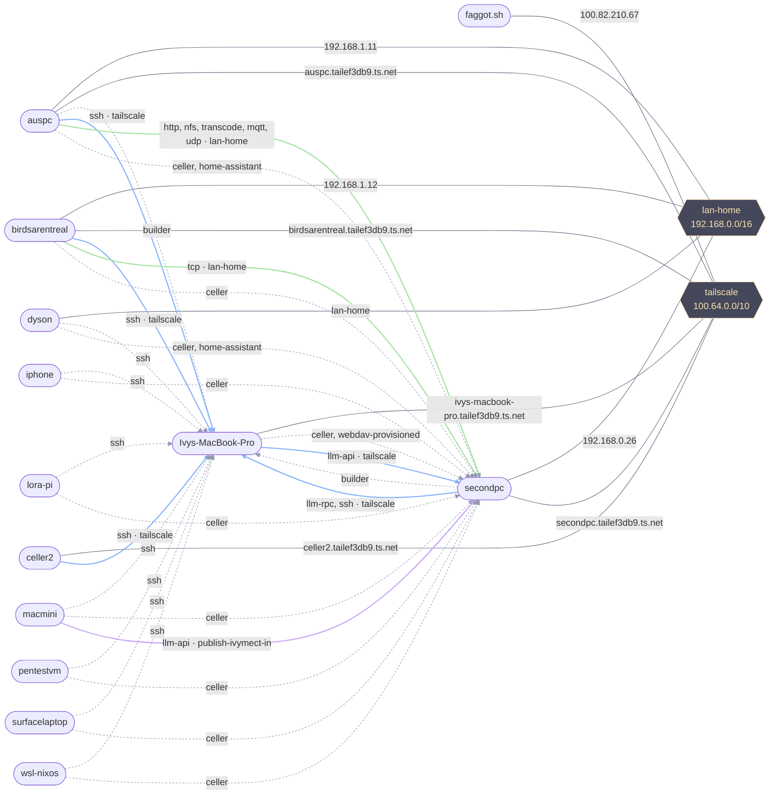

## Ivys-MacBook-Pro

**Architecture:** `aarch64-darwin`
**Roles:** study, gui, dev, gaming

### Aspects
- Ivys-MacBook-Pro/to-users
- agenix-rekey
- autopen
- batteries/define-user
- batteries/hostname
- batteries/inputs&#39;
- batteries/primary-user(ivypierlot@Ivys-MacBook-Pro)
- batteries/self&#39;
- batteries/sources
- browsers
- browsers/zen
- builders
- celler-host
- celler-quirk-args
- celler-user
- claude
- codesign-identity
- coolabah
- cotabby
- darwin-base
- darwin-finder
- darwin-gaming
- darwin-general
- darwin-hmApps
- define-user/ivypierlot@Ivys-MacBook-Pro
- dev
- dev-cli
- dev-nix
- difftastic
- esp-dev
- file-local
- fish
- ghostty
- gpg
- gui
- home-base
- homebrew
- hostname/os
- idris
- inputs&#39;/os
- insecure-predicate
- insecure-predicate/os
- insecure-predicate/user
- ivy-fetch
- ivypierlot
- ivypierlot/Ivys-MacBook-Pro
- ivypierlot/Ivys-MacBook-Pro/to-users
- js
- js/to-users
- jujutsu
- kanata
- karabiner-driver
- laptop-dock
- lib
- linux-builder
- llm-node
- lspmux
- main-ssh-key
- mcp-servers
- neovim
- nix
- nix-conf-parts
- nix-index
- nixpkgs-config
- nixvim
- nushell
- obsidian
- onepassword
- opencode
- overlays
- pam-rssh
- pam-touchid
- paneru
- provides/unfree(cmp-nvim-lsp-document-symbol,copilot-language-server)
- provides/unfree(copilot-language-server,copilot-language-server-lspmux)
- provides/unfree(copilot.vim,idris2-vim,presence.nvim,cmp-copilot,intel-ocl,code,1password,1password-cli,1password-gui,1password-gui-beta,claude-code,discord,google-chrome,helium,helium-bin,libkey-nomad,memorymate,minecraft-launcher,minecraft-server,nvidia-settings,nvidia-x11,obsidian,opencode,slack,spotify,steam,steam-original,steam-run,steam-runtime,steam-unwrapped,tidal-hifi,vscode,zoom,cmp-nvim-lsp-document-symbol)
- provides/unfree(cuda_cccl,cuda_cudart,cuda_nvcc,cuda_nvml_dev,libcublas)
- provides/unfree(libkey-nomad,onepassword-password-manager)
- provides/unfree(onepassword-password-manager)
- roaming-resolver
- runtime-links
- self&#39;/os
- shell
- shell/to-users
- sources/os
- specialisations
- starship
- stylix
- sudoagents
- t3code
- tailscale
- time-machine
- unfree-predicate
- unfree-predicate/os
- unfree-predicate/user
- user-shell/ivypierlot@Ivys-MacBook-Pro
- user/&lt;policy:ivypierlot-role-study&gt;[7]
- vpn
- vpn-secrets
- wakatime
- wake-on-lan-sender
- zig
- zotero

### Aspect Graph

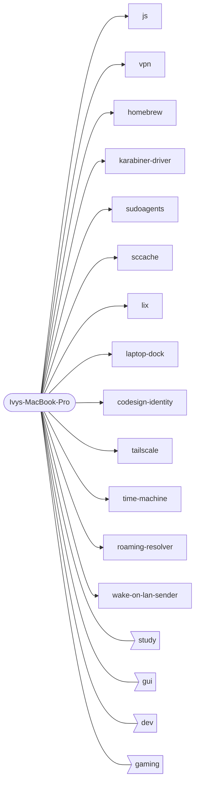

## auspc

**Architecture:** `x86_64-linux`
**Roles:** gui, gaming, dev

### Aspects
- agenix-rekey
- attachment-interface-check
- auscyber
- auscyber/auspc
- auscyber/auspc/to-users
- auspc/to-users
- batteries/define-user
- batteries/hostname
- batteries/inputs&#39;
- batteries/primary-user(auscyber@auspc)
- batteries/self&#39;
- batteries/sources
- bootlogo
- browsers
- browsers/helium
- builder-server
- builders
- cachyos-kernel
- ccache
- ccache/auspc
- celler-host
- celler-quirk-args
- celler-user
- claude
- clusterplex-mounts
- clusterplex-worker
- corsair-psu
- define-user/auscyber@auspc
- den/provides/unfree(castlabs-electron)
- derived-firewall
- derived-port-exclusion
- dev
- dev-cli
- dev-nix
- difftastic
- disko
- fish
- ghostty
- gpg
- gpus
- gui
- hda-jack-retask
- home-base
- hostname/os
- house-wifi
- initrd-ssh
- inputs&#39;/os
- insecure-predicate
- insecure-predicate/os
- insecure-predicate/user
- ivy-fetch
- jujutsu
- lib
- llm-node
- lspmux
- main-ssh-key
- neovim
- nfs-client
- nix
- nix-conf-parts
- nix-index
- nixos-general
- nixpkgs-config
- nixvim
- node-metrics
- nushell
- onepassword
- openrgb
- openssh
- overlays
- packages
- packages/proton-ge-bin
- pam-rssh
- plasma
- provides/unfree(cmp-nvim-lsp-document-symbol,copilot-language-server)
- provides/unfree(copilot-language-server,copilot-language-server-lspmux)
- provides/unfree(copilot.vim,idris2-vim,presence.nvim,cmp-copilot,intel-ocl,code,1password,1password-cli,1password-gui,1password-gui-beta,claude-code,discord,google-chrome,helium,helium-bin,libkey-nomad,memorymate,minecraft-launcher,minecraft-server,nvidia-settings,nvidia-x11,obsidian,opencode,slack,spotify,steam,steam-original,steam-run,steam-runtime,steam-unwrapped,tidal-hifi,vscode,zoom,cmp-nvim-lsp-document-symbol)
- provides/unfree(cuda_cccl,cuda_cudart,cuda_nvcc,cuda_nvml_dev,libcublas)
- provides/unfree(onepassword-password-manager)
- qemu
- qemu/to-users
- routing
- runtime-links
- secure-boot
- self&#39;/os
- shell
- shell/to-users
- sources/os
- specialisations
- starship
- stylix
- tailscale
- turntable-input
- unfree-predicate
- unfree-predicate/os
- unfree-predicate/user
- user-shell/auscyber@auspc
- user/&lt;policy:default-role-gaming&gt;[2]
- user/&lt;policy:eightbitdo-role-gui&gt;[4]
- user/&lt;policy:main-ssh-key/to-hosts&gt;[8]
- vban
- vban-turntable
- vpn
- wakatime
- wake-on-lan
- wake-on-lan-sender

### Aspect Graph

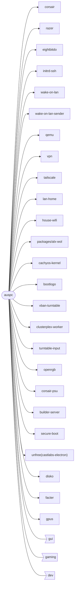

## birdsarentreal

**Architecture:** `x86_64-linux`
**Roles:** gui

### Aspects
- agenix-rekey
- airplay-bluetooth
- attachment-interface-check
- batteries/define-user
- batteries/hostname
- batteries/inputs&#39;
- batteries/primary-user(ivy@birdsarentreal)
- batteries/self&#39;
- batteries/sources
- bluetooth
- bt-console
- builders
- celler-host
- celler-quirk-args
- celler-user
- define-user/ivy@birdsarentreal
- derived-firewall
- derived-port-exclusion
- difftastic
- disko
- fish
- gpg
- home-base
- hostname/os
- impermanence
- inputs&#39;/os
- insecure-predicate
- insecure-predicate/os
- insecure-predicate/user
- ivy
- ivy-fetch
- ivy/birdsarentreal
- jujutsu
- kodi
- lib
- lspmux
- main-ssh-key
- neovim
- nix
- nix-conf-parts
- nix-index
- nixos-general
- nixpkgs-config
- nixvim
- node-metrics
- openssh
- overlays
- pam-rssh
- provides/unfree(cmp-nvim-lsp-document-symbol,copilot-language-server)
- provides/unfree(copilot-language-server,copilot-language-server-lspmux)
- provides/unfree(copilot.vim,idris2-vim,presence.nvim,cmp-copilot,intel-ocl,code,1password,1password-cli,1password-gui,1password-gui-beta,claude-code,discord,google-chrome,helium,helium-bin,libkey-nomad,memorymate,minecraft-launcher,minecraft-server,nvidia-settings,nvidia-x11,obsidian,opencode,slack,spotify,steam,steam-original,steam-run,steam-runtime,steam-unwrapped,tidal-hifi,vscode,zoom,cmp-nvim-lsp-document-symbol)
- routing
- runtime-links
- rust
- self&#39;/os
- sendspin-bluetooth
- shell
- shell/to-users
- sources/os
- specialisations
- starship
- stylix
- tailscale
- unfree-predicate
- unfree-predicate/os
- unfree-predicate/user
- user-shell/ivy@birdsarentreal
- user/&lt;policy:main-ssh-key/to-hosts&gt;[4]
- wakatime

### Aspect Graph

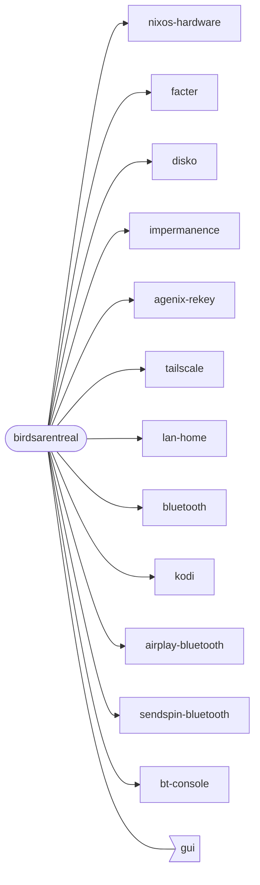

## celler2

**Architecture:** `x86_64-linux`

### Aspects
- agenix-rekey
- attachment-interface-check
- batteries/hostname
- batteries/inputs&#39;
- batteries/self&#39;
- batteries/sources
- builders
- celler-host
- celler-quirk-args
- celler-server
- celler-server/nixos
- derived-firewall
- derived-port-exclusion
- home-base
- hostname/os
- inputs&#39;/os
- insecure-predicate
- insecure-predicate/os
- jujutsu
- lib
- nix
- nix-conf-parts
- nix-index
- nixos-general
- nixpkgs-config
- node-metrics
- openssh
- overlays
- pam-rssh
- provides/unfree(copilot.vim,idris2-vim,presence.nvim,cmp-copilot,intel-ocl,code,1password,1password-cli,1password-gui,1password-gui-beta,claude-code,discord,google-chrome,helium,helium-bin,libkey-nomad,memorymate,minecraft-launcher,minecraft-server,nvidia-settings,nvidia-x11,obsidian,opencode,slack,spotify,steam,steam-original,steam-run,steam-runtime,steam-unwrapped,tidal-hifi,vscode,zoom,cmp-nvim-lsp-document-symbol)
- routing
- runtime-links
- self&#39;/os
- shell
- sources/os
- specialisations
- starship
- tailscale
- unfree-predicate
- unfree-predicate/os

### Aspect Graph

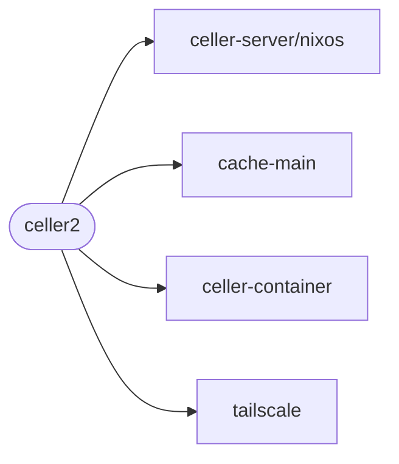

## dyson

**Architecture:** `esp32-idf`

### Aspects
- agenix-rekey
- attachment-interface-check
- builders
- celler-host
- celler-quirk-args
- derived-firewall
- derived-port-exclusion
- home-base
- house-wifi
- jujutsu
- lib
- nix
- nix-conf-parts
- nix-index
- nixos-general
- nixpkgs-config
- node-metrics
- openssh
- overlays
- pam-rssh
- provides/unfree(copilot.vim,idris2-vim,presence.nvim,cmp-copilot,intel-ocl,code,1password,1password-cli,1password-gui,1password-gui-beta,claude-code,discord,google-chrome,helium,helium-bin,libkey-nomad,memorymate,minecraft-launcher,minecraft-server,nvidia-settings,nvidia-x11,obsidian,opencode,slack,spotify,steam,steam-original,steam-run,steam-runtime,steam-unwrapped,tidal-hifi,vscode,zoom,cmp-nvim-lsp-document-symbol)
- routing
- runtime-links
- shell
- specialisations
- starship

### Aspect Graph

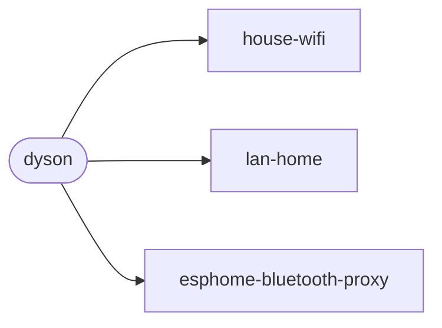

## iphone

**Architecture:** `aarch64-ios`

### Aspects
- agenix-rekey
- attachment-interface-check
- builders
- celler-host
- celler-quirk-args
- derived-firewall
- derived-port-exclusion
- home-base
- jujutsu
- lib
- nix
- nix-conf-parts
- nix-index
- nixos-general
- nixpkgs-config
- node-metrics
- openssh
- overlays
- pam-rssh
- provides/unfree(copilot.vim,idris2-vim,presence.nvim,cmp-copilot,intel-ocl,code,1password,1password-cli,1password-gui,1password-gui-beta,claude-code,discord,google-chrome,helium,helium-bin,libkey-nomad,memorymate,minecraft-launcher,minecraft-server,nvidia-settings,nvidia-x11,obsidian,opencode,slack,spotify,steam,steam-original,steam-run,steam-runtime,steam-unwrapped,tidal-hifi,vscode,zoom,cmp-nvim-lsp-document-symbol)
- routing
- runtime-links
- shell
- specialisations
- starship

### Aspect Graph

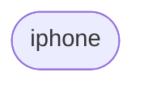

## lora-pi

**Architecture:** `aarch64-linux`

### Aspects
- agenix-rekey
- attachment-interface-check
- batteries/define-user
- batteries/hostname
- batteries/inputs&#39;
- batteries/primary-user(ivy@lora-pi)
- batteries/self&#39;
- batteries/sources
- builders
- celler-host
- celler-quirk-args
- celler-user
- define-user/ivy@lora-pi
- derived-firewall
- derived-port-exclusion
- difftastic
- fish
- gpg
- home-base
- hostname/os
- inputs&#39;/os
- insecure-predicate
- insecure-predicate/os
- insecure-predicate/user
- ivy
- ivy-fetch
- ivy/lora-pi
- jujutsu
- lib
- lspmux
- main-ssh-key
- neovim
- nix
- nix-conf-parts
- nix-index
- nixos-general
- nixos-raspberrypi
- nixpkgs-config
- nixvim
- node-metrics
- openssh
- overlays
- pam-rssh
- provides/unfree(cmp-nvim-lsp-document-symbol,copilot-language-server)
- provides/unfree(copilot-language-server,copilot-language-server-lspmux)
- provides/unfree(copilot.vim,idris2-vim,presence.nvim,cmp-copilot,intel-ocl,code,1password,1password-cli,1password-gui,1password-gui-beta,claude-code,discord,google-chrome,helium,helium-bin,libkey-nomad,memorymate,minecraft-launcher,minecraft-server,nvidia-settings,nvidia-x11,obsidian,opencode,slack,spotify,steam,steam-original,steam-run,steam-runtime,steam-unwrapped,tidal-hifi,vscode,zoom,cmp-nvim-lsp-document-symbol)
- routing
- runtime-links
- rust
- self&#39;/os
- shell
- shell/to-users
- sources/os
- specialisations
- starship
- stylix
- unfree-predicate
- unfree-predicate/os
- unfree-predicate/user
- user-shell/ivy@lora-pi
- user/&lt;policy:main-ssh-key/to-hosts&gt;[4]
- wakatime

### Aspect Graph

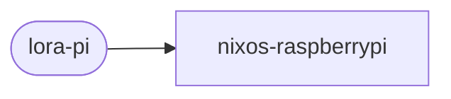

## macmini

**Architecture:** `aarch64-darwin`
**Roles:** gui

### Aspects
- agenix-rekey
- batteries/define-user
- batteries/hostname
- batteries/inputs&#39;
- batteries/primary-user(ivypierlot@macmini)
- batteries/self&#39;
- batteries/sources
- browsers
- browsers/zen
- builders
- celler-host
- celler-quirk-args
- celler-user
- claude
- coolabah
- cotabby
- darwin-base
- darwin-finder
- darwin-general
- darwin-hmApps
- define-user/ivypierlot@macmini
- dev
- dev-cli
- dev-nix
- difftastic
- file-local
- fish
- ghostty
- gpg
- gui
- home-base
- homebrew
- hostname/os
- idris
- inputs&#39;/os
- insecure-predicate
- insecure-predicate/os
- insecure-predicate/user
- ivy-fetch
- ivypierlot
- jujutsu
- kanata
- lib
- linux-builder
- lspmux
- main-ssh-key
- mcp-servers
- neovim
- nix
- nix-conf-parts
- nix-index
- nixpkgs-config
- nixvim
- nushell
- onepassword
- opencode
- overlays
- pam-rssh
- pam-touchid
- paneru
- provides/unfree(cmp-nvim-lsp-document-symbol,copilot-language-server)
- provides/unfree(copilot-language-server,copilot-language-server-lspmux)
- provides/unfree(copilot.vim,idris2-vim,presence.nvim,cmp-copilot,intel-ocl,code,1password,1password-cli,1password-gui,1password-gui-beta,claude-code,discord,google-chrome,helium,helium-bin,libkey-nomad,memorymate,minecraft-launcher,minecraft-server,nvidia-settings,nvidia-x11,obsidian,opencode,slack,spotify,steam,steam-original,steam-run,steam-runtime,steam-unwrapped,tidal-hifi,vscode,zoom,cmp-nvim-lsp-document-symbol)
- provides/unfree(libkey-nomad,onepassword-password-manager)
- provides/unfree(onepassword-password-manager)
- runtime-links
- self&#39;/os
- shell
- shell/to-users
- sources/os
- specialisations
- starship
- stylix
- sudoagents
- t3code
- unfree-predicate
- unfree-predicate/os
- unfree-predicate/user
- user-shell/ivypierlot@macmini
- wakatime
- zig

### Aspect Graph

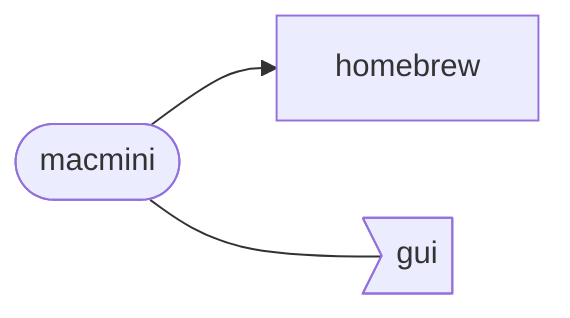

## pentestvm

**Architecture:** `x86_64-linux`

### Aspects
- admin
- agenix-rekey
- attachment-interface-check
- batteries/define-user
- batteries/hostname
- batteries/inputs&#39;
- batteries/primary-user(admin@pentestvm)
- batteries/self&#39;
- batteries/sources
- builders
- celler-host
- celler-quirk-args
- celler-user
- define-user/admin@pentestvm
- derived-firewall
- derived-port-exclusion
- difftastic
- home-base
- hostname/os
- inputs&#39;/os
- insecure-predicate
- insecure-predicate/os
- insecure-predicate/user
- ivy-fetch
- jujutsu
- lib
- main-ssh-key
- nix
- nix-conf-parts
- nix-index
- nixos-general
- nixpkgs-config
- node-metrics
- openssh
- overlays
- pam-rssh
- provides/unfree(copilot.vim,idris2-vim,presence.nvim,cmp-copilot,intel-ocl,code,1password,1password-cli,1password-gui,1password-gui-beta,claude-code,discord,google-chrome,helium,helium-bin,libkey-nomad,memorymate,minecraft-launcher,minecraft-server,nvidia-settings,nvidia-x11,obsidian,opencode,slack,spotify,steam,steam-original,steam-run,steam-runtime,steam-unwrapped,tidal-hifi,vscode,zoom,cmp-nvim-lsp-document-symbol)
- routing
- runtime-links
- self&#39;/os
- shell
- shell/to-users
- sources/os
- specialisations
- starship
- unfree-predicate
- unfree-predicate/os
- unfree-predicate/user
- user/&lt;policy:main-ssh-key/to-hosts&gt;[3]

### Aspect Graph

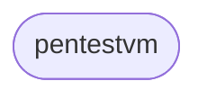

## secondpc

**Architecture:** `x86_64-linux`

### Aspects
- access
- agenix-rekey
- alloy
- attachment-interface-check
- audiobookshelf
- auscyber
- auscyber/secondpc
- batteries/define-user
- batteries/hostname
- batteries/inputs&#39;
- batteries/primary-user(auscyber@secondpc)
- batteries/self&#39;
- batteries/sources
- bazarr
- builder-server
- builders
- celler
- celler-host
- celler-main
- celler-quirk-args
- celler-server
- celler-server/nixos
- celler-user
- claude
- cloudflare-tunnel
- clusterplex-orchestrator
- container
- define-user/auscyber@secondpc
- derived-firewall
- derived-port-exclusion
- difftastic
- disko
- donetick
- esphome
- fish
- garage
- gated-oauth2-proxy
- gateway
- gpg
- grafana
- grocy
- home-base
- homeassistant
- homepage
- host/&lt;policy:containers-to-host&gt;[0]
- host/&lt;policy:containers-to-host&gt;[1]
- host/&lt;policy:containers-to-host&gt;[2]
- host/&lt;policy:containers-to-host&gt;[3]
- hostapd
- hostname/os
- immich
- impermanence
- inputs&#39;/os
- insecure-predicate
- insecure-predicate/os
- insecure-predicate/user
- ivy-fetch
- jujutsu
- kanidm
- lib
- lidarr
- llm-head
- local
- loki
- lspmux
- mail
- mail-ddns
- main-ssh-key
- matter-server
- mosquitto
- music-assistant
- navidrome
- neovim
- netbootxyz
- nextcloud
- nfs-server
- nginx
- nix
- nix-conf-parts
- nix-index
- nix/secondpc
- nixos-general
- nixpkgs-config
- nixvim
- node-metrics
- nspawn-host
- oci-container
- openssh
- overlays
- pam-rssh
- paperless
- pia
- plex
- plex/to-users
- postgres
- prom-device
- provides/unfree(castlabs-electron)
- provides/unfree(cmp-nvim-lsp-document-symbol,copilot-language-server)
- provides/unfree(copilot-language-server,copilot-language-server-lspmux)
- provides/unfree(copilot.vim,idris2-vim,presence.nvim,cmp-copilot,intel-ocl,code,1password,1password-cli,1password-gui,1password-gui-beta,claude-code,discord,google-chrome,helium,helium-bin,libkey-nomad,memorymate,minecraft-launcher,minecraft-server,nvidia-settings,nvidia-x11,obsidian,opencode,slack,spotify,steam,steam-original,steam-run,steam-runtime,steam-unwrapped,tidal-hifi,vscode,zoom,cmp-nvim-lsp-document-symbol)
- provides/unfree(intel-ocl,plexmediaserver)
- prowlarr
- proxy-nginx
- publish-ivymect-in
- qbittorrent
- radarr
- restic
- routing
- runtime-links
- samba
- samba-users
- searchix
- secondpc-fail2ban
- secondpc-otel-fail2ban
- secondpc-web
- seerr
- self&#39;/os
- service-accounts
- shares
- shell
- shell/to-users
- sonarr
- sources/os
- specialisations
- splitpro
- sso
- starship
- stylix
- tailscale
- tandoor
- tautulli
- tempo
- unfree-predicate
- unfree-predicate/os
- unfree-predicate/user
- user-shell/auscyber@secondpc
- user/&lt;policy:main-ssh-key/to-hosts&gt;[6]
- vaultwarden
- vikunja
- vpn
- vpn-secrets
- vpn-server
- wakatime
- wake-on-lan
- wake-on-lan-sender

### Aspect Graph

```mermaid
graph LR
  root([secondpc])
  root --> n69d2f567a8["wake-on-lan"]
  root --> nb1395d6d2c["wake-on-lan-sender"]
  root --> n58c54bb3de["celler-main"]
  root --> n66f66ceb39["impermanence"]
  root --> n58a3ed6f29["nginx"]
  root --> ne56549c11b["nix"]
  root --> neb034454a4["celler"]
  root --> n939bb46a04["local"]
  root --> n49c72fde6b["vpn-server"]
  root --> n15f90b1816["tailscale"]
  root --> n5cd788f9fa["pia"]
  root --> n0e2c71be78["lan-home"]
  root --> nc486768ed5["publish-ivymect-in"]
  root --> na1eff8f831["builders"]
  root --> nb7010eea24["builder-server"]
  root --> n20927c4aee["disko"]
  root --> n4cb3064114["facter"]
  root --> nb38f24084c["secondpc-web"]
  root --> n9a7f6d8957["searchix"]
  root --> naebda823a2["plex"]
  root --> n8a6b3c5e6b["gateway"]
  root --> n0fb2b37110["gated-oauth2-proxy"]
  root --> nd03692863b["kanidm"]
  root --> nbd8a7d53e3["service-accounts"]
  root --> nf519bce8b0["grafana"]
  root --> n65e336e20c["tempo"]
  root --> n8d809cbaa0["alloy"]
  root --> n568be0fa20["homepage"]
  root --> n101e12b916["immich"]
  root --> nafb9d1dcf2["sso"]
  root --> n0f12541afc["access"]
  root --> nb36ad30593["samba"]
  root --> n6c7b2c6feb["hostapd"]
  root --> n4788d7f70d["netbootxyz"]
  root --> n94e62efb0d["secondpc-fail2ban"]
  root --> n34c98830f7["secondpc-otel-fail2ban"]
  root --> nff66faf87b["unfree(intel-ocl,plexmediaserver)"]
  root --> n31e028553b["navidrome"]
  root --> n8c5915c16c["seerr"]
  root --> n2b4d133c3e["agenix-rekey"]
  root --> nb1d4a81cb9["user-pwd"]
  root --> na5b23f3386["loki"]
  root --> nddf4f26432["vaultwarden"]
  root -.->|serves| n6915258135{{"audiobookshelf"}}
  root -.->|serves| n085f0b437f{{"bazarr"}}
  root -.->|serves| n3c8181496b{{"donetick"}}
  root -.->|serves| n4c2f65997d{{"garage"}}
  root -.->|serves| nc1292685cd{{"grocy"}}
  root -.->|serves| n04afe215fa{{"home-assistant"}}
  root -.->|serves| nc015fff30a{{"lidarr"}}
  root -.->|serves| n1d6e1cf70e{{"mail"}}
  root -.->|serves| n1a039cae17{{"music-assistant"}}
  root -.->|serves| nf2baa52d02{{"nextcloud"}}
  root -.->|serves| n6249c08eaa{{"paperless"}}
  root -.->|serves| nafc848c316{{"postgres"}}
  root -.->|serves| nde6ff49c94{{"prowlarr"}}
  root -.->|serves| n3ebd4dd8af{{"qbittorrent"}}
  root -.->|serves| n8a5cd39a1a{{"radarr"}}
  root -.->|serves| n6e2a525ceb{{"sonarr"}}
  root -.->|serves| n377ec52622{{"splitpro"}}
  root -.->|serves| n481c79fa55{{"tandoor"}}
  root -.->|serves| n767c55408f{{"vikunja"}}
```

## surfacelaptop

**Architecture:** `x86_64-linux`
**Roles:** gui, dev

### Aspects
- agenix-rekey
- attachment-interface-check
- auscyber
- auscyber/surfacelaptop
- batteries/define-user
- batteries/hostname
- batteries/inputs&#39;
- batteries/primary-user(auscyber@surfacelaptop)
- batteries/self&#39;
- batteries/sources
- builders
- celler-host
- celler-quirk-args
- celler-user
- claude
- define-user/auscyber@surfacelaptop
- derived-firewall
- derived-port-exclusion
- difftastic
- fish
- gpg
- home-base
- hostname/os
- inputs&#39;/os
- insecure-predicate
- insecure-predicate/os
- insecure-predicate/user
- ivy-fetch
- jujutsu
- lib
- lspmux
- main-ssh-key
- neovim
- nix
- nix-conf-parts
- nix-index
- nixos-general
- nixpkgs-config
- nixvim
- node-metrics
- openssh
- overlays
- pam-rssh
- provides/unfree(castlabs-electron)
- provides/unfree(cmp-nvim-lsp-document-symbol,copilot-language-server)
- provides/unfree(copilot-language-server,copilot-language-server-lspmux)
- provides/unfree(copilot.vim,idris2-vim,presence.nvim,cmp-copilot,intel-ocl,code,1password,1password-cli,1password-gui,1password-gui-beta,claude-code,discord,google-chrome,helium,helium-bin,libkey-nomad,memorymate,minecraft-launcher,minecraft-server,nvidia-settings,nvidia-x11,obsidian,opencode,slack,spotify,steam,steam-original,steam-run,steam-runtime,steam-unwrapped,tidal-hifi,vscode,zoom,cmp-nvim-lsp-document-symbol)
- routing
- runtime-links
- self&#39;/os
- shell
- shell/to-users
- sources/os
- specialisations
- starship
- stylix
- unfree-predicate
- unfree-predicate/os
- unfree-predicate/user
- user-shell/auscyber@surfacelaptop
- user/&lt;policy:eightbitdo-role-gui&gt;[3]
- user/&lt;policy:main-ssh-key/to-hosts&gt;[7]
- wakatime

### Aspect Graph

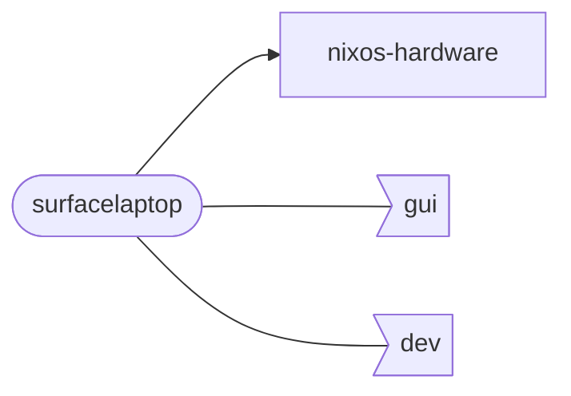

## wsl-nixos

**Architecture:** `x86_64-linux`

### Aspects
- agenix-rekey
- attachment-interface-check
- batteries/define-user
- batteries/hostname
- batteries/inputs&#39;
- batteries/primary-user(nixos@wsl-nixos)
- batteries/self&#39;
- batteries/sources
- builders
- celler-host
- celler-quirk-args
- celler-user
- define-user/nixos@wsl-nixos
- derived-firewall
- derived-port-exclusion
- difftastic
- fish
- home-base
- hostname/os
- inputs&#39;/os
- insecure-predicate
- insecure-predicate/os
- insecure-predicate/user
- ivy-fetch
- jujutsu
- lib
- main-ssh-key
- nix
- nix-conf-parts
- nix-index
- nixos
- nixos-general
- nixos/to-users
- nixpkgs-config
- node-metrics
- openssh
- overlays
- pam-rssh
- provides/unfree(copilot.vim,idris2-vim,presence.nvim,cmp-copilot,intel-ocl,code,1password,1password-cli,1password-gui,1password-gui-beta,claude-code,discord,google-chrome,helium,helium-bin,libkey-nomad,memorymate,minecraft-launcher,minecraft-server,nvidia-settings,nvidia-x11,obsidian,opencode,slack,spotify,steam,steam-original,steam-run,steam-runtime,steam-unwrapped,tidal-hifi,vscode,zoom,cmp-nvim-lsp-document-symbol)
- routing
- runtime-links
- self&#39;/os
- shell
- shell/to-users
- sources/os
- specialisations
- starship
- unfree-predicate
- unfree-predicate/os
- unfree-predicate/user
- user-shell/nixos@wsl-nixos
- user/&lt;policy:main-ssh-key/to-hosts&gt;[4]

### Aspect Graph

## My Packages

| Package | Version | Description |
|---------|---------|-------------|
| celler | `0.1.0` | Multi-tenant Nix binary cache system |
| cotabby | `v0.6.2-beta` |  |
| donetick | `v0.1.85` | Self-hosted task and chore manager |
| flaresolverr | `3.5.2` | Proxy server to bypass Cloudflare protection |
| ghostty | `1.4.0` | Fast, native, feature-rich terminal emulator pushing modern features |
| helium | `0.20.2.1` | Private, fast, and honest web browser based on Chromium |
| ivy-fetch | `unknown` |  |
| jankyborders | `a7297ca7d1933f3a30b12e8f10750e8d84eeee1e` | Lightweight tool designed to add colored borders to user windows on macOS 14.0+ |
| jj-mcp-server | `1.0.1` | Model Context Protocol server for the Jujutsu (jj) version control system |
| kanata-ls | `6fe27bceb4b303ea88e0fdb622198de75d3f1697` | Kanata Language Server |
| kanata-tray | `v0.8.0` | Tray Icon for Kanata  |
| kanidm-provision | `1.3.0` | Small utility to help with kanidm provisioning |
| lspmux | `18861f9d59e74ece8d867772cf07fa302c2dae98` |  |
| ms-365-mcp-server | `0.145.1` | Microsoft 365 / Outlook MCP server (mail, calendar, OneDrive, Excel) over Microsoft Graph |
| oauth2c | `1.21.1` | User-friendly OAuth2 CLI |
| prom-device | `0.2.0` | Prometheus instant queries as one Home Assistant device per host |
| proton-ge-bin | `GE-Proton11-11` | Compatibility tool for Steam Play based on Wine and additional components.

(This is intended for use in the `programs.steam.extraCompatPackages` option only.)
 |
| sketchybar | `2.24.0` | Highly customizable macOS status bar replacement |
| todoist-mcp | `13.0.0` | Model Context Protocol server for Todoist |
| zotero-mcp | `0.6.2` | Model Context Protocol server for Zotero |

## Other Projects
- [xmonad](https://github.com/xmonad/xmonad)
- [xmonad-contrib](https://github.com/xmonad/xmonad-contrib)
- [alacritty](https://github.com/alacritty/alacritty)
- [ghostty](https://github.com/ghostty-org/ghostty)
- [neovim](https://github.com/neovim/neovim)
- [starship](https://github.com/starship/starship)
